<p align="center"></p>

<h1 align="center">SatMe</h1>

<p align="center">
Amateur radio satellite tracking for Android and the PC — passes, pointing, Doppler, logging.<br>
<a href="https://play.google.com/store/apps/details?id=fr.f4ioz.satcombo">Google Play</a> ·
<a href="https://github.com/f4ioz/SatMe/wiki/Why-SatMe">Why SatMe?</a> ·
<a href="https://github.com/f4ioz/SatMe/wiki">Documentation (wiki)</a> ·
<a href="README.fr.md">Français</a> ·
<a href="docs/API-v1.md">API</a>
</p>

### One station, three SatMe

<p align="center"></p>

**SatMe** in your pocket to work satellites anywhere, **SatMe-PC** for the whole station in a browser, **SatMe-Node** on a Raspberry Pi at the mast. The same engine everywhere: what the PC does, the phone does too. Free, no account, no ads, free software.

**Try it in two minutes, nothing plugged in**: simulated rig and rotator, the real passes of the moment.
[▶ Google Play](https://play.google.com/store/apps/details?id=fr.f4ioz.satcombo) · Linux PC or Raspberry Pi: `curl -fsSL https://raw.githubusercontent.com/f4ioz/SatMe/main/installe-satme.sh -o installe-satme.sh && bash installe-satme.sh` · [Windows, all in one (.msi)](docs/installer-satme-pc-windows.md)

- 🛰 **Never miss a pass again** — the automatic mode follows every pass of the satellites you chose: rig and rotator in place 5 min before AOS, the sound recorded, the pass in the journal.
- 🎯 **Doppler handled for you** — IC-9700, IC-9100, IC-910H, TS-2000, FT-817 / IC-705, TH-D72; turn the knob, the rig follows the transponder.
- 🎞 **Every pass replayed** — on the sky or the map, with its sound, the S-meter, contacts and SSTV pictures in their place; made into a video or a GIF to share.
- 📲 **From the phone to the PC with one QR code** — passes worked portable land on the PC with their contacts, pictures and sound.
- 📡 **And everything else** — SSTV, METEOR, APRS (and KISS), FT8, radiosondes, a QO-100 cockpit, DATV received and transmitted, voice to text, a log with QRZ and Wavelog / Cloudlog.

### A real pass, as SatMe kept it

The ISS on 4 October: four school pictures in Robot 36, decoded as they arrived, each in its place on the trajectory — then RS-44 replayed with its S-meter and the frequency the rig was on, and the picture SatMe makes to share the moment.

<p align="center">
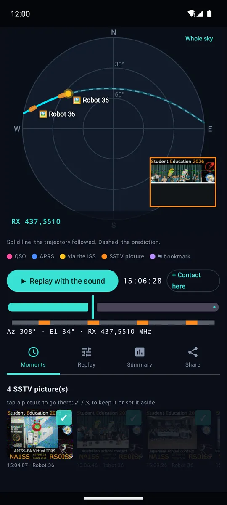
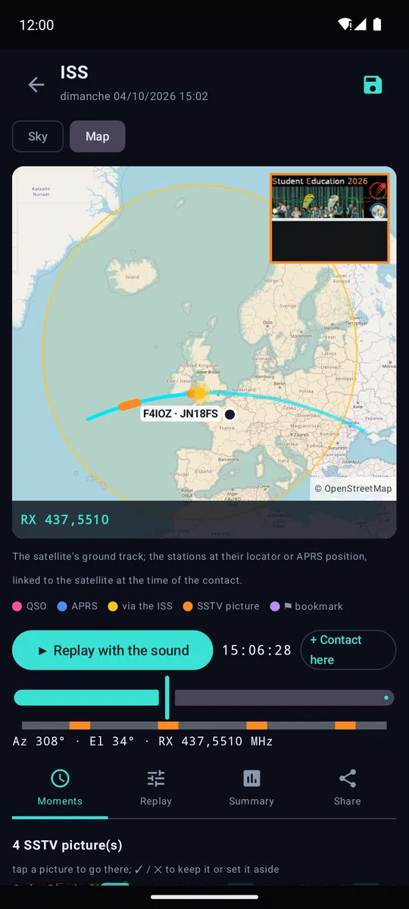
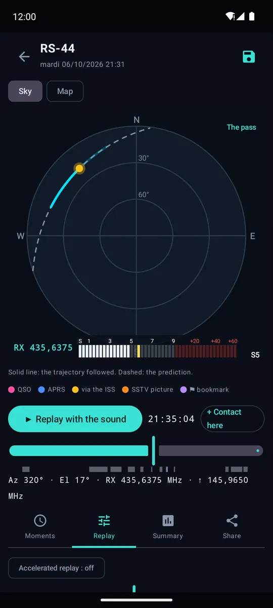
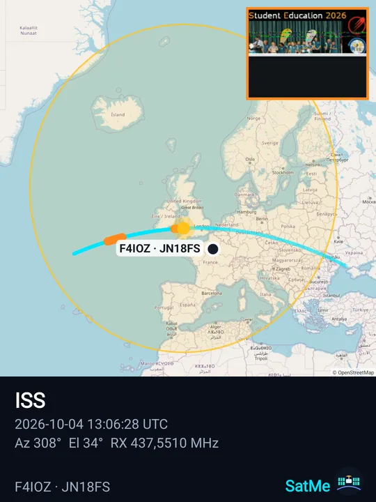
</p>

### SatMe-PC — the whole station in a browser

SatMe also runs on a PC (Linux, Windows, Raspberry Pi), with the phone's own engine: passes, Doppler, rig and rotator, the log with the station live beside it, skeds, the **QO-100 cockpit**, **DATV** received and transmitted, SDR (RTL-SDR, ADALM-PLUTO, bladeRF 2.0), voice to text, radiosondes, METEOR, SSTV, APRS, FT8, the pass journal — and SatMe on the phone joins it by scanning a QR code, its passes, pictures, sounds and contacts coming over. → [SatMe-PC](docs/station-pc.md)

**Install**, guided (it sees what is plugged in): `curl -fsSL https://raw.githubusercontent.com/f4ioz/SatMe/main/installe-satme.sh -o installe-satme.sh && bash installe-satme.sh` · [SatMe-PC on Linux](docs/installer-satme-pc.md) · [SatMe-PC on Windows](docs/installer-satme-pc-windows.md) (all in one) · [SatMe-Node on a Raspberry Pi 3](docs/installer-satme-node.md) (the MiniTiouner next to the antenna) · [downloads](https://github.com/f4ioz/SatMe/releases/latest)

<p align="center">


</p>
<p align="center">


</p>
<p align="center">


</p>

### From the phone to the PC: one QR code

<p align="center"></p>

The phone also serves pages to the PC's browser (USB cable or Wi-Fi, nothing to install): the pass journal replayed large on a map with its sound, and the SSTV sheet laid out with the mouse.

<p align="center">
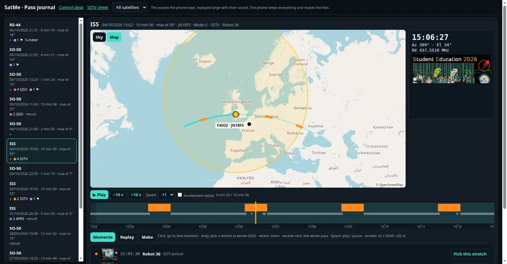
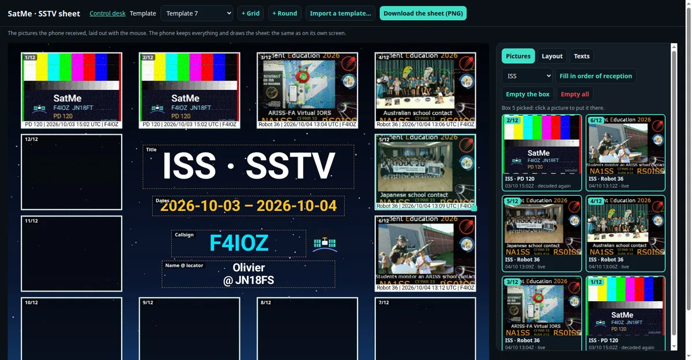
</p>

<p align="center"><a href="https://play.google.com/store/apps/details?id=fr.f4ioz.satcombo"><b>▶ Get SatMe on Google Play</b></a> — free, no account, no ads</p>

<p align="center">


</p>
<p align="center">


</p>
<p align="center">
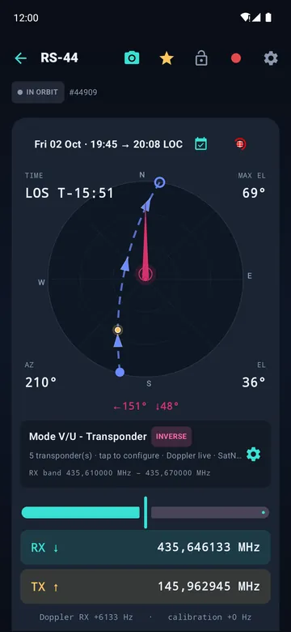
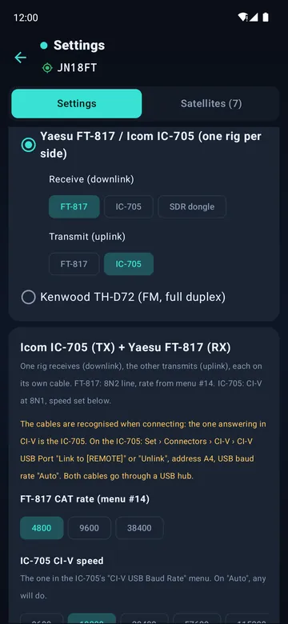
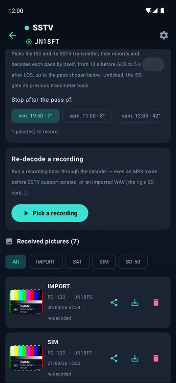
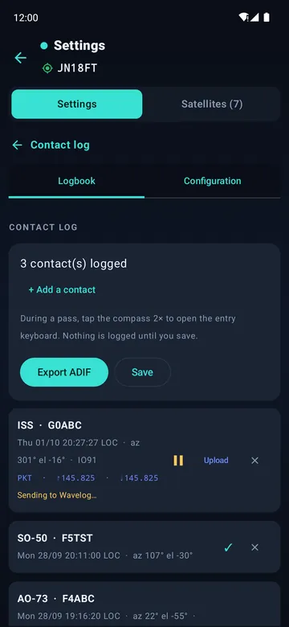
</p>
<p align="center">
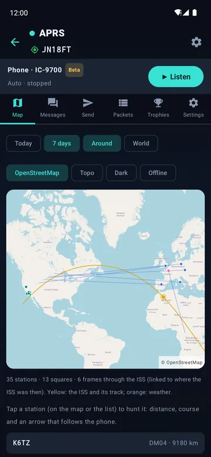
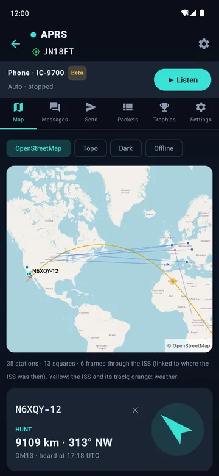
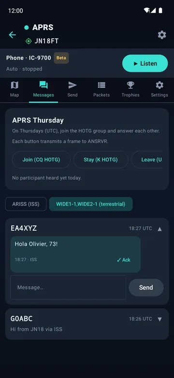
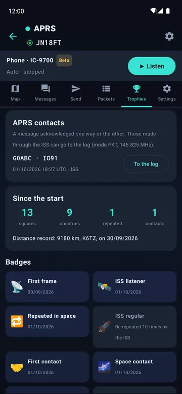
</p>
<p align="center">
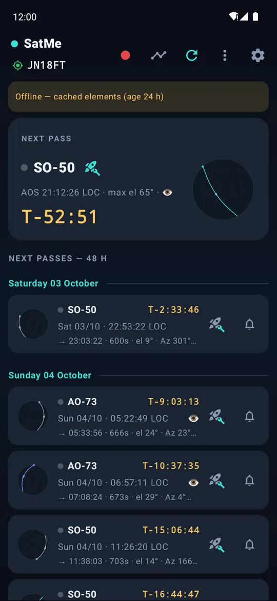
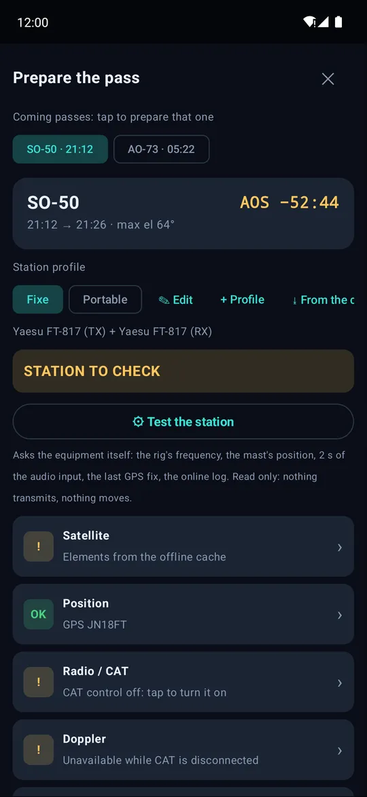
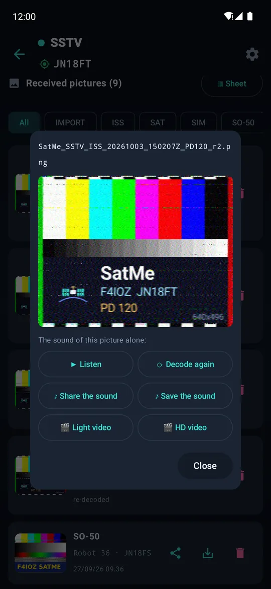
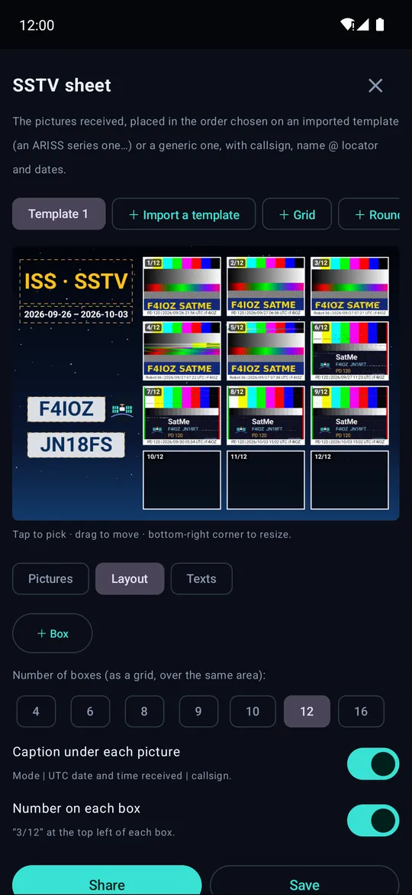
</p>
<p align="center">
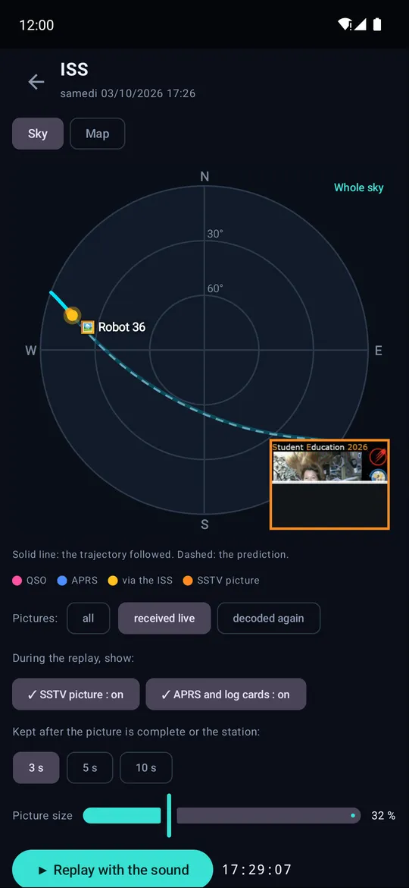
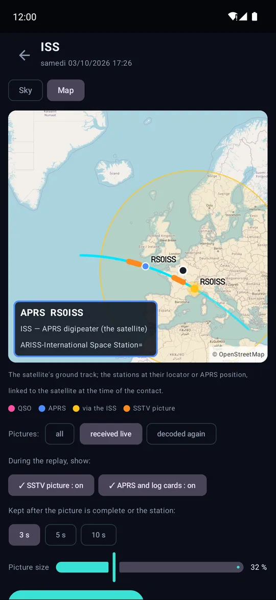
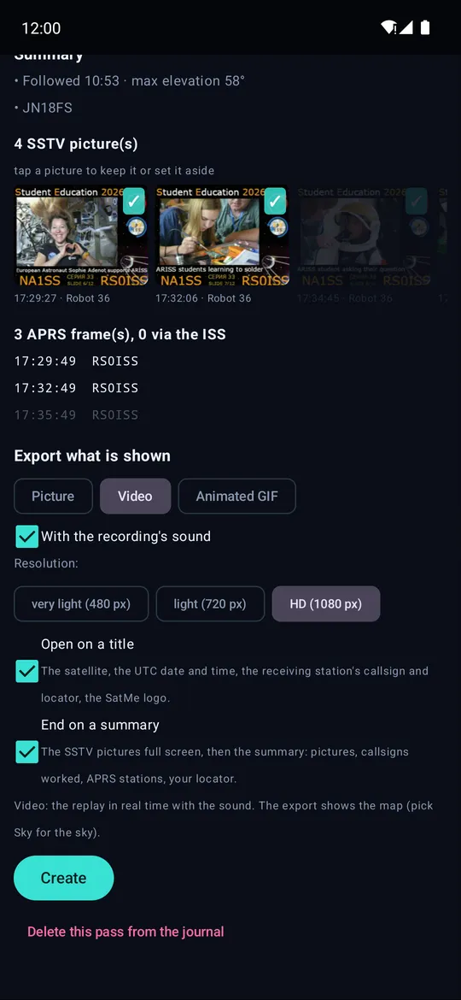
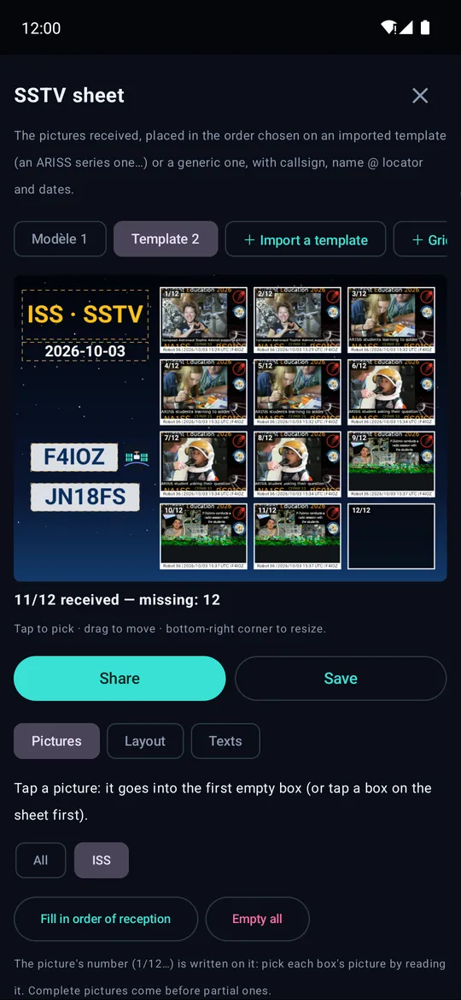
</p>

## New on SatMe-PC (October 2026)

SatMe-PC grew from a satellite station into a whole station in a browser: QO-100 and DATV with its own DVB-S2 modem, an SDR receiver with every comfort, telemetry, aircraft and ships, the station drawn as it is wired. Everything below is in the [SatMe-PC guide](docs/station-pc.md) (also built in: **F1**) and the [wiki](https://github.com/f4ioz/SatMe/wiki/SatMe-PC).

<p align="center"></p>

**🔧 SatMe-Node from the page** *(upcoming, after 20.83)* — Station › **SatMe-Node**: the Pi's health, each board's role (DATV receiver, SDR receiver, transmitter), services, version and log; **restart or switch off the Pi** after a confirmation. The node's LNB supply is kept when changing station, from the PC or the phone; a restarted SatMe-PC finds a receiving node by itself; the phone lists the wide band's stations to receive with a touch, the picture full screen. [Installing SatMe-Node](docs/installer-satme-node.md)

**📺 Émis | Reçu** *(upcoming)* — while transmitting DATV, the picture sent beside the picture received back from QO-100, each one enlarged with a click.

**🎙 The IC-9700 transmitting** *(upcoming)* — PTT held from the page (one client, 2 s watchdog, time-out), the browser's microphone to the rig through its USB sound card or the network, RF power capped; HTTPS for the page opened from another machine.

**🖼 The SSTV sheet** *(upcoming)* — fewer pictures than the template, laid out as large as can be, one copy of each slide; a background (built in, NASA pictures or your own) and up to three mission patches, their plain surround removed.

<p align="center">


</p>
<p align="center"></p>

**🤖 SSTV campaigns on auto-pilot** — an ARISS series or a satellite sending pictures for a few days is entered like an appointment in the **Agenda**, or from the announcement's **flyer** read on the PC; the auto-pilot (off by default) prepares the rig, rotator, sound and decoder before each pass, records, keeps the pictures and puts everything back. Receive only, never transmits.

**🧭 The rotator's plan** — the whole pass planned before AOS: which side of the end stop, **flipped at 180°** over the zenith or a single unwind placed where the satellite is low; **hidden zones** (roof, tree); the plan drawn on the Suivi sky, and each logged contact's rotator path.

**🛰 QO-100 with a drifting LNB** — the beacon calibration follows a drift of a few Hz/s, a **beacon lock** takes the jumps out of the whole transponder, and FT8 tolerates drift. This mitigates, it does not replace an **LNB held by a GPSDO reference** ([how](docs/station-pc.md#lnb-and-gpsdo-reference)).

<p align="center">


</p>

**🧭 A new page** — six workspaces in a side rail (Ciel, QO-100, DATV, Modes, Carnet, Station; keys 1–6), a header strip (what is followed, the active receiver, the next pass, a red **TX** light that only stops), a status bar, the **Ctrl+K** palette (a tab, a satellite, a callsign, a typed frequency), « ? » help on every card, the **built-in manual (F1)** with search, keyboard shortcuts. The header's **« Son »** chip: what the decoders hear, the rig's sound card recognised by name, one-key **Prepare the pass** and record. Non-satellite tabs (aircraft, ships, sondes) only when ticked.

**🔌 Montage: the station as it is wired** — the station drawn from antenna to PC, lit live (cyan receives, red transmits, frequencies on the cables); drag-and-drop editing from a catalogue (dishes, LNBs, DX Patrol converters and PAs, GPSDOs including Leo Bodnar, bias-T, DC block…), photos cut out automatically, **what is missing** checked with dangers flagged (an LNB supply reaching an SDR board); which SatMe function holds which board, conflicts and how to free them, receive profiles applied in a safe order.

<p align="center">


</p>

**📻 SDR receiver** — memories in folders with flags on the spectrum, band plans, band stack, receive-only **scanning** (memories, ranges, priority channel), display options (averaging, peak hold, seven palettes), **sound cleaning** (noise blanker, automatic and manual notch, noise reduction, AGC), **CTCSS** reading and tone squelch, **I/Q** « back in time », SigMF recording and replay, a **test generator** with no hardware, **measurements** (level over time, Sun noise, the QO-100 beacon over 24 h). Receivers: RTL-SDR, ADALM-PLUTO, bladeRF 2.0 — and the **IC-9700's IF** demodulated by SatMe.

**📡 IC-9700 over the network** — CAT and receive audio through the rig's LAN (Network Control ON), no USB cable; receive only, every transmit command refused; AF or IF output; the coded credentials learnt from a capture of your own login.

**📡 QO-100 cockpit** — the waterfall **names each signal**, a click tunes it and opens the right decoder; **up to four decoders at once** (FT8, FT4, CW, SSTV, voice, PSK31, RTTY, beacon); the band plan and an **emergency frequency** guard, beacon calibration and beacon lock, **LEILA** flagged; the **middle beacon's BPSK telemetry** decoded.

**📺 DATV** — MiniTiouner, SatMe-Node or SatMe's own **DVB-S2 demodulator** (Pluto, bladeRF); quality in plain words, the wide band at a glance, subtitles, callsigns read in the picture; **transmission in DVB-S2 or DVB-S** with every safety rule in the code, indoor and dummy-load tests, per-board **I/Q correction**.

**🛰 Telemetry** — 1200–9600 bit/s FSK / GMSK packets (G3RUH, AX.25), **SSDV pictures** rebuilt, **FUNcube** real-time values; optional sharing with SatNOGS DB (off by default).

<p align="center">


</p>

**✈ Aircraft, ships, space weather** — **ADS-B** at 1090 MHz with **aircraft scatter** windows, **AIS** at 162 MHz, both on a shared **offline map** with the forecast aurora; **space weather** (Kp, flux, X-rays, solar wind, aurora, alerts), downloaded only when ticked.

**📒 Log and journal** — the contact goes on the satellite the rig works; date, time and satellite editable; **compound callsigns** (EA3/M5JFS) with their country and flag, the square of the callsign as typed, the map following the entry; a **pass report** per pass (Doppler-followed waterfall, level, decodes, contacts) as one HTML file.

**🔗 Interfaces** — a **rigctld** server for logging programs (receive only, PTT refused), the **USB volume knob** as a VFO (Linux), **spoken announcements** (passes, transmissions, your call decoded…), **spoken translation** of voice to text, a WebSocket link, CAT that follows the satellite change at once and, if chosen, tunes the rig even when the satellite is not visible.

**🔒 Remote** — the page **behind a password** for other machines, installable as an app, a **remote mode** with low-latency audio for a VPN link. Receive only from afar.

<p align="center">


</p>

## What's new in 20.83

- **CAT**: the rig moves to the new satellite at once (linear or FM).
- **Rotator**: the pass planned before AOS, a 180° flip instead of a full turn.
- **Log**: the satellite taken from the rig; satellite, date and time editable; compound calls (EA3/M5JFS) and flags.
- **QO-100**: the beacon calibration follows a drifting LNB; FT8 tolerates drift.
- **SatMe-PC**: many new features (station layout, IC-9700 over the LAN, telemetry…), see above.

### And in 20.82

- **METEOR weather pictures (LRPT)**, beta: METEOR-M2-3 and M2-4 decoded on the phone from an RTL-SDR dongle and a 137 MHz antenna — colour by day and infrared, north up, a preview while the pass comes in; started by hand or by itself before each pass; a raw I/Q WAV recording decoded too. Coastlines and borders drawn from the orbit. On the satellite's page, one button: **Receive the pictures**. Checked on the recording of a real pass, not yet live.
- **Icom IC-910H and IC-9100** in satellite mode, beside the IC-9700: their own CI-V address and speed (19,200 baud), and the IC-910H's own satellite-mode command. Bench-tested, not yet on the real rigs.
- **Rotator: no more endless relay clicking** — one axis at a time, the mast a little ahead of the satellite, at most one command every 6 s, and never the same one again while the mast stays where the controller left it; a command the controller did not take goes out again after 10 s.
- Fixed: a recording stopped by hand while the rotator was connected could stay shown as running.

<p align="center"></p>

### And in 20.81

- **Rotator: a pass over the end stop is planned** — the antennas go round the far side of the zenith, or tilt over the top with 180° of elevation, instead of turning back at the stop; a full turn only when worth it, never during an expected SSTV picture nor while transmitting. A dial with the stop, the dead zone, the cable and the planned path; the path also drawn in white on the satellite's compass.
- **Kenwood TS-2000** in SAT mode: Doppler on both VFOs, mode of each side, CTCSS, S-meter.

### And in 20.80

- **The pass journal on the PC**: the passes replayed large with their sound, on the sky or an OpenStreetMap map (footprint, your station, the stations worked or heard), the S-meter and the SSTV picture arriving, a timeline to click, drag (a whole QSO) and zoom, accelerated replay; the phone makes the sound, the picture, the video, the GIF or the pass file, and the PC downloads it.
- **The SSTV sheet on the PC**: the template large, boxes and texts moved with the mouse, pictures dragged into the boxes, a template imported from the PC, a background (stars, gradients, NASA pictures, or your own fitted to the sheet) and up to three mission patches placed and resized with the mouse, their plain surround removed; the sheet downloaded at full resolution.
- A tighter control desk page; the three pages linked, under one code.

## Features

### Passes and prediction
- Offline SGP4/SDP4 predictions: AOS, LOS, maximum elevation, azimuths, duration, and a polar plot of every pass.
- Alerts before AOS, and a pass added to the phone's calendar in one tap.
- Printable PDF pass sheets: tick the satellites' passes, then choose how many coming passes of each to print (up to 20, two weeks ahead).
- Live tracking: elevation, azimuth, Doppler and countdown, on a screen readable at arm's length.
- Pass journal: every pass followed kept on the phone (real trajectory, rig frequencies, antennas, recording), on the sky or an OpenStreetMap map with the footprint; contacts, APRS stations and SSTV pictures in place; replayed with its sound, with cards for the stations; exported as a picture, a video, a GIF or a sound. Bookmarks, the IC-9700's S-meter, an accelerated replay, contacts entered from the replay. Past passes found again from the log, the pictures, the recordings and Wavelog / Cloudlog; a pass given to another station in one file.
- Prepare the pass: from the icon on any pass, nine lights check the station against your profiles (Home, Portable…, each with its rigs, compass and audio source), each leading to what fixes it. A read-only station test asks the equipment itself; with CAT connected, the rig goes to the satellite prepared. Simultaneous passes are marked.
- Globe with ground tracks, timeline of the coming passes, and mutual skeds — the windows when a satellite is visible both from you and from another station.
- AMSAT and SatNOGS status for each satellite, AMSAT report in a few taps; silent satellites kept out of the list. Satellites carry their short AMSAT name ("AO-07", "ISS") and their AMSAT status whatever the element source.
- Orbital elements from AMSAT, CelesTrak and SatNOGS (about 1,700 satellites), or through a [SatMe GP server](https://github.com/f4ioz/SatMe-serveur); kept on the phone for use offline. When sources disagree, the freshest elements for now win.

### Pointing
- Phone compass with guided calibration, or a WitMotion Bluetooth module fixed on the antenna boom.
- Rotators: Yaesu GS-232 over USB serial, Hamlib rotctld over the network. A pass over the end stop planned before it (far side of the zenith, over the top, a turn only when worth it), the path shown on the compass. Flip over the zenith, park after the pass, and simulated antennas to watch the tracking before moving the real ones.

### Rig control and Doppler
- RX and TX Doppler correction, linear transponders (inverting or not) and FM, with a calibration kept per satellite.
- CAT: Icom IC-9700 in satellite mode, Kenwood TS-2000 in SAT mode, Kenwood TH-D72 in full duplex with its own panel, a Yaesu FT-817 or Icom IC-705 on each side (two FT-817, two IC-705, or one of each), or one of them transmitting while an RTL-SDR dongle receives.
- The rig is tuned before AOS, ready as the satellite rises. A USB knob or keypad can drive it, its keys learned by pressing them.
- The CTCSS tone is picked from the transponder's name (SO-50, ISS…), or set by hand.
- A test bench in the CAT settings: a simulated rig that refuses what the real one refuses, the frames exchanged decoded in plain words, and the pass-start sequence replayed with no radio plugged in.
- QO-100: the geostationary narrowband transponder with your converters, and the error of each oscillator measured against a reference.

### Logging
- One-handed callsign keypad, QRZ.com lookup, new grid square and duplicate flagged while typing.
- Wavelog and Cloudlog: contacts uploaded, optionally by themselves a minute after entry, with your station profiles. SatMe also shows up as a radio in Wavelog and Cloudlog: satellite, mode and Doppler-corrected frequencies are filled in.
- LoTW confirmations, grid squares map, ADIF export, PDF QSL cards and activation sheets.

### Recording and decoding
- Every pass recorded to MP3 — phone microphone, Bluetooth hands-free or the rig's USB sound card — with a spoken header (satellite, UTC time, locator) and a copy in the folder of your choice.
- SSTV decoded live while recording (Robot, Martin, Scottie, PD), or later from a recording or a WAV from the rig's SD card. Automatic SSTV: the ISS or a favourite satellite and its transmitter picked, each pass recorded and decoded by itself up to the pass you choose, screen off included. An SSTV test card to send, with simulated fading to check a decoder.
- Every pass recorded by itself while the rig is under CAT (option), 5 s before AOS to 5 s after LOS, the audio input checked when arming.
- Each SSTV picture keeps its own sound: listen, decode it again alone, share or save it; a video of the picture arriving with its sound, light or HD; pictures cleaned of lines lost in noise, exported with or without a caption; decoding again keeps when and where it was received. An SSTV sheet puts the pictures of a series, in the order you choose, on an imported template (ARISS…) or a SatMe background, with callsign, logo, name @ locator and dates; it can hold fewer pictures than the template, chosen one by one or by number (1, 2, 4, 6…), the layout fitted so they are as large as can be; filling takes one copy of each slide, the cleanest.
- APRS (beta): AFSK 1200 frames decoded while recording — the ISS digipeater on 145.825 MHz — or received through a KISS radio, and the stations a Yaesu FT3D decodes. Positions (Mic-E included), messages, status. Transmit through the IC-9700 or a KISS radio such as the Kenwood TH-D72: APRS Thursday (HOTG) ready, acks shown. Works on the ISS (145.825 MHz, Doppler tracked) or on the terrestrial network (144.800 MHz, WIDE1-1,WIDE2-1) — or both, the ISS during its passes and terrestrial the rest of the time. One "Listen" button sets the IC-9700 up over CAT; a Kenwood is switched to KISS and tuned by SatMe itself. Your position can go out approximate (a fixed offset under 500 m).
- APRS for fun: when the ISS repeats your own frame, SatMe cheers (banner, buzz, notification) and tells who else was on that pass. A map over OpenStreetMap tiles (pinch and drag) with the stations heard, the ISS track, and each station linked to where the ISS was when it was heard. Messages as conversations, acked both ways, with one-tap APRS Thursday buttons and today's participants. Hunt a station with distance, course and an arrow that follows the phone. The day's tally as a picture to share, APRS contacts through the ISS straight into the log, records and 14 badges. Weather stations decoded, and an optional beacon as the ISS passes (off by default).
- METEOR-M2-3 / M2-4 weather pictures (LRPT, beta) from an RTL-SDR dongle: colour and infrared, live, by themselves on each pass, or from a raw I/Q recording.
- FT8 / FT4 decoding, weather radiosondes, and an RTL-SDR dongle with its spectrum.

### Sharing
- Live demonstration: the audience follows the pass on their own phones, joining with a QR code.
- Remote listening from a second phone on the same network.
- Pictures, videos, sounds, sheets and cards: shared, or saved on the phone.
- PC control desk: web pages served by the phone, by USB cable or Wi-Fi — keyboard entry, polar dial, recording, your station and the coming passes; the pass journal replayed large (map, S-meter, timeline, accelerated replay, videos made by the phone); the SSTV sheet laid out with the mouse — and an [HTTP API](docs/API-v1.md) for other clients.
- SatMe-PC joined by scanning its QR code: the phone's passes, SSTV pictures, recordings and contacts brought to the PC. Each new contact can go to Wavelog by itself after a delay of your choice, on the phone as on the PC.

French and English. Controls readable by screen readers.

## Supported hardware

| Type | Models |
|---|---|
| Radios | Icom IC-9700 (SatMe-PC: USB or the rig's network) · Icom IC-910H¹ · Icom IC-9100¹ · Kenwood TS-2000 (SAT mode; RigExpert Tiny tried) · Kenwood TH-D72 (FM, full duplex) · Yaesu FT-817 or Icom IC-705¹ on each side · FT-817 or IC-705¹ + SDR dongle |
| APRS | KISS radio over USB: Kenwood TH-D72 (tried); other KISS TNCs on a USB serial line¹ · Yaesu FT3D: stations it decodes (positions, WAY.P output) |
| SDR | RTL2832U (voice, SSTV, METEOR pictures with a 137 MHz antenna) · SatMe-PC also: ADALM-PLUTO (network), Nuand bladeRF 2.0 micro (USB 3, Linux) — receive, and transmit DATV and SSTV · HackRF One (test transmitter, indoor or dummy load only) · the IC-9700's IF · ADS-B and AIS on an RTL-SDR |
| DATV | MiniTiouner (through LongMynd, on the PC or a SatMe-Node) · ADALM-PLUTO or bladeRF 2.0 with SatMe's DVB-S2 demodulator |
| Compass | WitMotion WT901BLE, WT9011DCL-BT50 |
| Rotators | Yaesu GS-232 · Hamlib rotctld (network) |
| USB serial | CP210x, FTDI, PL2303, CH340/341/9102, MCP2200/2221, CDC |
| Other | USB sound cards · USB knob/keypad (keys learned by pressing; SatMe-PC too, Linux) |

¹ Built and bench-tested, not yet tried on the real hardware.

### Wiring

The phone has a single USB-C port. A powered hub behind it carries everything: rigs, sound card, SDR dongle, rotator interface, knob. Through its USB-C PD input it can also charge the phone during the pass. An RTL-SDR dongle alone draws about 300 mA, which is why the hub must be powered. The PC control desk then works over Wi-Fi.

<p align="center">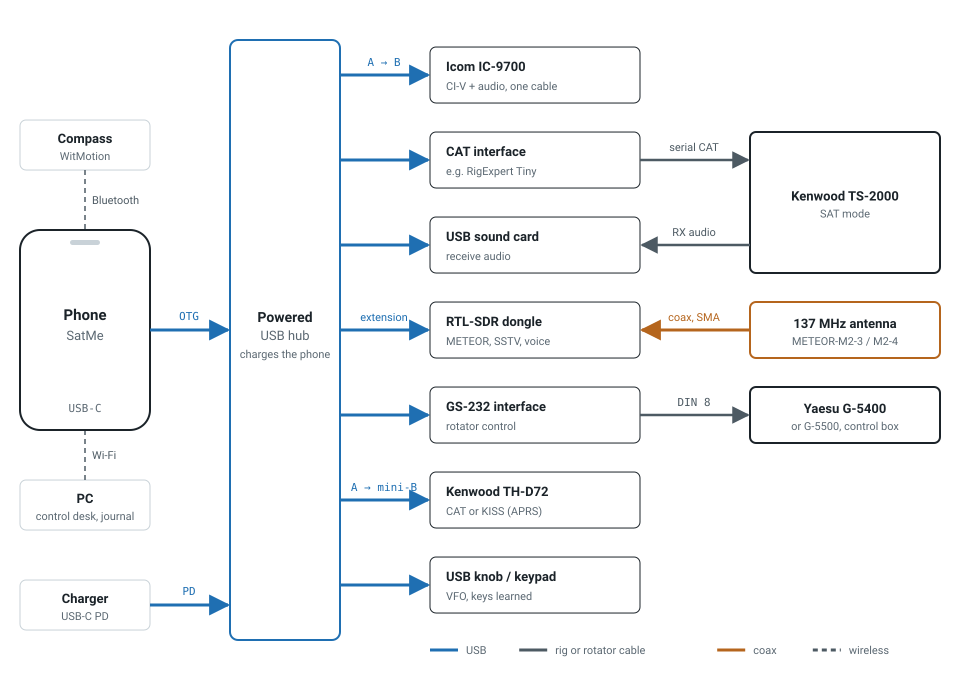</p>

## Documentation

- **[SatMe wiki](https://github.com/f4ioz/SatMe/wiki)**: the full guide, step by step, with screenshots — installation, passes, CAT, recording, SSTV, APRS, logbook, FAQ
- **[SatMe-PC guide](docs/station-pc.md)**: every tab of the PC — QO-100 cockpit, DATV reception and transmission, SSTV, FT8 / FT4, voice to text, the SDR hardware, the safety rules
- [Control desk API v1](docs/API-v1.md): HTTP protocol for third-party clients
- [SatMe GP server](https://github.com/f4ioz/SatMe-serveur): relays orbital elements (OMM/GP) to SatMe, to install on a Raspberry Pi, a Linux server or Proxmox
- [Third-party components](THIRD-PARTY.md)
- [Privacy policy](docs/privacy-policy.html)

## Build

JDK 21, Android SDK 36.

```sh
./gradlew testDebugUnitTest assembleDebug
```

Release signing reads `keystore.properties` at the root (not committed): `storeFile`, `storePassword`, `keyAlias`, `keyPassword`.

## License

[GPL-2.0-or-later](LICENSE). Third-party licenses in [THIRD-PARTY.md](THIRD-PARTY.md).

## Credits

- T. S. Kelso — SGP4/SDP4 models and CelesTrak (orbital elements)
- John Magliacane KD2BD — PREDICT
- Neoklis Kyriazis 5B4AZ — C translation of SGP4/SDP4, used by PREDICT
- David Johnson G4DPZ — predict4java (pass and Doppler computation)
- Kārlis Goba — ft8_lib (FT8/FT4 error-correcting code tables)
- K9AN, G4WJS and K1JT — FT8 and FT4 protocols (QEX article)
- Peter Goodhall MM9SQL — Cloudlog
- The Wavelog team — Wavelog, a Cloudlog fork
- IS0GRB — QO-100 WebSDR (frequency reference)
- John Morris G4ANB — Maidenhead locator squares
- AMSAT and SatNOGS — satellite status; SatNOGS DB — orbital elements
- Bob Bruninga WB4APR (SK) — APRS
- Stephen Smith WA8LMF — TNC test CD (APRS decoder testing)
- F6KMX radio club

73 de **F4IOZ**
