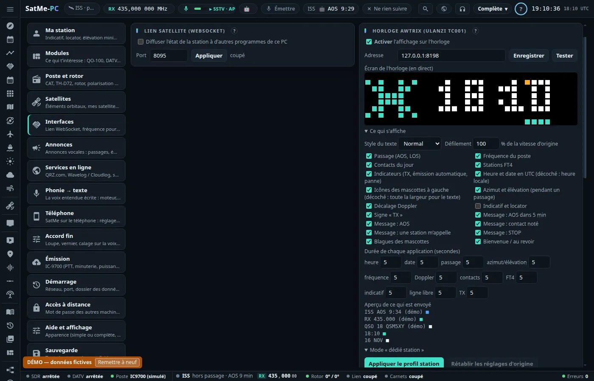
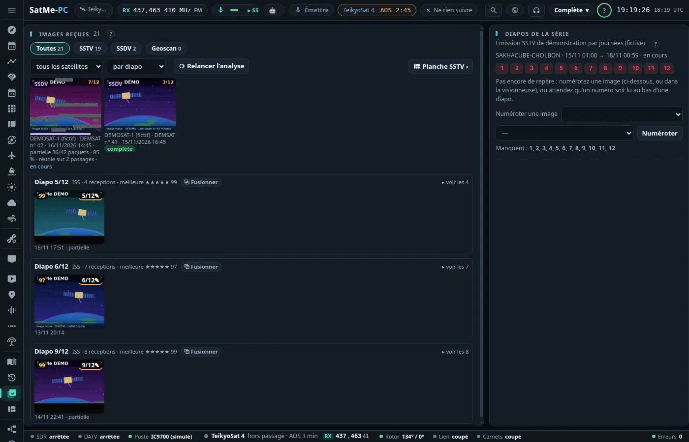

# SatMe-PC

**Français** · [English below](#english)

SatMe-PC suit les satellites radioamateurs depuis votre ordinateur (Linux, Windows, Raspberry Pi) : passages, pointage, Doppler, carnet de trafic, décodage SSTV / SSDV / FT8 / APRS / télémesure / CW en réception, DATV QO-100. Il s'utilise dans le navigateur, sur ce PC ou sur votre réseau. Une application Android existe aussi : [Google Play](https://play.google.com/store/apps/details?id=fr.f4ioz.satcombo).

## Dernière version : 2026.11.9

- **Journal (film)** : deux repères **début / fin** du passage (le reste file en accéléré, sans son), **intros animées** avec Gamma, Kepler, Doppler ou le Trio, baisse du bruit de fond par un vrai squelch, zones vides ou à ×1 modifiables à la main, musique qui ne change plus la durée.
- **Sous-titres** : audio nettoyé avant transcription, traduction ligne par ligne, défilement vers le haut comme un générique, lignes calées au mot près (« ham radio » n'est plus traduit par « jambon »).
- **CW** : F1 envoie la mémoire F1 ; **fiche du correspondant** en surimpression, avec les contacts du passage en cours et l'alerte de doublon.
- **FT4 / FT8 sur satellite** : recalage rapide de l'émission, ton qui vise tout de suite la colonne du correspondant, indicateur « centre de l'activité », journal des émissions.
- **Puissance du poste** lue par la CAT et **Puissance max (W)** : au-delà, plus aucune émission.
- **CAT** : la molette du poste n'est plus ramenée en arrière par le Doppler ; **rotor** connecté automatiquement à la sélection d'un passage ; **horloge AWTRIX** : page « passage » fixe (élévation et temps avant le LOS).
- **Moteurs d'IA installés en un clic** (lecture des numéros SSTV, musique du Journal, illustration de planche), avec progression, reprise et désinstallation.

Le détail est dans la [page de la version](https://github.com/f4ioz/SatMe/releases/tag/satme-pc-2026.11.9).

### En images

Captures de la démonstration (`satme --demo`) : stations, indicatifs et images fictifs, rien d'émis.

## Télécharger

Les versions sont dans l'onglet **[Releases](https://github.com/f4ioz/SatMe/releases/latest)** :

- Linux / Raspberry Pi : `satme-pc.tar` (Java 17 ou plus) ;
- Windows : `satme-pc-windows.msi` (installeur) ou `satme-pc-windows.zip` (sans installer) ;
- `SHA256SUMS` pour vérifier le téléchargement, et le manuel en PDF.

Pour essayer sans matériel : `satme --demo`. Le guide complet est dans le programme (touche **F1**) et sur **[f4ioz.fr](https://f4ioz.fr)**.

## Licence et avertissement

SatMe est un logiciel libre, **GNU GPL version 2 ou ultérieure**. Le développement a lieu dans un dépôt privé ; chaque version publiée ici est accompagnée de son **code source complet** (`satme-pc-<version>-source.tar.gz`). Les composants tiers sont listés dans `THIRD-PARTY.md`, joint à chaque source. Aucune garantie.

SatMe peut piloter un émetteur : l'opérateur reste seul responsable de ses émissions et du respect de sa licence et de la réglementation radioamateur. Aucune émission ne part sans un geste de sa part.

## Contact

Olivier Gouyen, **F4IOZ** : [f4ioz.fr](https://f4ioz.fr) · [Issues](https://github.com/f4ioz/SatMe/issues) pour signaler un défaut.

---

## English

SatMe-PC tracks amateur radio satellites from your computer (Linux, Windows, Raspberry Pi): passes, pointing, Doppler, logbook, and receive-only decoding of SSTV / SSDV / FT8 / APRS / telemetry / CW, plus QO-100 DATV. It runs in your browser, on this PC or across your network. An Android app exists too: [Google Play](https://play.google.com/store/apps/details?id=fr.f4ioz.satcombo).

### Latest version: 2026.11.9

- **Journal (film)**: **start / end** markers for the pass (the rest is sped up, silent), **animated intros** with Gamma, Kepler, Doppler or the Trio, background-noise reduction with a real squelch, hand-editable empty or ×1 zones, music that no longer changes the length.
- **Subtitles**: audio cleaned before transcription, line-by-line translation, scrolling up like film credits, lines aligned to the word (« ham radio » is no longer translated as « jambon »).
- **CW**: F1 sends memory F1; a floating **correspondent card** with the contacts of the current pass and a duplicate alert.
- **FT4 / FT8 on satellite**: fast transmit re-alignment, tone that aims straight at the correspondent's column, « centre of activity » indicator, transmit log.
- **Radio power** read over CAT and **Max power (W)**: above it, no transmission at all.
- **CAT**: the radio's dial is no longer pushed back by Doppler; **rotor** connected automatically when you select a pass; **AWTRIX clock**: fixed « pass » page (elevation and time to LOS).
- **AI engines installed in one click** (SSTV number reading, Journal music, board illustration), with progress, resume and uninstall.

Details are on the [release page](https://github.com/f4ioz/SatMe/releases/tag/satme-pc-2026.11.9).

### In pictures

Screenshots of the demonstration (`satme --demo`): made-up stations, callsigns and pictures, nothing transmitted.

### Download

Versions are under **[Releases](https://github.com/f4ioz/SatMe/releases/latest)**:

- Linux / Raspberry Pi: `satme-pc.tar` (Java 17 or later);
- Windows: `satme-pc-windows.msi` (installer) or `satme-pc-windows.zip` (no install);
- `SHA256SUMS` to check the download, and the PDF manual.

To try it without any hardware: `satme --demo`. The full guide is inside the program (key **F1**) and on **[f4ioz.fr](https://f4ioz.fr)**.

### Licence and disclaimer

SatMe is free software, **GNU GPL version 2 or later**. Development takes place in a private repository; every version published here comes with its **complete corresponding source code** (`satme-pc-<version>-source.tar.gz`). Third-party components are listed in `THIRD-PARTY.md`, included in each source archive. No warranty.

SatMe can drive a transmitter: the operator alone is responsible for what is transmitted and for complying with their licence and amateur radio regulations. Nothing is ever transmitted without the operator's own action.

### Contact

Olivier Gouyen, **F4IOZ**: [f4ioz.fr](https://f4ioz.fr) · [Issues](https://github.com/f4ioz/SatMe/issues) to report a bug.
