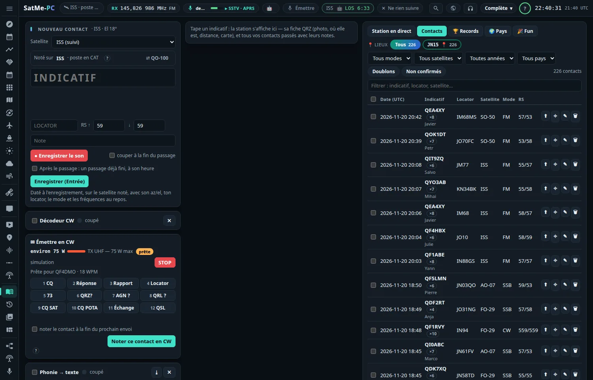
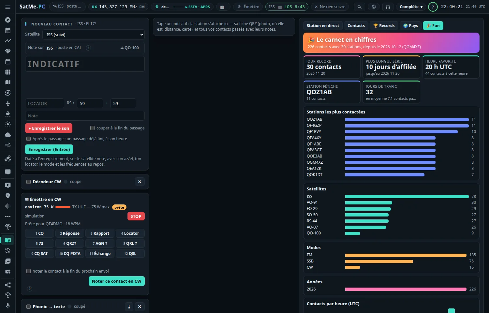
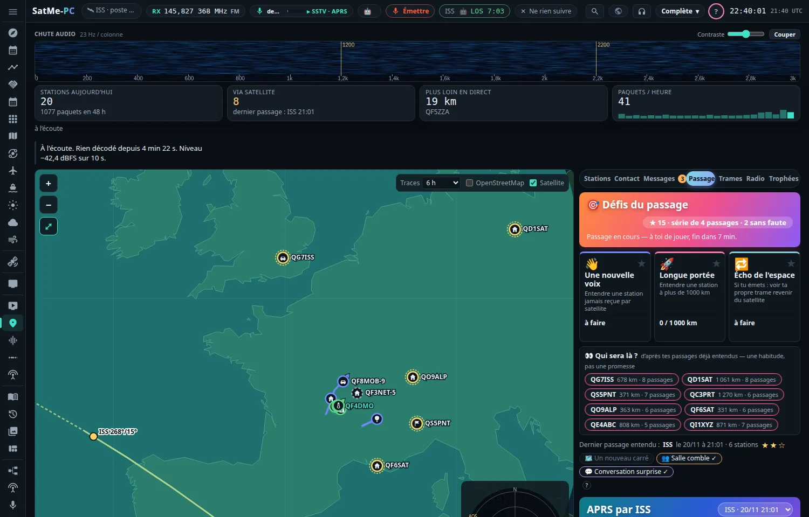
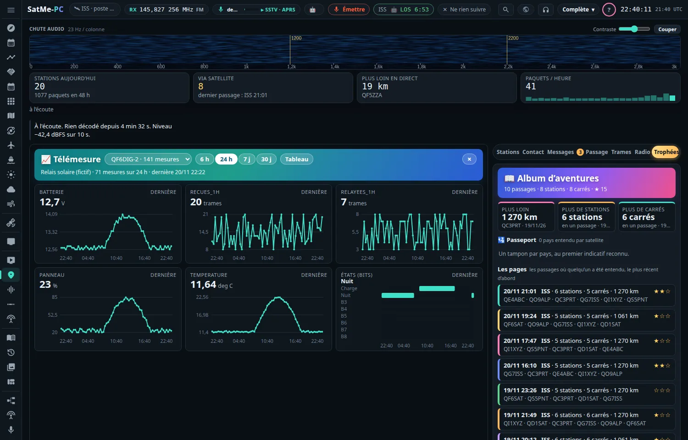
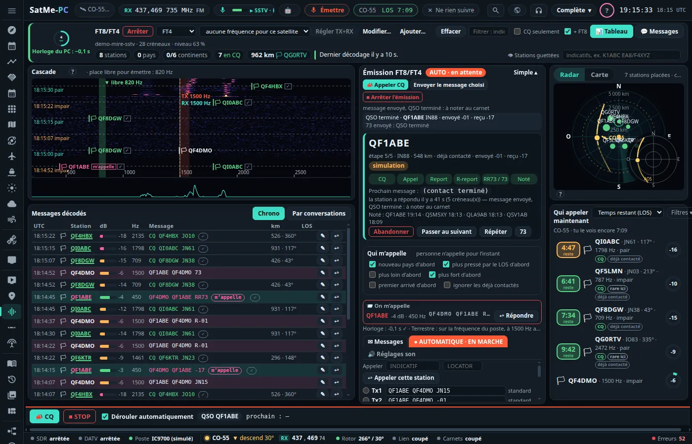
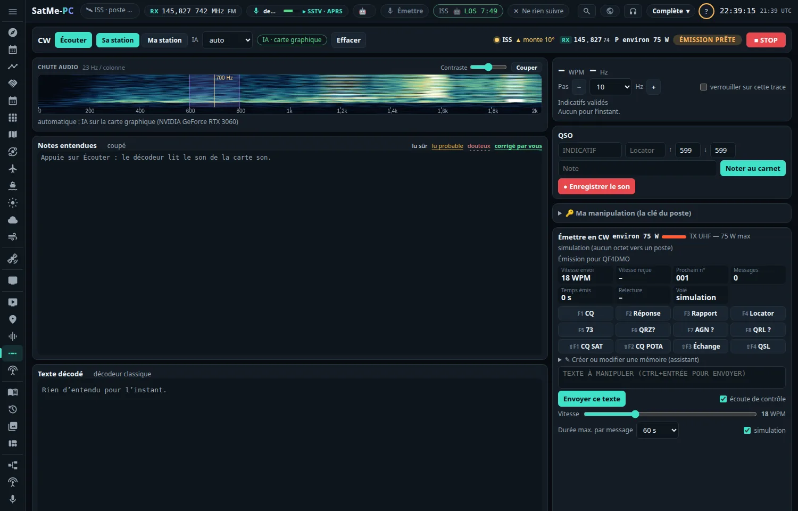
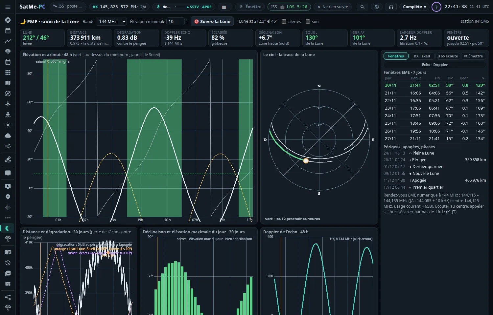
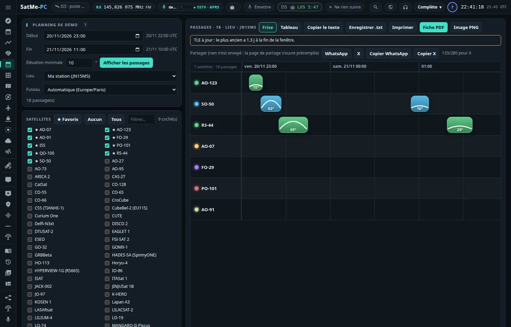
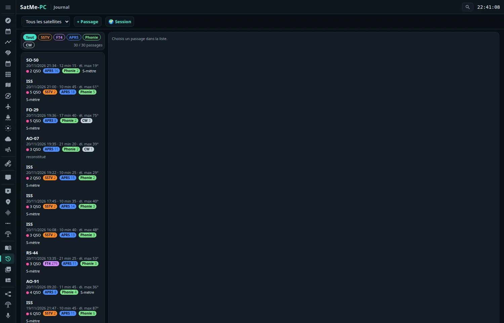

# SatMe-PC

**Français** · [English below](#english)

SatMe-PC suit les satellites radioamateurs depuis votre ordinateur (Linux, Windows, Raspberry Pi) : passages, pointage, Doppler, carnet de trafic, décodage SSTV / SSDV / FT8 / APRS / télémesure / CW en réception, DATV QO-100. Il s'utilise dans le navigateur, sur ce PC ou sur votre réseau. Une application Android existe aussi : [Google Play](https://play.google.com/store/apps/details?id=fr.f4ioz.satcombo).

## Dernière version : 2026.11.10

- **Carnet** : les **lieux de la station** (récupérés de Wavelog ou saisis à la main), une barre des lieux et des **filtres** au-dessus des contacts (mode, satellite, année, pays, doublons), une vue **Pays** et un carnet **Fun** en chiffres.
- **FT4 / FT8** : un contact noté reçoit **nom et ville** de l'annuaire, comme en phonie ; FT4 sur RS-44 passe à **435,611 MHz**.
- **APRS** : des **défis** à chaque passage, « **Qui sera là ?** », un **album** avec passeport des pays, la **télémesure en graphiques**, les **chemins par satellite**, un assistant de contact par l'ISS. Rien ne part sans votre clic.
- **Planning** : une vue **Frise**, une ligne par satellite.
- **Station** : la carte son est retrouvée par son nom après un redémarrage ; la puissance de l'IC-9700 est lue sur la bonne bande en mode satellite.

Le détail est dans la [page de la version](https://github.com/f4ioz/SatMe/releases/tag/satme-pc-2026.11.10).

### En images

Captures de la démonstration (`satme --demo`) : stations, indicatifs et images fictifs, rien d'émis.

## Télécharger

Les versions sont dans l'onglet **[Releases](https://github.com/f4ioz/SatMe/releases/latest)** :

- Linux / Raspberry Pi : `satme-pc.tar` (Java 17 ou plus) ;
- Windows : `satme-pc-windows.msi` (installeur) ou `satme-pc-windows.zip` (sans installer) ;
- `SHA256SUMS` pour vérifier le téléchargement, et le manuel en PDF.

Pour essayer sans matériel : `satme --demo`. Le guide complet est dans le programme (touche **F1**) et sur **[f4ioz.fr](https://f4ioz.fr)**.

## Licence et avertissement

SatMe est un logiciel libre, **GNU GPL version 2 ou ultérieure**. Le développement a lieu dans un dépôt privé ; chaque version publiée ici est accompagnée de son **code source complet** (`satme-pc-<version>-source.tar.gz`). Les composants tiers sont listés dans `THIRD-PARTY.md`, joint à chaque source. Aucune garantie.

SatMe peut piloter un émetteur : l'opérateur reste seul responsable de ses émissions et du respect de sa licence et de la réglementation radioamateur. Aucune émission ne part sans un geste de sa part.

## Contact

Olivier Gouyen, **F4IOZ** : [f4ioz.fr](https://f4ioz.fr) · [Issues](https://github.com/f4ioz/SatMe/issues) pour signaler un défaut.

---

## English

SatMe-PC tracks amateur radio satellites from your computer (Linux, Windows, Raspberry Pi): passes, pointing, Doppler, logbook, and receive-only decoding of SSTV / SSDV / FT8 / APRS / telemetry / CW, plus QO-100 DATV. It runs in your browser, on this PC or across your network. An Android app exists too: [Google Play](https://play.google.com/store/apps/details?id=fr.f4ioz.satcombo).

### Latest version: 2026.11.10

- **Log**: the **station's places** (read from Wavelog or typed by hand), a places bar and **filters** above the contacts (mode, satellite, year, country, repeats), a **Countries** view and a **Fun** page of figures.
- **FT4 / FT8**: a logged contact gets its **name and town** from the callsign directory, as in phone; FT4 on RS-44 moves to **435.611 MHz**.
- **APRS**: **challenges** on every pass, "**Who will be there?**", an **album** with a passport of countries, **telemetry as graphs**, **paths per satellite**, a contact assistant through the ISS. Nothing leaves without your click.
- **Planning**: a **timeline** view, one line per satellite.
- **Station**: the sound card is found by its name after a reboot; the IC-9700's power is read on the right band in satellite mode.

Details are on the [release page](https://github.com/f4ioz/SatMe/releases/tag/satme-pc-2026.11.10).

### In pictures

Screenshots of the demonstration (`satme --demo`): made-up stations, callsigns and pictures, nothing transmitted.

### Download

Versions are under **[Releases](https://github.com/f4ioz/SatMe/releases/latest)**:

- Linux / Raspberry Pi: `satme-pc.tar` (Java 17 or later);
- Windows: `satme-pc-windows.msi` (installer) or `satme-pc-windows.zip` (no install);
- `SHA256SUMS` to check the download, and the PDF manual.

To try it without any hardware: `satme --demo`. The full guide is inside the program (key **F1**) and on **[f4ioz.fr](https://f4ioz.fr)**.

### Licence and disclaimer

SatMe is free software, **GNU GPL version 2 or later**. Development takes place in a private repository; every version published here comes with its **complete corresponding source code** (`satme-pc-<version>-source.tar.gz`). Third-party components are listed in `THIRD-PARTY.md`, included in each source archive. No warranty.

SatMe can drive a transmitter: the operator alone is responsible for what is transmitted and for complying with their licence and amateur radio regulations. Nothing is ever transmitted without the operator's own action.

### Contact

Olivier Gouyen, **F4IOZ**: [f4ioz.fr](https://f4ioz.fr) · [Issues](https://github.com/f4ioz/SatMe/issues) to report a bug.
