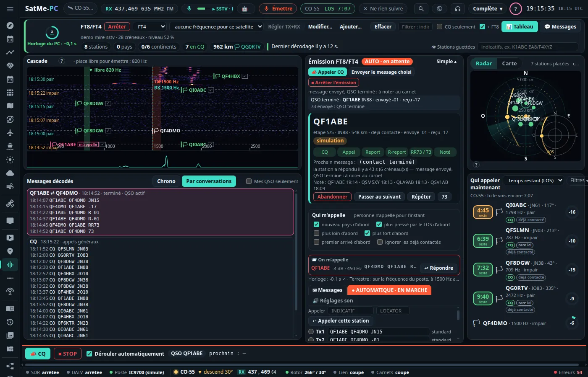
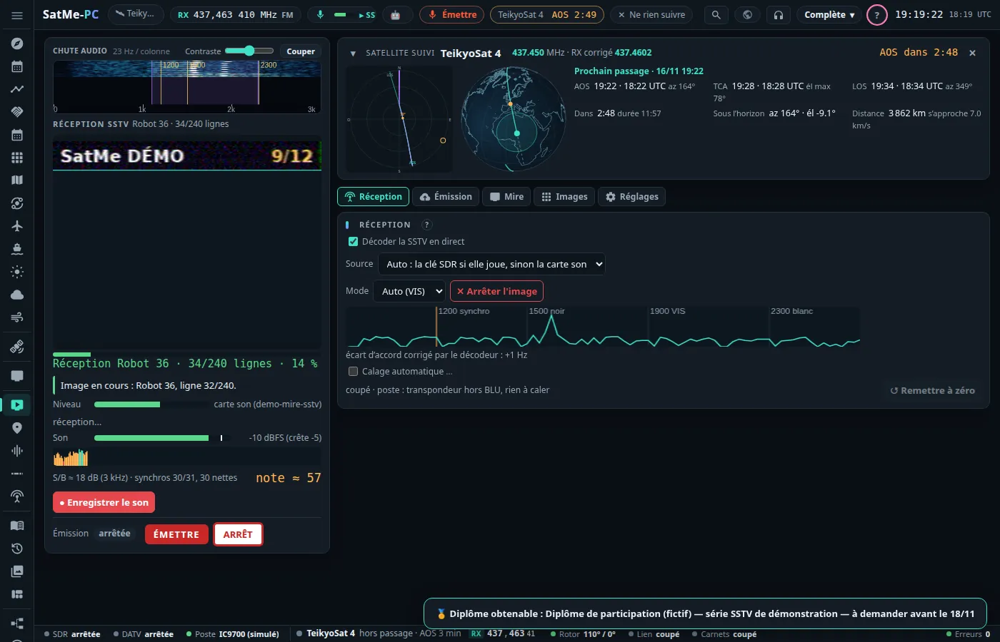
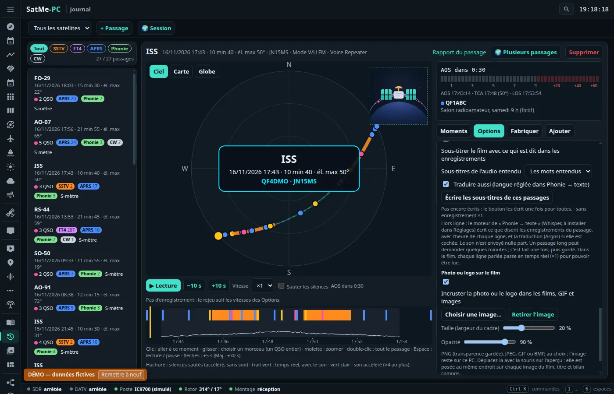

# SatMe-PC

**Français** · [English below](#english)

SatMe-PC suit les satellites radioamateurs depuis votre ordinateur (Linux, Windows, Raspberry Pi) : passages, pointage, Doppler, carnet de trafic, décodage SSTV / SSDV / FT8 / APRS / télémesure / CW en réception, DATV QO-100. Il s'utilise dans le navigateur, sur ce PC ou sur votre réseau. Une application Android existe aussi : [Google Play](https://play.google.com/store/apps/details?id=fr.f4ioz.satcombo).

## Dernière version : 2026.11.8

- **Horloge AWTRIX (Ulanzi TC001) dédiée à SatMe** : l'écran de l'horloge est émulé en direct dans Réglages › Interfaces, avec ses options (ce qui s'affiche, style et vitesse du texte, durée de chaque application, profil « station »).
- **FT4 / FT8** : un clic sur une station et le contact se déroule (message, report, R-report, RR73, 73, note au carnet) ; barre de commande toujours visible au bas de l'onglet ; badges **LOS** colorés selon le temps restant ; affichage **Par conversations** ; « Répondre » suit le message reçu.
- **Calage automatique de la fréquence d'émission FT4/FT8** sur un satellite (coché d'origine, bouton « 0 Hz ») : à essayer, pas encore vérifié en réel.
- **Plus de verrous d'émission sur SatMe-PC** : plus de mot ARMER ni d'interrupteur « Tout déverrouiller ». Restent STOP/Échap, les plafonds de puissance, les bandes, les minuteries et l'indicatif des Réglages ; pour travailler en automatique (FT8/FT4, APRS), on coche **Émission automatique**.
- **Journal** : un **logo ou une photo** incrusté sur le film (vidéo, GIF, image) et des **sous-titres** de l'audio entendu, écrits hors ligne par « Phonie → texte » (sous-titres : à essayer, pas encore vérifiés en réel).
- Depuis la 2026.11.7 : le mode données FT4 ne gêne plus la phonie (bouton **🎙 Phonie**, fenêtre « Tu parles ? »).

Le détail est dans la [page de la version](https://github.com/f4ioz/SatMe/releases/tag/satme-pc-2026.11.8).

### En images

Captures de la démonstration (`satme --demo`) : stations, indicatifs et images fictifs, rien d'émis.

## Télécharger

Les versions sont dans l'onglet **[Releases](https://github.com/f4ioz/SatMe/releases/latest)** :

- Linux / Raspberry Pi : `satme-pc.tar` (Java 17 ou plus) ;
- Windows : `satme-pc-windows.msi` (installeur) ou `satme-pc-windows.zip` (sans installer) ;
- `SHA256SUMS` pour vérifier le téléchargement, et le manuel en PDF.

Pour essayer sans matériel : `satme --demo`. Le guide complet est dans le programme (touche **F1**) et sur **[f4ioz.fr](https://f4ioz.fr)**.

## Licence et avertissement

SatMe est un logiciel libre, **GNU GPL version 2 ou ultérieure**. Le développement a lieu dans un dépôt privé ; chaque version publiée ici est accompagnée de son **code source complet** (`satme-pc-<version>-source.tar.gz`). Les composants tiers sont listés dans `THIRD-PARTY.md`, joint à chaque source. Aucune garantie.

SatMe peut piloter un émetteur : l'opérateur reste seul responsable de ses émissions et du respect de sa licence et de la réglementation radioamateur. Aucune émission ne part sans un geste de sa part.

## Contact

Olivier Gouyen, **F4IOZ** : [f4ioz.fr](https://f4ioz.fr) · [Issues](https://github.com/f4ioz/SatMe/issues) pour signaler un défaut.

---

## English

SatMe-PC tracks amateur radio satellites from your computer (Linux, Windows, Raspberry Pi): passes, pointing, Doppler, logbook, and receive-only decoding of SSTV / SSDV / FT8 / APRS / telemetry / CW, plus QO-100 DATV. It runs in your browser, on this PC or across your network. An Android app exists too: [Google Play](https://play.google.com/store/apps/details?id=fr.f4ioz.satcombo).

### Latest version: 2026.11.8

- **AWTRIX clock (Ulanzi TC001) dedicated to SatMe**: the clock's screen is emulated live in Settings › Interfaces, with its options (what is shown, text style and speed, duration of each app, « station » profile).
- **FT4 / FT8**: click a station and the contact runs by itself (message, report, R-report, RR73, 73, log note); the command bar is always visible at the foot of the tab; **LOS** badges coloured by the time left; a **Par conversations** (by conversation) view; « Répondre » follows the message received.
- **Automatic FT4/FT8 transmit-frequency alignment** on a satellite (ticked by default, « 0 Hz » button): to be tried, not yet checked on the air.
- **No more transmit locks on SatMe-PC**: no ARMER word and no « Unlock everything » switch any more. What stays: STOP/Esc, the power caps, bands, timers and the settings' callsign; to work automatically (FT8/FT4, APRS) you tick **Émission automatique**.
- **Journal**: a **logo or a photo** laid over the film (video, GIF, picture) and **subtitles** of the audio heard, written offline by « Phonie → texte » (subtitles: to be tried, not yet checked on the air).
- Since 2026.11.7: the FT4 data mode no longer gets in the way of voice (**🎙 Phonie** button, « Are you talking? » window).

Details are on the [release page](https://github.com/f4ioz/SatMe/releases/tag/satme-pc-2026.11.8).

### In pictures

Screenshots of the demonstration (`satme --demo`): made-up stations, callsigns and pictures, nothing transmitted.

### Download

Versions are under **[Releases](https://github.com/f4ioz/SatMe/releases/latest)**:

- Linux / Raspberry Pi: `satme-pc.tar` (Java 17 or later);
- Windows: `satme-pc-windows.msi` (installer) or `satme-pc-windows.zip` (no install);
- `SHA256SUMS` to check the download, and the PDF manual.

To try it without any hardware: `satme --demo`. The full guide is inside the program (key **F1**) and on **[f4ioz.fr](https://f4ioz.fr)**.

### Licence and disclaimer

SatMe is free software, **GNU GPL version 2 or later**. Development takes place in a private repository; every version published here comes with its **complete corresponding source code** (`satme-pc-<version>-source.tar.gz`). Third-party components are listed in `THIRD-PARTY.md`, included in each source archive. No warranty.

SatMe can drive a transmitter: the operator alone is responsible for what is transmitted and for complying with their licence and amateur radio regulations. Nothing is ever transmitted without the operator's own action.

### Contact

Olivier Gouyen, **F4IOZ**: [f4ioz.fr](https://f4ioz.fr) · [Issues](https://github.com/f4ioz/SatMe/issues) to report a bug.
