# SatMe-PC — the station in a browser

*October 2026. The Android app stays the reference; the PC does what it does, and what is made on the PC comes to the phone too. The PC pages are in French for now.*

SatMe runs on a PC (Linux, Windows, Raspberry Pi) and is driven from a browser. Its core is **the same code as on the phone**: Doppler loop, rotator tracking, pass journal, SSTV, METEOR, APRS, FT8, QO-100, DATV and the log all come from the shared `:moteur` module.

<p align="center">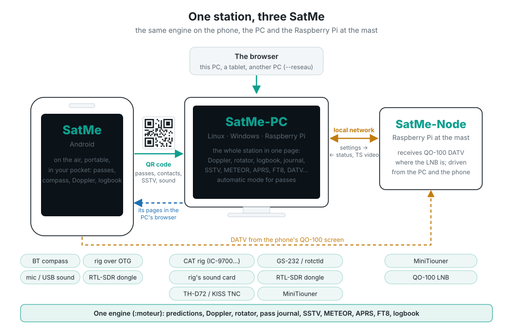</p>

<p align="center"></p>

## Contents

1. [Installing it](#installing-it) — options, the page on other machines and its password
2. [The tabs at a glance](#the-tabs-at-a-glance) — workspaces, header, « Son », shortcuts, built-in manual (F1)
3. [Station and passes](#station-and-passes) — the rotator's plan, automatic mode, SSTV campaigns and their auto-pilot, upcoming activities (online sources), preparing a pass, recording, calendar, horizon
4. [The log (Carnet)](#the-log-carnet) — which satellite, correcting a contact, compound callsigns, a contact's pass and rotator path
5. [SatMe on the phone](#satme-on-the-phone)
6. [Pass journal](#pass-journal) — pass report
7. [QO-100: the cockpit](#qo-100-the-cockpit) — multiple decoders, PSK31 and RTTY, beacon, a drifting LNB, LNB and GPSDO reference
8. [DATV: reception](#datv-reception) — MiniTiouner, SatMe-Node, Pluto / bladeRF, wide band, quality, subtitles
9. [DATV: transmission](#datv-transmission) — DVB-S2 and DVB-S, the station, the rules, the indoor test, card and chat
10. [SSTV](#sstv) — reception and transmission
11. [FT8 / FT4](#ft8--ft4)
12. [Telemetry](#telemetry) — 1200 to 9600 bit/s packets, SSDV pictures, FUNcube, SatNOGS
13. [Voice to text (Phonie → texte)](#voice-to-text-phonie--texte) — written and spoken translation
14. [The SDR receiver](#the-sdr-receiver) — memories, band plan, display, sound cleaning, CTCSS, scanning, I/Q, test generator, measurements
15. [SDR hardware](#sdr-hardware) — RTL-SDR, ADALM-PLUTO, bladeRF 2.0, HackRF One, the IC-9700's IF
16. [Aircraft (ADS-B) and the map](#aircraft-ads-b-and-the-map) — 1090 MHz, aircraft scatter, the shared map
17. [Ships (AIS)](#ships-ais)
18. [Space weather](#space-weather)
19. [Montage: the station chain](#montage-the-station-chain) — diagram, editing, catalogue, functions, profiles
20. [Réglages (settings)](#réglages-settings) — rig and rotator, IC-9700 over the network, the IC-9700 transmitting (PTT, microphone, power), orbital elements, Doppler log, satellite link, rigctld, USB knob, announcements, I/Q correction, remote access and HTTPS, start-up (quick setup, what's new, updates, startup options, deployment)
21. [More of the PC](#more-of-the-pc)
22. [Hardware safety](#hardware-safety)
23. [Before the first try](#before-the-first-try)

## Installing it

- **Linux**: [Installing SatMe-PC](installer-satme-pc.md) — download `satme-pc.tar`, unpack, start, then open **http://localhost:8090/**.
- **Windows**: [Installing SatMe-PC on Windows](installer-satme-pc-windows.md) — all in one: `satme-pc-windows.msi`, double-click, the page opens.
- **The MiniTiouner by the antenna**: [Installing SatMe-Node on a Raspberry Pi](installer-satme-node.md).

| Option | Effect |
|---|---|
| `--port 8090` | the page's port |
| `--reseau` | page open to the other machines of the network (a station at the foot of the mast, driven from the house); without it, this PC only |
| `--dossier DIR` | where settings, log, journal and recordings are kept (`~/.satme`, `%APPDATA%\SatMe` on Windows) |
| `--noeud` | SatMe-Node: the DATV receiver only, driven over the network |
| `--bureau` · `--console` | open the page in the browser, an icon by the clock (the default on Windows); or not |
| `--local` | this PC only, even when the startup file says otherwise |

`--port`, `--reseau` and `--dossier` can also be set from the page (*Réglages › Démarrage*, kept in `~/.config/satme/satme-pc.properties`, `%APPDATA%\SatMe\satme-pc.properties` on Windows); the command line wins (see [Start-up, updates and deployment](#start-up-updates-and-deployment)).

**The page on the network's other machines** (a tablet, the living-room PC): start `satme --reseau`, then open `http://<the PC's address>:8090/` (`hostname -I` gives it). On Linux with ufw, open the port to the local network once, in a terminal: `sudo ufw allow from 192.168.0.0/24 to any port 8090 proto tcp` (adapt the range to your router). **A password** is then asked of the other machines (this PC itself gets in without one): drawn at the first start with `--reseau` (four words, written in SatMe-PC's log and shown in *Réglages › Accès à distance*), to be replaced with your own (see [Remote access](#remote-access)). Without HTTPS everything goes in clear: home network only, never opened to the internet. **🔈 Écouter ici**, at the top, plays SatMe-PC's sound (SDR or sound card) in that browser.

**Optional tools**, only for the features that use them (Linux):

| Package | For |
|---|---|
| `ffmpeg` | DATV pictures and sound, DATV transmission, subtitles (bundled on Windows) |
| `tesseract-ocr` | callsigns read in the DATV picture |
| `hackrf` | the HackRF One test transmitter |
| `bladerf` | the bladeRF 2.0 |
| `python3-venv` | voice to text (the engine is installed from Réglages) |

## The tabs at a glance

| Tab | What it does |
|---|---|
| **Suivi** | the next 24 h passes, the satellite followed on the sky or the map, the AMSAT box, Doppler-corrected frequencies, the rig and rotator by name with a green tick |
| **Carnet** | the log: entry with callsign prediction and QRZ, the station live beside it, the CW decoder window, voice to text |
| **Agenda** · **Frise** · **Carrés** | appointments and the **automatic mode**; the passes on a timeline; worked squares on a map |
| **Sked** | the windows when you and another station both see a satellite, replayed on the map, made into a video |
| **QO-100** | the narrow band cockpit: one-click reception, named signals, click-to-tune with the right decoder |
| **DATV** | QO-100's wide band: reception (MiniTiouner, node, Pluto or bladeRF), quality, subtitles, transmission |
| **Montage** | the station diagram, what each SatMe function holds, the receive profiles |
| **SDR** | the receiver: RTL-SDR, ADALM-PLUTO, bladeRF 2.0, the IC-9700's IF, I/Q file, test generator; waterfall, vernier, magnifier, memories, scanning, sound cleaning, measurements |
| **Carte** · **Avions** · **Navires** | the shared map (satellites, APRS, sondes, aircraft, ships, DATV, squares, aurora); ADS-B on 1090 MHz and aircraft scatter; AIS on 162 MHz |
| **Météo spatiale** | Kp index, solar flux, X-rays, solar wind, aurora, alerts (downloaded only when ticked) |
| **Télémesure** | FSK / GMSK packets from 1200 to 9600 bit/s, SSDV pictures, FUNcube, the QO-100 beacon |
| **Sondes** · **METEOR** | radiosondes; METEOR-M LRPT pictures |
| **Son** | the sound card, recording |
| **SSTV** | live decoding, the pictures, the test card, transmission |
| **Planche** | the SSTV sheet: pictures on a template — all its boxes, or fewer, laid out as large as they can be —, a background (stars, gradients, NASA pictures or your own) and up to three patches dragged with the mouse, their surround removed if need be; downloaded full size. **Export the template…** gives it as one `.satme-planche` file (layout, texts, background, patches already cut out — no received picture; the callsign and name stay fields the importer fills, unless « keep my callsign written in » is ticked); **Import a template…** (or the file dropped on the page) takes an ARISS picture or such a file as a new template, never over another one; **Renommer**, the sheet's **event**, **Remplir par diapo**, the event's **Rapport** — see [Pictures by slide](#pictures-by-slide-marks-and-the-series-timetable) |
| **APRS** · **FT8** | APRS (KISS radio too) and its game; the FT8 / FT4 board |
| **Journal** | the passes replayed with their sound, made into a picture, video or GIF |
| **Réglages** | by category: Ma station, Poste et rotor, Satellites, Interfaces, Annonces, Services en ligne, Phonie → texte, Téléphone, Accord fin, Émission, Accès à distance, Sauvegarde |

The QO-100, DATV and SSTV tabs fit one screen (1920×970 down to 1366×700): the main view stays in sight, the secondary cards are **sub-tabs** with icons, the last one opened kept.

<p align="center"></p>

- **Workspaces**, in the left rail (keys **1** to **6**, each reopened at its last tab; **[** folds or unfolds it): **Ciel** (Suivi, Agenda, Frise, Sked, Carrés, Carte, Avions, Navires, Météo spatiale, METEOR, Sondes), **QO-100**, **DATV**, **Modes** (SSTV, APRS, FT8, Télémesure), **Carnet** (Carnet, Journal, Planche), **Station** (Montage, SDR, Son, Réglages). On a phone the rail becomes a bar at the bottom. Avions, Navires and Sondes are in the rail only when ticked (see [Non-satellite functions](#non-satellite-functions)).
- **Ctrl+K**: the command palette — tabs and sub-tabs, settings categories, actions (« Arrêter toute émission »…), a satellite, or a typed frequency (« 145,8 ») for the SDR receiver to listen to.
- **The built-in manual**: **F1** opens it at the current tab's chapter; it can be searched; its chapters are those of the French guide. **Esc** closes it — a second **Esc** stops transmissions, as always. The « ? » beside the cards' titles give the short explanation, with « En savoir plus » leading to the manual.

<p align="center">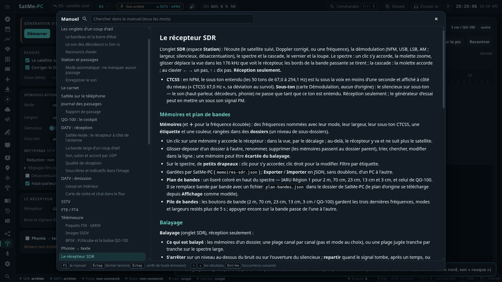</p>

### The header strip and the status bar

- **The header** (top): callsign and square, what is followed (a satellite, the QO-100 cockpit), the active receiver's frequency and mode (the rig over CAT, else the SDR), the **Son** chip, the next pass counted down, local time and UTC, **Distant** (see [Remote mode](#remote-mode)), **🔈 Écouter ici**. During a transmission (DATV, SSTV, I/Q calibration) a red-orange **TX** light: one click stops everything.
- **The status bar** (bottom): SDR, DATV receiver, rig, rotator, recording, satellite link, rigctld clients, errors (the page's and the server's) — each one click from its tab. A click on **Poste** opens a small Connect / Disconnect menu sending exactly the model and port shown.

### The decoders' sound (« Son »)

The header's **Son** chip (key **S**) says what SSTV, FT8, CW, APRS and voice to text hear, with a small level meter. Its menu: the sources (sound cards by name — « IC-9700 (USB Audio CODEC) », « Carte mère (ALC897) » —, the SDR receiver, the IC-9700 over the network), start or stop, the decoders listening, **● Record the sound**, **Prepare the pass**, **Écouter ici**. A decoder that hears nothing offers the gesture that fixes it.

- Switching a decoder on, or asking for a recording, starts the card it needs: the one chosen for the satellite, the last one used, the rig's own — never a guessed card. Receive only.
- Sound cards are recognised and named from the system (`/proc/asound`, sysfs; no port opened): a codec on the same USB hub as the rig on CAT becomes « IC-9700 (USB Audio CODEC) ».

<p align="center">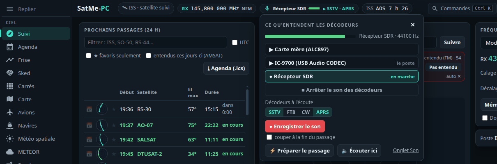</p>

### Keyboard shortcuts

| Key | Effect |
|---|---|
| **Esc** | stop every transmission (DATV, SSTV, I/Q calibration, test card); only stops, never starts anything |
| **Ctrl+K** | the command palette |
| **1** … **6** | the workspaces |
| **?** | the shortcuts help · **F1** the manual · **[** the rail |
| **S** | the decoders' sound |
| **E** | record the sound, or stop the recording |
| **P** | prepare the followed satellite's pass |
| **N** | log a contact (the log, cursor on the callsign) |
| ← → ↑ ↓ | QO-100: tune by 100 Hz / 1 kHz |
| **+** **−** **0** · **E** · **V** | Montage: zoom in, out, the whole drawing · edit · full or simplified view |

## Station and passes

**Suivi** (workspace **Ciel**) lists the passes of the next 24 hours (favourites, heard on AMSAT these days, agenda), the satellite followed on the sky or the map, the **AMSAT box** to the right of its name (what stations hear, "Heard" / "Not heard" in one click), Doppler-corrected frequencies with the RX/TX offsets, **● Record the sound**, and **the rig and the rotator by name, a green tick ✓ when connected** — one click leads to their settings.

- **⤓ Agenda (.ics)**: the passes of the list (its filters kept), or those of the followed satellite, in a calendar file (RFC 5545, UTC; satellite, max elevation, AOS/LOS azimuths) for any calendar application.
- **⚡ Préparer le passage** (key **P**): for the followed satellite, the sound source, its transmitter's decoders (SSTV, APRS, FT8, CW…) and the recording armed for AOS. Receive only.
- **The rig follows at once**: changing the followed satellite retunes the rig on CAT immediately, to the middle of a linear transponder's passband. *Régler le poste même quand le satellite n'est pas visible* (Réglages › Poste et rotor, unticked by default): the rig is ready before AOS, or for a bench test — tuning only, never transmission.
- **Horizon mask** (Réglages › Ma station): the obstacles' height per azimuth sector (8 × 45° or 12 × 30°), drawn from above. Passes then start and end when the satellite clears them (the geometric AOS/LOS shown under ✱); passes hidden all along are left out. All at 0 changes nothing. Same setting on the phone.
- **The rotator's plan**: before AOS, SatMe plans the whole pass — which side of the end stop, upright or **flipped** (a rotator that goes to 180° elevation follows over the zenith: az + 180°, 180° − el, no turn), and if needed the one moment the rotator changes (a flip, or an **unwind**: one turn, ~1 min without reception), played at the rotator's measured speed and placed where the satellite is low or hidden. The plan is drawn on the Suivi sky — violet: upright; amber: flipped; dashed red: the change, with its time — and said in one sentence below. Tracking takes the plan's branch from the clock: no more hesitating at the end stop. Settings: [The rig and the rotator](#the-rig-and-the-rotator).

<p align="center"></p>

### Automatic mode: miss no pass

**Agenda** tab. Choose your satellites (one by one, or every ★ at once) and a minimum elevation; SatMe-PC lists their passes over the next 24 hours. Any of them can be set aside with a tick.

- **5 minutes before AOS**, the pass's satellite becomes the one followed: **the rig (CAT, Doppler) and the rotator follow it** — the rotator goes and waits at the rise azimuth.
- **The sound is recorded** from 5 s before AOS to 30 s after LOS (the Son tab's sound card), and the pass lands in the **journal**, replayable with its sound.
- **Two passes at once**: the first goes on, the other is marked "during …"; setting the first aside keeps the second.
- Changing satellite by hand during a pass is still possible: the automatic mode does not take over again before the next pass.
- The card says what is missing: rig not connected, rotator without "Suivre" (follow), sound card stopped.

The same mode is on the phone (*Settings → Recording / SSTV & NOAA → Automatic mode*), screen off included.

<p align="center">

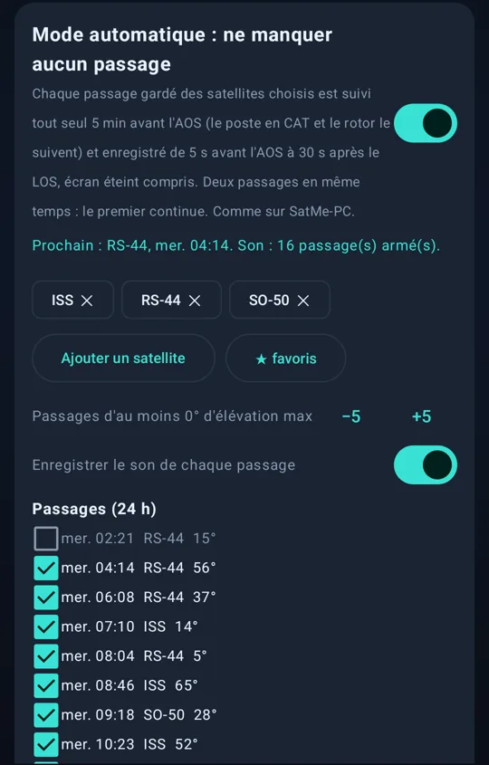
</p>

### SSTV campaigns: the auto-pilot

**Agenda › SSTV · auto-pilote** tab. An SSTV event — an ARISS series, a satellite sending pictures for a few days — is entered like an appointment: the satellite, its transmitter or a frequency of its own (FM or SSB, width), the SSTV mode (or *Auto*: the VIS header says it), the period (« horaire à confirmer »: whole days), the minimum elevation, the rhythm (« 36 s on / 2 min off », as a reminder), the link and notes.

- **Importer une affiche** (import a flyer): the announcement's picture (JPEG, PNG), or its address, is read on this PC by **tesseract** (`sudo apt install tesseract-ocr`); frequency, mode, dates, satellite, rhythm and link fill the form, to check before saving. Nothing is sent; an address is fetched only if you give one.
- **The campaign's receive chain**: a [Montage](#functions-and-profiles) profile, or box by box — the rig (CAT, Doppler), the rotator following the satellite, the sound (the rig's, IC-9700 over the network or USB card; a sound card; the SDR receiver; or leave it alone), the recording, the SSTV decoder held on the mode, the spoken announcement, the rotator parked after LOS. *Le connecter tout seul* (connect it by itself): the rig only over the IC-9700's network link or the Icom's own USB port, the rotator only through rotctld.
- **The auto-pilot** (master switch, off by default, also in the header): a few minutes before the AOS of each pass high enough it prepares the chain; it records from AOS to after LOS, attaches the pictures received to the campaign, then puts the reception back as it was. During the pass, a banner with **■ STOP**.
- **Receive only**: it never transmits and touches no transmit setting. A transmission under way, DATV holding the receiver, or another campaign at the same time: the pass is set aside and the reason noted in the **history**.
- The **🤖 passes** in the tab's list, in Suivi and on the timeline (Frise); the campaign in the **Ctrl+K** palette. Campaigns are kept on the PC (`sstv-campagnes.json`) and re-armed after a restart.

<p align="center"></p>

### Upcoming activities: the online sources

**Agenda › Activités à venir** tab. What satellites are about to send that SatMe decodes, from public sources: **ISS SSTV** (and other satellites), **ARISS school contacts** (FM voice), **SSDV**, **METEOR LRPT** pictures. Satellites only; never NOAA APT (all retired in 2025).

- **The sources**, each at its own pace: the **ARISS calendar** (public Google Calendar, every 6 h at most), **AMSAT-UK** and **AMSAT-F** news (RSS, every 6 h at most), **SatNOGS** for METEOR-M2-3 and M2-4 (twice a day: "seen recently on 137.900 MHz", an indication), **AMSAT reports** (every 30 min, only during an announced SSTV/SSDV). On by default; one master switch and one per source. A failing source says so quietly, with its last successful read; everything is kept on the PC (`activites-cache.json`) and the list stays available offline.
- **The list**, by day: satellite, type, period (local time and UTC), frequency, mode, rhythm, sources and links, and **your passes** during the activity with their maximum elevation (at least the minimum elevation from Settings). Two sources saying the same thing (15:10 here, 15:30 there) make one activity: the earliest start, the latest end, every source. *Announced*, *confirmed by reports* (AMSAT reports during the period) or *seen recently* (SatNOGS).
- **Notify**: a new activity (once; an ARISS contact only when it passes over here), before each useful pass (10 min before AOS by default) and "**on the air now**" when AMSAT reports come in; each one can be turned off. A banner at the bottom of the page and a count on the sub-tab.
- **Préparer la campagne SSTV** opens [Agenda › SSTV](#sstv-campaigns-the-auto-pilot) with the form filled (satellite, frequency, mode, period, rhythm, link); nothing is saved before "Enregistrer la campagne".

<p align="center">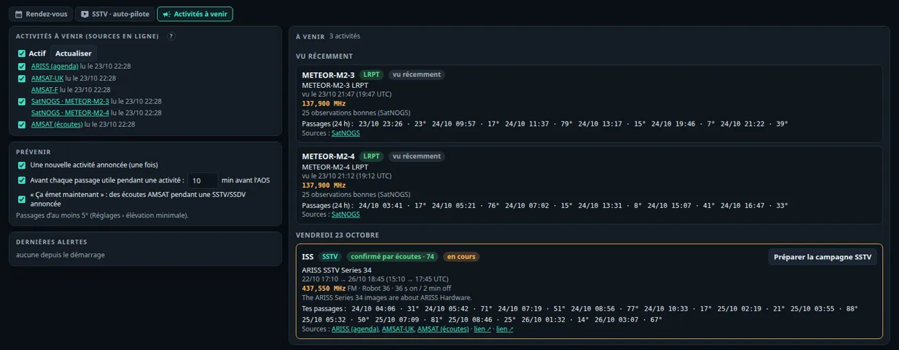</p>
### Recording the sound

- **● Record the sound** in Suivi, Carnet and Son: a WAV named after the satellite (`SatMe_RS-44_20261013_203051Z.wav`), as on the phone.
- **Stop at the end of the pass** (option): even started by hand, the recording stops 30 s after the LOS of the pass it caught.
- **Every pass of the satellite followed** (option in the Son tab), or those of the **automatic mode**.
- A recording stopped by hand does not start again by itself before the next pass.
- **A sound card being recorded keeps its decoders** when the SDR receiver starts: QO-100 switched on to listen is only heard, never recorded in its place (at the wrong rate). Otherwise the SDR gives back, when it stops, the sound card it borrowed: the IC-9700's sound no longer stays silent.

## The log (Carnet)

A contact is typed with the callsign predicted from your log and QRZ (Tab goes through the predictions, Enter confirms). Next to it, the station live: the satellite, its frequencies, the polar plot, the rotator, whether you are in the passband, the recording. The callsign's card: every past contact and its notes, the QRZ.com sheet (photo, distance, map). A forgotten contact is added after the pass, at its time. **Records** by satellite: the farthest contact of all, of each satellite, mode, continent and country, WAC.

- **CW decoder** (off unless ticked): the tone found by itself, the speed followed, the Doppler followed; callsigns, squares and reports lit, a callsign into the entry with a click.
- **Delete** a contact from its row (🗑), or tick several and delete them at once.
- **Wavelog's station locations**: "Read the profiles" shows where you are (your square, or both on a grid line) and the profile it goes to — chosen in the list, or **created** when Wavelog has none for it (DXCC, CQ and ITU zones asked). Each contact goes to the profile of where it was made from; a profile chosen by hand for another square is flagged.
- **Each new contact sent to Wavelog / Cloudlog by itself**, after a delay to choose (30 s to 30 min): the time to fix it or hold it back (⏸, countdown in the log). A contact the server refuses is held back with the reason. The phone has the same delay choice.
- **ADIF** export, and the deposit by hand (⬆).
- **Which satellite**: a contact is logged on the satellite chosen in the entry, else the rig's (the followed satellite, Doppler by CAT), QO-100 when the rig is on it or the contact is typed in the cockpit. A receiver listening to QO-100 in the background no longer switches the log. The entry says where it logs and why, with a one-click switch.
- **Correcting a contact**: the satellite (the list, QO-100, a free name, terrestrial), the **date and UTC time** (local time beside it, « maintenant »; not in the future, not before 1961). Azimuth, elevation, frequencies and the log's order follow; a duplicate (same call, same satellite, 10 min) is reported. The phone does the same.
- **Compound callsigns** (`EA3/M5JFS`, `DL1ABC/P`, `F/ON4ABC/P`): the country is the operating prefix's (EA3/M5JFS = M5JFS operating from Spain), with its **flag** in the list, the entry, the card and the editor. When QRZ has no record for the compound form, the card is the operator's, identity only (no square, position or address). A square taken from a record belongs to the callsign as typed (« F4IOZ/P » does not take « F4IOZ »'s square). **The map** follows the entry live: the square typed (an invalid square: no point), else the country's centre, fainter; a contact's editor has its own map.
- **⌖ on a contact's row**: its pass on the sky and the rotator's path as it went, taken from the journal (cyan: the satellite, yellow: the moment of the contact). The phone serves the same view.

<p align="center">


</p>

## SatMe on the phone

The log's **Import → SatMe sur le téléphone**:

- **By QR code**: the PC shows one; on the phone, *Settings → Share and listen → Share → Scan the PC's QR code*. The phone opens its control desk and the PC joins it by itself (same Wi-Fi). On Linux, the PC's firewall must let the page's port + 1 through (`8091` by default), for example `sudo ufw allow from 192.168.0.0/16 to any port 8091 proto tcp`.
- **Or by hand**, with the address and code the phone shows.
- The phone's passes are listed; those ticked come over with their **SSTV pictures**, their **recordings** (made WAV, the spoken header cut) and their **contacts** (added to the log unless already there).
- A **pass file (.zip)** made on the phone can also be dropped on the page.

<p align="center">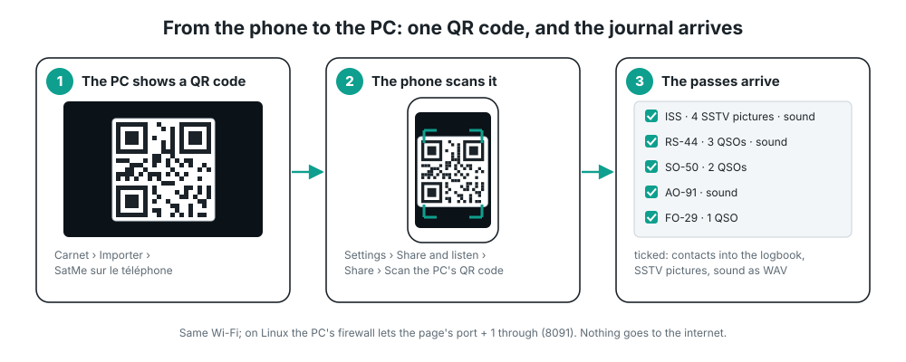</p>

<p align="center"></p>

## Pass journal

The phone's journal page, under the PC's tabs: passes listed (♪ when there is sound), replayed on the sky or the map with the S-meter, the frequency, the contacts and the pictures in their place. "Make": sound, picture, video, GIF or pass file. **The file's frame is drawn over the replay** (phone 3:4 or screen 16:9): what is inside the frame is what the file shows.

- **The whole pass** on the map: the predicted track dashed, the part followed solid — even when SatMe-PC was started mid-pass.
- **Each contact in its place, as in the video**: a dot on the track at the QSO's moment, with the callsign, and the station at its square, linked to it.
- **The video's SSTV picture, with the mouse**: on the replay, drag it to move it, pull its corner (or use the wheel) to size it (4:3, 15 to 90 % of the width); a dashed frame shows it on hover even when no picture is arriving. Kept by the station and used as is by the picture, the GIF and the video, in 16:9 as in 3:4. **Auto** puts it back in its original place: at the top, in the corner away from the satellite.
- **The S-meter** read through CAT (IC-9700, IC-9100, IC-910H, TS-2000), receiving only.
- **Add** a contact during the replay: paused, the time is the sound's; callsign predicted and QRZ, the satellite's mode and frequencies, RST (59 / 59 by default) and a comment; Enter confirms.
- **+ Passage**: a pass made from nothing — the satellite and its times, contacts, a sound, pictures.
- The pass's **Doppler / CAT log** (when kept, see [Réglages](#réglages-settings)) is linked from it.

### SSTV pictures and report elements

In **Make**, under the buttons, what is chosen for the pass — kept with it, used by the picture, the GIF, the video and the replay:

- **The pass's SSTV pictures**: the **pass's default version** — **Raw (as received)** at first (older videos do not change), **Auto (best mark)**, **Corrected**, **Fused** — then picture by picture (« as the pass », or a version that exists, each with its mark). A version chosen that has gone shows Auto, and says so (« missing: Auto shown »). **Make the fusion** when the slide has several copies and no fusion yet. **Mark corrected/fused** (unticked at first, as on the sheet) writes « corrected » or « N copies fused » on the processed picture.
- **Report elements** of the pass's SSTV event (the sheet's, found the same way): **Receive montage** (the plan that draws the pass's reception best, or the one chosen in **Montage plan**), **Slide grid** (this pass's slides framed), **Pass sky plot** (the pictures on the track), **Elevation profile** (the slides' slots), **SSTV figures** (slides this pass received/expected, best mark, slides of the series, pictures), **Event's sheet**, **SatMe logo**. Each an **overlay** (on the replay, placed with the mouse as the SSTV picture: drag, its corner or the wheel to size it, **Auto** for its own place) and/or a **card** (a frame of its own in the video and the GIF: the montage after the title, the others at the end). All unticked at first. Without an event, the grid, the figures and the sheet are not offered; the sky and the profile then come from the pass's own track.
- The pass's **Report** shows its SSTV pictures in the version chosen too.

### Pass report

**Rapport**, in a journal pass: the pass's observation report on one page.

- The header: AOS, TCA, LOS, maximum elevation, the station as drawn in the Montage, the Kp index of the moment.
- **The Doppler-followed waterfall**: from the pass's SigMF I/Q recording, or from the *Journal détaillé* (Réglages › Poste et rotor › Journal Doppler / CAT, off by default: the spectrum around the downlink kept during followed passes).
- The level and elevation timeline with decodes and contacts marked; the decodes (SSTV, APRS, telemetry, voice), the contacts, the sounds to play, a quality score.
- **Save** as one HTML file, or as a ZIP with its files; **Partager** only makes a local file. Nothing is uploaded.

<p align="center"></p>

<p align="center">


</p>

## QO-100: the cockpit

The **QO-100** tab is the narrow band transponder on one screen: the receiver, the decoder and the log entry side by side, the transponder's waterfall below.

1. **Démarrer la réception QO-100**: one click starts the receiver (SDR dongle, ADALM-PLUTO or bladeRF behind the LNB or a converter), puts it on QO-100 and sends its sound to the decoders and the log.
2. **Click a signal** in the waterfall: SatMe tunes it in its mode (SSB, CW, FT8, SSTV) and opens the right decoder in the dock — voice to text, CW, FT8 / FT4 or SSTV (*Auto*, or chosen by hand).
3. **Log the contact** on the right: satellite QO-100, frequencies and mode already filled in.
4. The **middle beacon** is the reference: with *Calage automatique* it is measured every 5 s and the LNB's drift followed by small steps, never on a weak measure — more closely when the LNB drifts fast (see [A drifting LNB](#a-drifting-lnb)).

- **Signal classifier**: each signal of the transponder named on the waterfall (SSB, CW, FT8, FT4, PSK31, RTTY, SSTV, carrier, beacons, wide digital, unknown), coloured by class with its confidence; one FFT of 16 Hz bins over the receiver's raw stream, combs of spurious lines and key clicks left out, signals forgotten once gone. It runs only while the page looks at it.
- **Band plan** (AMSAT-DL's) on the ruler and atop the waterfall, each segment's rule on hover. **Emergency frequency** (10 489.858 – 10 489.865): red outline and banner; SatMe never sends the uplink there to the rig by itself (a memory, a signal clicked, a DATV talkback, a restored session) — only when tuned by hand. The FT8 free spot is offered only in the digital segments; a mode out of its segment gets a discreet hint.
- **LEILA**: when the ground station's siren is heard (the listened station is stronger than the beacons and must lower its power), a red **⚠ LEILA** shows under the downlink for 10 s.
- **Multiple decoders** (**Multiples** button, off by default): up to **4 channels** taken from what the receiver sees, each with its decoder (FT8, FT4, CW, SSTV, voice, or plain listening; one SSTV and one voice at most). Presets « FT8 + CW + phonie » and « FT8 + FT4 »; right-click (or Shift + click) on a waterfall signal: « Ajouter un décodeur ici ». The sound stays the main tuning's, except the channel ticked 🔈; a click on a channel's frequency tunes the main receiver there. About 1 % of a core per channel.
- **PSK31 and RTTY**: two more decoders (the decoder's *PSK31 / RTTY* tab, or a *Multiple decoders* channel). PSK31: varicode, ±50 Hz AFC, quality squelch, S/N and idle IMD. RTTY: ITA2, 45.45 / 50 / 75 Bd, 170 / 425 / 850 Hz shift, reverse. Time-stamped lines, callsigns lit, copy and save; a PSK31 or RTTY label on the waterfall opens them.
- **Affichage** (the waterfall's palette, contrast and brightness, memory flags), **Mémoires**, **Mesures** and **sound cleaning**, as in the SDR tab (see [The SDR receiver](#the-sdr-receiver)); the memories made here carry the « QO-100 » tag.
- **Resume after a restart**: a banner offers to take QO-100 back where it was (receiver, frequency, mode); *Réglages › Satellites › QO-100* does it by itself at start. Reception only: nothing is ever transmitted.
- **Balise** (sub-tab): the middle beacon's telemetry decoded — 400 bit/s BPSK, Manchester, differential coding; its coded frames (256 bytes in 13 s: rate 1/2 K=7 convolutional code, two RS(160,128), scrambling, 80 × 65 interleaving and distributed sync, the coded format proposed for AO-40) and its uncoded 512-byte blocks (sync 39 15 ED 30, CRC). « Décoder la balise » puts a *Multiple decoders* channel on 10 489.7485 MHz; each frame gives its corrected bytes, wrong symbols and S/N, the text or the raw bytes. « Essai » runs a made-up signal through the same decoder. Frames are kept on the PC (`telemesure/`), nothing is uploaded.
- Sub-tabs: **Calage** (beacon calibration, by hand or automatic), **Qualité** (beacon over noise, offset, the LNB's error and drift over the hour, noise floor, a day's curve), **Balise**, **Mémoires**, **Poste & chaîne** (converters), **Pointage**.

<p align="center">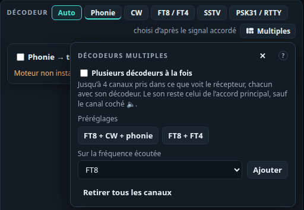</p>

<p align="center">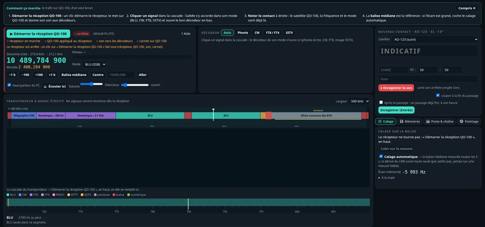</p>

### A drifting LNB

An LNB without an external reference moves with temperature: a few hertz per second after power-up or in the sun, sometimes jumps of ±25 Hz within a second. FT8's tones are 6.25 Hz apart: such an LNB is enough to decode nothing. SatMe-PC does three things, all receive-only:

- **Calibration that follows**: when *Calage automatique* sees a real drift (over 1 Hz/s, beyond three standard errors), the beacon is measured every second and the error taken from the straight line through the last 30 seconds rather than from a mean. After a step, only measures made since count. While FT8 or FT4 decode the receiver's sound, steps fall only in the last second of a slot, between two transmissions.
- **Verrouillage sur la balise** (beacon lock; *Calage* sub-tab, off by default): the middle beacon followed by a phase loop in the raw I/Q stream; its jumps are taken out of the whole transponder, continuously, smoothly, while the calibration keeps the slow error. The correction is bounded (±250 Hz) and checks itself: hitting the bound or too restless a correction lets go for 30 s; a calibration step searches again at once, the correction kept. Status: *balise cherchée* (searching), or *tient · N Hz rms ôtés* (holding, N Hz rms removed).
- **FT8 tolerating drift**: a slot's shared drift (up to ±15 Hz/s) is found from the sync arrays, then taken out before a second reading.

On slots made as live (beacon at 17 dB, 12 Hz rms jitter, 5 to 7 Hz/s drift), FT8 goes from 0 to 4 or 5 decodes out of 5. This **mitigates** the problem without solving it: the lock needs a beacon well above the noise, and an LNB that jumps faster than the loop is still an LNB that jumps. **The real answer is an LNB held by a reference.**

<p align="center">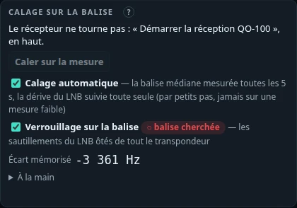</p>

### LNB and GPSDO reference

An LNB whose oscillator is locked to a GPS-held reference no longer drifts: no more running calibration, FT8 and DATV at peace. The plan for F4IOZ's station, which the [Montage](#drawing-and-editing) can draw (catalogue: Twin LNB with external 25 MHz reference, programmable Leo Bodnar GPSDO, injector, DC block):

- a **Twin LNB** whose PLL takes an external **25 MHz** reference;
- that 25 MHz from a **Leo Bodnar GPSDO**, cabled to the LNB's PLL;
- one output to the **MiniTiouner** (DATV), which powers the LNB with **18 V**;
- the other to the **bladeRF 2.0** (narrow band) through a **DC-blocking injector**: the LNB supply never reaches the bladeRF's input.

Beacon calibration stays useful for the fixed offset; the lock can then stay off.

## DATV: reception

The **DATV** tab receives DVB-S / DVB-S2 on QO-100's wide band (or any frequency the receiver covers). The picture is sized to the window, with the lock, MER, MODCOD, the **margin** and its verdict, and the station's card beside it; **Réception**, **Émission**, **Qualité** and **Sous-titres** are sub-tabs.

<p align="center"></p>

**Three receivers**, chosen in the Réception card:

- **MiniTiouner** (tuner and demodulator on USB), driven by [LongMynd](https://github.com/BritishAmateurTelevisionClub/longmynd), BATC's free program. SatMe runs it apart, as it runs rtl_tcp: build it, then give its path on the page (or put it in the `PATH`). Its **LNB supply stays off** unless chosen (13 V or 18 V), with a warning. On Linux a udev rule lets LongMynd open it — LongMynd's own file misses the Pro TS2 (USB name `MiniTiouner_Pro_TS2`); this one covers them all, then unplug and plug it in again:

  ```
  echo 'SUBSYSTEMS=="usb", ATTRS{idVendor}=="0403", ATTRS{idProduct}=="6010", ATTRS{product}=="MiniTiouner*", MODE:="0666"' | sudo tee /etc/udev/rules.d/60-satme-minitiouner.rules
  sudo udevadm control --reload-rules && sudo udevadm trigger
  ```

  Plugged in, the MiniTiouner also shows as two serial ports (`/dev/ttyUSB…`): never choose them as the rig's or the rotator's port.
- **ADALM-PLUTO** or **bladeRF 2.0** with **SatMe's own DVB-S2 demodulator** (written from ETSI EN 302 307-1): carrier search on the spectrum, matched filter with clock recovery, PLHEADER search, carrier recovery on pilots or by decision, LDPC and BCH decoding, transport packets checked. QPSK and 8PSK, normal and short frames, with or without pilots. The SDR tab lends its board for the time of the reception and takes it back after; a board receiving DATV is refused to the transmitters. Lock is given up after 8 failed frames in a row.
- **A SatMe-Node** next to the antenna (below).

**What the tab shows**: the beacon (10491.5 MHz, 1.5 MS/s), the narrow channels, 125 to 2000 kS/s; the LNB's oscillator (9750 MHz by default) and **Caler sur le signal** to correct it on the beacon; lock (DVB-S / DVB-S2), MER, MODCOD, carrier and offset, service and provider, the constellation live. The picture in the page (H.264 or H.265, the players restarted when a station changes its coding), the sound on the PC, the same stream in **VLC**, and **recording** to a `.ts` file.

### SatMe-Node: the receiver next to the antenna

The MiniTiouner works best close to the LNB. A **SatMe-Node** is SatMe on a small computer there — a Raspberry Pi (a **Pi 3 is enough** for the MiniTiouner: the node only receives) — driven over the network by SatMe-PC and by the phone (**QO-100** screen → **DATV**: the same controls, the picture through the phone's own decoder, full screen with a touch; the wide band's stations, chosen with a touch, when the ground station's spectrum is ticked). It runs LongMynd, or SatMe's DVB-S2 demodulator with a Pluto or a bladeRF; its status and the transport stream (0.3 to 2 Mbit/s) come to the PC, which shows, plays and records them as if the receiver were plugged into it. The phone and SatMe-PC take from the node its calibrated oscillator, its input and the **LNB supply** in use: changing station, from either, no longer cuts the LNB the node feeds; a restarted SatMe-PC finds a receiving node by itself.

Installing it on the Pi: [Installing SatMe-Node on a Raspberry Pi](installer-satme-node.md) — three commands, about ten minutes on a Pi 3. The script installs Java, builds LongMynd, lets it open the MiniTiouner (udev), and starts the **satme-noeud** service (`satme --noeud`, port 8090). At its first start the node draws a **six-digit code**, shown at the end of the installation (again: `journalctl -u satme-noeud | grep Code`). In SatMe-PC, DATV tab, **Changer**: the node's address and its code, **Associer**. The PC keeps the key the node gave: either can restart. An empty address goes back to the receiver on the PC. Without its key the node only says what it is; its LNB supply stays off unless chosen.

### SatMe-Node: its SDR, its transmitter, its health

The node is not only for DATV. Suggested wiring, with a **twin-output LNB**:

- **output 1 → MiniTiouner**, which powers the LNB with **18 V** (**horizontal** polarisation, wide-band DATV);
- **output 2 → a bias tee (DC block on the board side) → bladeRF**: the tee powers that output with **13 V** (**vertical**, the narrow band), the board only gets the RF;
- the **bladeRF on a USB 3 port** (blue) of a **Raspberry Pi 4 or 5**; a Pluto can replace it, and/or transmit.

Montage proposes this wiring as soon as a joined node reports a MiniTiouner and an SDR.

<p align="center">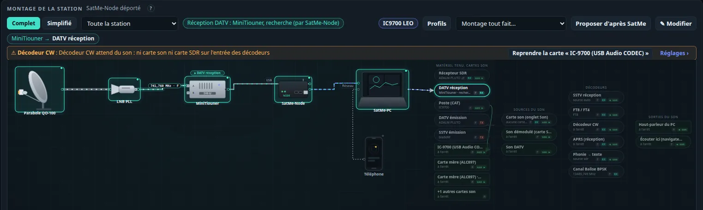</p>

**The node's SDR as this PC's receiver.** On the node's page (opened on the node), Station › SatMe-Node, or in SatMe-PC's SDR tab: the board lent as the SDR (bladeRF or Pluto), independent of the DATV one — MiniTiouner and bladeRF receive at the same time. In the SDR tab, receiver **« SDR du SatMe-Node »**: it works everywhere a board plugged in here does (QO-100 cockpit, waterfall, FT8, beacon calibration and lock, recording). The node tunes its board as the PC asks (frequency, gain, correction), brings the stream down to the chosen rate in half-band steps (1.0584 MS/s: the whole narrow-band transponder, about 34 Mbit/s, a cable is advised; 529 or 265 kS/s for a slow network), and sends it over **one connection**: a header (rate, centre, format), numbered and timestamped frames (lost frames are counted). Network gone: the reception waits, says why, and resumes by itself.

**The node's transmitter.** Station › SatMe-Node › **« Émettre par le SatMe-Node »** (off by default): DATV and SSTV (FM or SSB) transmissions go out through the node's transmitter (Pluto or bladeRF, the same kind as the transmitter chosen here). SatMe-PC modulates as usual and applies **all** its rules (confirmation, callsign, bands, duration, ceiling, beacon loop); the node adds its own:

- **« émission autorisée sur ce node »**, off by default, can be ticked **only on the node itself** (its page opened on the Raspberry Pi, or through a tunnel `ssh -L 18090:localhost:8090 pi@node` then `http://localhost:18090`); unticking it stops a transmission at once; choosing another transmitter board from SatMe-PC unticks it too;
- its bands (144–146, 430–440, 1240–1300, 2300–2450 MHz), its maximum duration and its own gain ceiling;
- a **watchdog**: nothing from SatMe-PC for 1.5 s (samples or « still there »), or the connection closed, and the transmission stops;
- never a board that is already receiving (lent SDR, DATV).

**One controller for transmitting.** This PC's page, the same page opened from another machine (remote mode, password), later the phone: all go through SatMe-PC's same routes and rules. One client holds the transmission at a time; everyone sees who, since when, what (the header's TX light); **STOP** is always possible from anywhere. Only the holding client's « still there » counts: from **another machine**, a link lost for more than **2 s** stops the transmission, and the session's first transmission asks for one more confirmation.

**Its page.** Station › **SatMe-Node** (also the Suivi tab's small card, the status bar's **Node** chip and Ctrl+K) reads the node every 3 s: the Pi's temperature and throttling (`vcgencmd`), load, memory, microSD free space, network and I/Q stream throughput, USB boards and their speed (a bladeRF on USB 2 is flagged), each service's state and client, the last log lines, its version against this SatMe-PC's (with the update commands when the node is older). There too: each board's **role** (DATV receiver, SDR receiver, transmitter — one board never receives and transmits at once), « Utiliser comme récepteur SDR », and stopping a service, stopping the node's transmission, or **restarting SatMe on the node** (only when its systemd service restarts it; the Pi itself stays up).

<p align="center"></p>

**Restarting or switching off the Pi.** Services › **Redémarrer le Pi** / **Éteindre le Pi**, each after a confirmation saying what stops. The node first stops everything — the transmission (if it transmits, the dialog offers to stop it; otherwise it refuses), DATV reception (LongMynd, and the LNB supply), the SDR stream, boards let go —, writes its settings, answers, then runs `systemctl reboot` or `poweroff`. After a restart the page shows « redémarrage… », finds the node again by itself and says when it is back (after 3 min it warns: power, network). Switched off, it is shown **éteint**, with no alarm, read every 30 s only: it can only be switched on again **on site** (power removed and restored). Only for a node run by its systemd service, with the right the installer gives it (`/etc/sudoers.d/satme-noeud`, those two commands only); without it the page says to run the installer again. Also on the node's own page opened on the Pi; never on the page served by the phone.

**The phone, next.** It will go through SatMe-PC (its remote mode), not straight to the node: one set of transmit rules, one controller, the 2 s watchdog. The node only takes one transmit client at a time and keeps its own guards. These routes answer harmlessly when the phone serves the page.

### The wide band at a glance

*Spectre de la bande large — station sol, par Internet (pas ma réception)*, off by default: the QO-100 ground station's public spectrum of the wide band (10490.5 – 10499.5 MHz, 4 frames a second), read over the Internet while the option is on and the tab open. **It is not what your own dish receives**: carriers show there even with the dish mis-pointed.

- **My reception over it**, in purple (legend *Station sol (Internet)* / *Ma réception (MiniTiouner)*): the MiniTiouner gives no spectrum, only its state and MER where it listens. Locked, a bar at the frequency and width found, as high above the noise as its MER (≈ C/N, drawn as (C+N)/N on the ground station's dB scale); searching or stopped, hatching « nothing received here ». One line compares both, e.g. « Balise : +8,2 dB à la station sol · chez moi : MER 5,9 dB (seuil QPSK 4/5 4,7 dB) » or « chez moi : rien (recherche) — la balise est là : vérifier pointage / polarisation / LNB ». The phone (DATV screen) shows the same.

- The **signals found**, each with its width rounded to the nearest symbol rate, its level against the beacon, and the station's **name** once read (service name, station card or callsign in the picture; kept 24 h for that frequency and rate).
- **Click a signal**: the MiniTiouner tunes to it (same oscillator, same input).
- **Veille**: the occupied channels in turn, held while locked, an optional recording named after the station; any tuning by hand stops it.
- **In the QO-100 cockpit too**: *Bande large DATV — station sol, par Internet*, off by default, shows the same band under the narrow transponder; a click on a signal tunes the DATV receiver. The connection stays open only while one of the two tabs shows it.

<p align="center">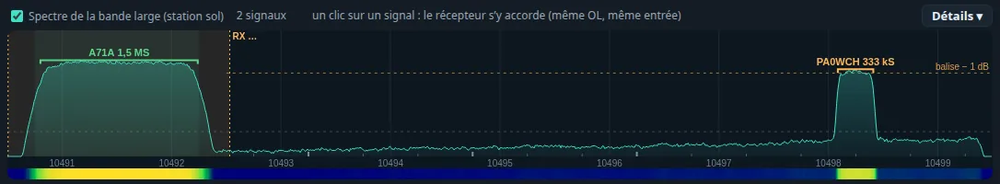</p>

### Sound, chat and tuning by UDP

Each off until chosen in the Réception card.

- **Vumètre et volume**: the sound is decoded by SatMe (ffmpeg to 48 kHz stereo PCM) instead of ffplay, played on the PC's sound output at the chosen volume (0 to 200 %, applied at once), its left and right levels (« M » when both channels are the same) with the peak held 1.5 s. **Écouter ici** › *Son DATV* also sends it to the browser, with its own volume.
- **Salon de la bande large**: the ground station's public chat (BATC), read only until you write: nothing is sent without a click on **Envoyer**, the nick is the station's callsign (set just before the first message), one message every 3 s at most; without a callsign it stays read only. **Rapport** writes the usual reception report into the box (« SigReport: callsign - D margin (MER dB) - rate Ks - frequency »), to read over and send. No online DATV reception report service is reachable today: the page says so (« service indisponible ») and nothing else is sent.
- **Accord par UDP**: another program asks for a tuning by a text datagram, on the chosen port (9997 by default), from this PC only — or from the local network, when SatMe-PC runs with `--reseau` and the box is ticked. Receive only: nothing is ever answered nor transmitted, the LNB supply stays as it is, one request every 2 s at most (10 a minute), the same one asked again while receiving restarts nothing. Two formats:

  ```
  FREQ=10494750;SR=1500;OL=9750000;ENTREE=A
  [GlobalMsg],Freq=10491500,Offset=9750000,Srate=1500,FPlug=A
  ```

  The first: the sky frequency in kHz (or in MHz with a point: `FREQ=10494.75`), the symbol rate in kS/s, the LNB's oscillator in kHz and the input A or B optional (kept otherwise). The second, common among DATV tools: Freq in kHz, Offset the oscillator in kHz (0: Freq is already the intermediate frequency), Srate in kS/s; its other keys (supply, 22 kHz…) are ignored. For example: `echo -n 'FREQ=10494750;SR=333' | nc -u -w1 127.0.0.1 9997`.

### Reception quality

The **Qualité** sub-tab says whether the picture is good and why:

- **The margin**, big and coloured: the MER against the MODCOD's quasi-error-free threshold (EN 302 307-1), with a plain verdict ("Image parfaite"…).
- Tiles: packets received against expected (from the PCR), continuity errors and missing packets, transport errors and sync losses, error correction (LDPC, BCH), whole DVB-S2 frames lost, the video and audio decoders' errors, the tables seen (PAT, PMT, SDT, PCR) and the stream's null share.
- Four curves over 2 minutes (MER, margin, packets, continuity errors), the PIDs table, the constellation. When the receiver holds our own transmission, packets sent against received.

<p align="center">
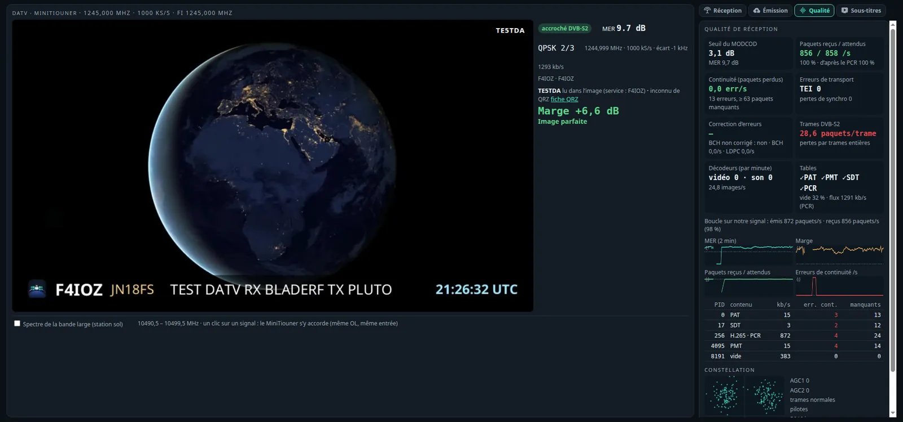

</p>

### Subtitles and callsigns in the picture

Both off unless chosen in the DATV tab.

- **Sous-titres**: the received sound (its first audio track, decoded by ffmpeg) goes to [voice to text](#voice-to-text-phonie--texte); the last two overs over the picture with the language's flag and the translation, the history in the sub-tab, callsign chips filling the log in mode DATV.
- **Callsigns read in the picture**: every 3 s while locked, the latest frame read by **tesseract** (`sudo apt install tesseract-ocr`); a callsign is shown once read twice, look-alike signs repaired (A/4, O/0…), checked against the service name, the station card and the log. Its **QRZ.com record** (name, town, country, square with distance and bearing, LoTW / eQSL, photo) is looked up by SatMe-PC, kept 7 days, at most one request every 5 s. Only what was read since the current lock is shown.
- **Noter le QSO**: QO-100 or *DATV terrestre* by the frequency received, mode DATV (ATV in ADIF), the MER as report, name and QTH from QRZ when blank.

## DATV: transmission

The DATV tab's **Émission** sub-tab sends a DVB-S2 (or DVB-S) signal to QO-100's wide band transponder with an **ADALM-PLUTO** or a **bladeRF 2.0** (a **HackRF One** only for indoor and dummy-load tests). SatMe makes the DVB-S2 itself (EN 302 307-1: QPSK at every rate, 8PSK 3/5 to 9/10, normal or short frames, pilots, roll-off 0.35 / 0.25 / 0.20); **ffmpeg** makes the picture into a transport stream at exactly the rate the MODCOD carries (`-muxrate`, null packets filling it), H.264 or H.265, the service's name and provider being the station's callsign.

- **Standard**: DVB-S2, or **DVB-S** (EN 300 421: energy dispersal, RS(204,188), I=12 interleaver, K=7 code punctured 1/2 to 7/8, QPSK) for receivers that read only that. Same station card; MODCOD adaptation stays DVB-S2.
- **The picture**: SatMe's test card with the callsign, an **animated test card** (a moving picture over the bars, a beep each second), a still image, a **video file looped**, or a camera (`/dev/video…`, listed only until a transmission starts).
- **Parcourir…**: the PC's folders (home, removable media, SatMe's `datv-sources`), read only, with thumbnails; files sent from the browser (500 MB at most) are kept in `datv-sources`. **Prévisualiser** makes one picture with the same command, nothing transmitted.
- **Overlay** (off by default): callsign, locator, a free line, the UTC time and the SatMe mark, in a corner or a strip, over the picture.
- **Émis | Reçu**: while transmitting, the picture sent is shown beside the picture received back from QO-100 (one under the other on a narrow screen), whichever sub-tab is open; under the first the MODCOD, frequency and rate, under the second the lock, the MER and whether it is our own signal. The picture sent is decoded by SatMe-PC, at a low priority, from a copy of the stream going to the modulator (5 small pictures a second, only while a page looks at it): nothing more is transmitted, the stream sent never waits. With the UTC time overlaid, the gap between the two clocks is the round trip's delay. The title's button separates or joins them. Reception only: nothing changes.
- **Enlarge**: ⛶ at the bottom right of each picture, or a double click; ⛶, a double click or Esc to come back (Esc also stops every transmission, as everywhere on the page). Not transmitting, the browser's full screen; while transmitting, the picture fills the window with an **ARRÊT** button (the browser's full screen would keep Esc for itself).
- **Adapter le MODCOD à la réception** (off by default): while our own signal is received back (service or station card in our callsign), the most efficient MODCOD of the allowed range whose threshold stays 2 dB under the MER is chosen — down quickly when the margin falls or packets are lost, up slowly after 20 s of spare margin, 8 s after each change for the receiver to relock, the most robust one if the loop is lost. Frequency, symbol rate and power are never touched; a lower power is suggested on QO-100, never applied.

<p align="center"></p>

**The station.** PC —USB— Pluto **TX** port → band-pass filter → power amplifier → feed (2.4 GHz uplink). Reception check: dish, LNB → MiniTiouner (*Réception*). A board transmitting does not receive (the SDR tab refuses it), and the other way round; DATV and SSTV transmissions exclude each other.

| kS/s | samples per symbol | Pluto rate |
|---|---|---|
| 125 | 17 | 2.125 MS/s |
| 250 | 9 | 2.25 MS/s |
| 333 | 7 | 2.331 MS/s |
| 500 | 5 | 2.5 MS/s |
| 1000 | 3 | 3 MS/s |
| 1500 / 2000 | 2 | 3 / 4 MS/s |

The bladeRF keeps at least 4 samples per symbol. A symbol rate or MODCOD not offered is refused, never silently replaced.

**First test: into a load, never into the antenna.** Pluto TX → 30 dB attenuator (or more) → MiniTiouner input (its tuner covers 2.4 GHz directly: *Ciel* = the uplink frequency, LNB oscillator 0, LNB supply **off**). Tick *Test sur charge* (any frequency, gain held at −40 dB or below, a red warning), choose 333 kS/s QPSK 2/3, **ÉMETTRE**, confirm: the MiniTiouner should lock on DVB-S2 with the callsign as service and the test card as picture. Only then the amplifier and the dish.

**The rules, built in.**
- Only on the operator's action: **ÉMETTRE** then a confirmation; never at startup, never taken back from the settings (only the parameters are kept).
- A **callsign** (Réglages › Ma station) before anything is sent.
- On the air, the whole occupied band (Rs × (1 + α)) between **2403.000 and 2410.000 MHz** uplink: clear of the beacon (uplink 2402.0 MHz, its band ending near 2402.9 MHz), up to the band plan's last channel (10499.25 MHz down, 2409.75 MHz up). The channel list is the band plan's; the one the MiniTiouner holds is marked busy.
- **Duration** 10 min by default, 30 min at most, then it stops by itself.
- It stops by itself when the board stops taking samples or is pulled out, when the samples come late too often, when ffmpeg stops, when the page has been silent for 15 s (closed tab, lost network), and when SatMe-PC closes.
- At every stop the Pluto's **TX oscillator is powered down first**; at the start it stays down until the first samples are in. Should the Pluto be unreachable at that moment, the page says so: unplug it.
- **TX gain** (an attenuation, 0 dB = full power): Pluto −30 dB by default, bladeRF −50 dB, never above the maximum set in Réglages (−10 dB by default).
- **Closed loop**: the receiver's MER on our own signal against the beacon's (measured with *Balise* beforehand): if we are not at least 1 dB under the beacon, a warning, and the gain is stepped down 1 dB every 5 s until we are. It never steps it up.

**Réglages › Poste et rotor › ADALM-PLUTO**: the maximum TX gain, and *Couper l'oscillateur d'émission du Pluto quand SatMe s'en sert en réception* (off by default). A Pluto switched on leaves its TX oscillator running (2450 MHz by default): ticked, SatMe powers it down each time it starts receiving with the Pluto.

### The indoor test

*Essai en intérieur* (Pluto, bladeRF or HackRF): two small antennas a few metres apart, indoors, to see the whole chain work before any dish.

- A real radio emission: for a **licensed radio amateur**, under the callsign (service name and test card), with an orange warning in the card.
- Only in amateur bands the MiniTiouner covers, the **whole occupied band inside**: 23 cm **1240–1300 MHz** or 13 cm **2300–2450 MHz**. 1255 MHz by default; 1260–1300 MHz is shared with radionavigation satellites and 2400–2450 MHz with Wi-Fi (the card says so).
- **Minimum power**: Pluto and bladeRF at −40 dB at most; the HackRF with its amplifier off and VGA ≤ 20 dB.
- **5 min** by default, **10 min** at most, then it stops by itself. The QO-100 closed loop is not used.

**The receiving side.** The card gives the MiniTiouner's settings for the test: *Ciel* = the transmit frequency, LNB oscillator **0**, the same symbol rate, LNB supply **off** — *Régler la réception* fills them in (without starting). With an antenna on the MiniTiouner's input the LNB supply **must be off**, or its 13/18 V go into the antenna. A Pluto or bladeRF can receive instead, with SatMe's demodulator.

**First indoor test, step by step.** Callsign set (Réglages › Ma station). HackRF (or Pluto) TX → small 23 cm antenna; receiver input → another small antenna, 2–3 m away. Card: *Émetteur* HackRF One, *Détecter*; tick *Essai en intérieur*, 1255 MHz, 333 kS/s, QPSK 2/3, test card, VGA 0 dB (Pluto: −40 dB or lower), 5 min. *Régler la réception*, then *Recevoir* in the Réception card (LNB supply off). **ÉMETTRE**, confirm: the receiver should lock on DVB-S2, the callsign as service. No lock: raise the VGA a few dB, or bring the antennas closer.

### Station card and chat in the stream

While transmitting, SatMe slips a **station card** into the transport stream, and the **chat** typed in the Émission card (a line of 140 characters at most, one every 2 s; typing never transmits: the chat only rides on a transmission already started). They take the place of null packets: the rate is unchanged, so are the picture and sound, and a receiver that does not know them ignores them. On reception the DATV tab shows the received station's card (flag, locator, distance and bearing, message, software; marked when it is already in the log), its chat lines as bubbles, and **Noter le QSO**. Receiving one's own signal ticks one's lines *✓✓ reçu*. The card is switched off under *Carte de visite dans le flux*.

**Talkback on the narrow band.** The Émission card also announces where the station listens for answers on the narrow band transponder (*Retour NB*, MHz, SSB or CW): by default the QO-100 cockpit's frequency when the rig is there. On reception the station's card shows « Retour en BLU : 10 489,xxx » and **Écouter le retour**: the QO-100 cockpit opens, the narrow band receiver tunes there and voice to text is switched on when installed. A talkback announced on the emergency frequency is flagged, never tuned by itself.

**The format**, for anyone who wants to read or send it:

- **PID 0x1F00**, MPEG private sections (ISO/IEC 13818-1, long form: `section_syntax_indicator` 1, `private_indicator` 1, MPEG-2 CRC-32 at the end); one section per group of packets, the first with `payload_unit_start` and `pointer_field` 0, the last padded with 0xFF. The PMT is left unchanged.
- **table_id 0xE5: card** (`table_id_extension` 0, `version_number` changes with the content), repeated every 2 s. **table_id 0xE6: chat line** (`table_id_extension` = 16-bit sequence number), sent 5 times 1 s apart; the receiver drops duplicates by callsign and sequence.
- Payload: `SATM`, a format byte (1), then TLV fields (1-byte tag, 1-byte length, UTF-8 value of 255 bytes at most). Tags: 0x01 callsign (required), 0x02 locator, 0x03 name, 0x04 QTH, 0x05 power, 0x06 antenna, 0x07 software, 0x08 transmit frequency (kHz, in digits), 0x09 MODCOD, 0x0A symbol rate (kS/s), 0x0B message, 0x0C talkback frequency on QO-100's narrow band transponder (downlink in Hz, in digits), 0x0D its mode (`USB` or `CW`), 0x20 chat text. An unknown tag is skipped; a format byte ≥ 0x80 announces an incompatible layout: the section is ignored.

## SSTV

The **SSTV** tab, as on the phone: the **live picture** (drawn at its true size from the first line, the lines to come dark, the arriving one marked), the decoder's state and a TX shortcut stay in view; **Réception**, **Émission**, **Mire**, **Images** and **Réglages** are sub-tabs.

<p align="center"></p>

**Reception**

- **Source**: *auto* (the SDR while it plays, else the sound card), the sound card, or the SDR heard directly.
- **Mode**: *Auto (VIS)* or forced; **continuous decoding** starts a picture on its sync pulses even without a header (mode found from the line length); **Caler maintenant** hooks the picture on the next sync pulse.
- **Automatic tuning** (off by default): the tones' offset measured on the header (read over ±1 kHz) and the sync pulses, and the receiver nudged — the SDR, or the rig while the CAT loop drives it — by 20 Hz a second at most, up to ±2 kHz.
- A spectrum with the tones marked (1200 sync, 1500 black, 1900 VIS, 2300 white), the level, a hint when the source is silent.
- **Images**: every picture kept from an eighth of its lines, with its own sound; filtered by satellite, opened in a viewer, decoded again, made into a GIF, deleted. Sorted **by slide** (or by reception) — see [Pictures by slide, marks and the series' timetable](#pictures-by-slide-marks-and-the-series-timetable).
- **Mire**: the SSTV test card (as on the phone), played on a chosen output or written to WAV.
- **Campaigns**: an ARISS series, or a satellite sending pictures for a few days, received by itself pass after pass — see [SSTV campaigns: the auto-pilot](#sstv-campaigns-the-auto-pilot); the series announced online show up in [Upcoming activities](#upcoming-activities-the-online-sources). ISS SSTV is on **437.550 MHz FM in Robot 36** since the 2026 series.

**Transmission** (*Émission*), with the **ADALM-PLUTO** or the **bladeRF 2.0**:

- The picture: SatMe's test card with the callsign, the SSTV sheet, or an image file; any mode, sent 1 to 3 times, the **callsign written across the top** of the picture, and in CW at the end if asked.
- **Modulation**: narrow FM (±2.5 or ±5 kHz, pre-emphasis optional), USB or LSB.
- **Rules, built in**: **ÉMETTRE** then a confirmation; a callsign; the whole occupied band inside an amateur band (144–146, 430–440, 1240–1300, 2300–2450 MHz); the satellite sub-bands (145.8–146, 435–438, 1260–1270 MHz) only with *Vers un satellite* ticked; **never 145.800 MHz** (ISS); QO-100's narrow band in USB only, inside its digital (2.7 kHz) or mixed segment — never the emergency or the beacons, and never louder than the beacon (a closed loop on the beacon when SatMe hears its own downlink). 15 min at most; it stops by itself once the picture is sent, or when the page goes silent. *Test sur charge* and *Essai en intérieur* as for DATV (−40 dB, 5 min indoors).
- **Régler la réception** sets the SDR tab's receiver on our own transmission (frequency, NFM or USB / LSB) to watch it come back.

### Pictures by slide, marks and the series' timetable

An ARISS series sends its 12 slides round and round for days: a week of passes gives dozens of copies of each. The **Images** sub-tab sorts them (**par diapo**, or **par réception** as before; on the phone and the page it serves too):

- **Copies of one slide together**: « Diapo 7/12 · 5 réceptions », the best first, a click unfolds the group. Pictures are compared small (32×48 cells of brightness and colour), on the rows sound in both, the dark sky every slide of a series shares left aside, with a slight shift sideways and any shift up or down (a picture begun late, without its header, is the lower part of the slide at the top); a picture cut short is compared on what it has. On the 43 pictures of series 34 (23–24 October 2026): no slide mixed with another; only four pictures almost wholly destroyed stay alone.
- **A mark from 0 to 100** on each picture (badge, stars in the heading): 100, less the share of rows missing (picture stopped early), less 1.1 × the share of rows spoilt (pixels unlike their neighbours — the green speckle of a weak FM signal in Robot 36 —, green bands, rows unrelated to their neighbours, horizontal streaks), less 4 per sync slip (20 at most); in a group, a picture begun late also loses the share of its top it lacks. A starry background (one-pixel dots) costs a clean picture a few points.
- **The slide's number**: read at the bottom of ARISS slides (« SLIDE n/12 » of series 34, compared with the digits seen on its real pictures — no OCR, the letters are 9 pixels high); 34 pictures read right out of 43, none wrong, the most spoilt not read; numbers 5 and 6 have no pattern yet (not received) and are never read, like a number clearly like none: the hand or the timetable gives it. Another series (another footer): nothing is read. A number set by hand (viewer: *Diapo*, or the series' card) holds for the whole group.
- **By hand**: the viewer puts the picture *with* another group, *on its own*, or back to the *automatic sorting*; this and the number are kept in the picture's sidecar (`slide=` and `group=` lines, which older versions ignore).

**The « Diapos de la série » card** (during a series announced in [Upcoming activities](#upcoming-activities-the-online-sources), or an Agenda campaign, and three days after):

- the slides received (green, ≈ when the number is estimated) and those missing (red);
- **the timetable**: the slides go round in order, one every 36 s + 2 min (156 s announced); each numbered picture is an anchor (its reception time less the picture's length), the period fitted by least squares, the mean error shown. An anchor far off the line (over 40 s) is a restart of the loop on board: the timetable starts again from there (the period still fitted on all), a lone wrong anchor is left out. Series 34: **158.97 s ± 0.03**, 35 anchors, mean error 7.4 s, two restarts seen (23/10 about 07:45 UTC and 24/10 about 00:36 UTC);
- **number a picture** chosen in the list (time, ISS pass and its place in the pass): the anchor when nothing is read;
- **the table of passes to come** until the series ends: for each, the slides expected — whole when sent while the ISS is above 5° (or the settings' minimum elevation, if higher), in brackets those cut by AOS or LOS —, those missing in red, and the uncertainty (±), which grows with time; then, for each missing slide, its next good passes.

It is **an estimate**: ARISS pauses, restarts the loop or changes the order without notice. A new numbered picture (read or by hand) brings the timetable up to date.

**The slide's badge**, on every thumbnail (gallery, sheet, viewer): « 2/12 » read at the bottom of the slide, « 2/12✎ » set by hand (amber line), « ≈2/12 » estimated from the timetable (grey, slanted). **⟳ Relancer l'analyse** measures each picture again, reads the numbers again and makes the groups afresh; numbers and groups set by hand stay (Shift+click, or the sheet's box: forget them too, after a confirmation).

**The sheet and its event**:

- **Renommer** (at the top, beside the template's choice); the list names each sheet with its event and its number of pictures. Older sheets read as they are and find their event the first time they are opened.
- **A sheet's event**: an autopilot campaign (Agenda › SSTV), an SSTV activity announced, or else a series seen in the gallery (one satellite's pictures less than two days apart). Chosen by itself — the one holding most of the sheet's pictures, the autopilot before the activity —, or by hand; kept in the sheet's file (an `evenement=` line, which older versions ignore), even when the campaign is deleted.
- **The pictures to choose from** show the event's first (« Toutes les images » or one satellite at will), **one per slide**: the best marked, its badge and mark, « ▸ +3 copies » to see the others.
- **Remplir par diapo (1/12, 2/12…)** puts slide n in box n (slide 1 in box 1 … slide 12 in box 12), its best marked copy; a missing slide leaves its box empty (no slide 5: box 5 empty), nothing moves up; groups with no number are not placed (an estimated number only takes a slide no read or hand-given number has); a template with fewer boxes takes slides 1..k. Each box carries the number of the slide it received (« ≈5/12 » when estimated), which follows the picture when swapped. *Remplir par ordre de réception* and the number of pictures stay, on the pictures shown.
- **Rapport**: a whole HTML page that fetches nothing from the Internet (pictures inside, charts in SVG), opened in a tab and printed to PDF, or downloaded (on the phone: shared or saved) — the event (series, dates, callsign, locator), the sheet, slides 1 to 12 (received or not, the best mark, the number of copies, and for a missing slide the past passes that should have sent it), the timeline of the passes, the **table of the passes** (UTC time, max elevation, AOS → LOS azimuths, slides expected and received, outcome: *received*, *received below the minimum elevation*, *expected, nothing received*, *too low*, *to come*, and the autopilot's word on it), **each pass's sky** (its azimuth/elevation track, each picture in orange on the track where it came) with its elevation profile and the slides' slots, the timetable and the figures. The **Ajouter la chaîne de réception** box: the pieces of a Station › Montage plan (antennas → rig → interface → SatMe) and, for a campaign, what the autopilot set up; on the phone, what the pictures say of their input (SDR or sound card). Past passes' geometry is **worked out again** with the orbital elements loaded (SatMe does not keep those of the time): the report says so, with their date.
- **Rapport PDF** (the report's *Format*, beside *Page web*): the same report as an A4 PDF drawn by SatMe itself, no browser and nothing fetched (PDFBox on the PC, the phone's own PDF drawing) — the event's name and « page n/N » on every page, no card cut between two pages, the charts kept as lines, the sheet at full resolution; `SatMe_Rapport_<event>_<day>.pdf`. The report is made from its data alone, with no address of the station in it: publishing it on the f4ioz.fr website is planned.
- **Dessin du montage** (the default when Station › Montage has a plan; or **Chaîne simple**): the chain drawn as Montage draws it — the plan that draws the event best (or the one chosen), lit for what the autopilot set up (antenna of the band, rig, its sound to SSTV, the mast), the equipment drawings or your cut-out photos, the cables in colour with their labels, SatMe's functions in columns (only those at work, the rest summed up) — side by side on a screen, stacked under the hardware on A4; the same drawing in the page (SVG) and the PDF (vector). The phone has no montage: its report keeps the simple chain. SatMe's logo heads the report and each PDF page.

### Corrected picture: decoded again, cleaned, fused

In the viewer (PC, the page the phone serves, and the phone): **Brute | Corrigée | Fusion** (raw, corrected, fused), and **Brute | Corrigée** side by side, a line to drag over the picture. The received picture is **never changed**: the processed one is a separate file (`sstv/corrigees/<name>_corrigee.png`, `<group>_fusion.png`, with a sidecar: method, mark before → after, copies used), always marked « Traitée », never listed with the receptions.

- **✨ Corriger**: decoded again from the picture's kept sound when there is one, else its specks removed. **⟳ Re-décoder depuis l'enregistrement** forces the sound. Decoding again takes the whole picture at once (not line by line as live): the line length searched over every sync pulse (clock drift, slant), each line placed on its neighbours' pulses (a noisy pulse no longer moves it, a jump in the sound still does), the tuning read on clean pulses only, Robot 36's chroma voted over the picture and the tone scale set again on the 1500/2300 Hz separators (a weak signal no longer turns green), each pixel the median of its span (FM clicks no longer speckle). Then the specks: colour brought to its 3×3 median (Robot 36's colour is half as fine as its brightness), broken pixels and rows taken from their neighbours; nothing invented or sharpened.
- **Re-décoder chaque image à la fin** (SSTV › Réglages › Décodage card, on by default; on the phone in Options SSTV): each picture received live, once kept with its sound, is decoded again and corrected this way on its own, in the background (a low-priority thread; the phone skips it in battery saver), never holding back the live decoder or the next picture; the corrected version is kept only when it marks better, never instead of one made by hand. Over 42 ISS pictures of 23–24/10: the best version kept goes from 84.4 (live decoder alone) to 90.2; a jump of the sound beyond ±25 ms is re-fitted on each side (20261024_034726: 79 → 98), and under about 18 dB the colour is smoothed over 5×5 (7×7 under 12 dB), measured closer to the other copies.
- **⧉ Fusionner les copies** (viewer, and each slide's heading): the slide's copies, each decoded again from its sound when kept, placed on the best one (up/down for a late start, sideways), the same sound decoded twice counted once, another slide left out; each pixel the weighted median of the copies (each row's cleanliness).
- **Measured on the series 34 received (23–24 October 2026)**, the gallery's mark and the gap to the other copies of the slide: over the 40 pictures whose sound is kept, mean mark 91.6 → 95.8 (the live decoder run again, « Redécoder son son »: 92.5), gap 10.5 → 8.2; pictures garbled live (sync slips) 24 → 91, 49 → 79, 91 → 99; the weakest 17 → 44, 36 → 62 (the text comes back, the photo stays noisy). Without a sound (pictures from before SatMe kept it): specks only, 82.0 → 83.9. Fusion counts mostly when no copy is clean (slide 7: 88 → 96); next to an already excellent copy it is about even.
- **The sheet**: *Meilleures versions traitées* puts in each box the best marked of its slide's versions (as received, corrected, fused); by default the sheet stays clean, with no mark — *Marquer « corrigée » / « fusion » sur la planche* writes it in the legend (else a corner). The ARISS pack always takes the pictures as received.
- **Box by box**: click a box on the sheet — its panel offers *Auto (la mieux notée)*, *Reçue*, *Corrigée*, *Fusion* (those there are, mark and small picture; *Créer la fusion* when the slide has copies and no fusion yet, then chosen) and which received copy goes in it. A small mark shows these boxes in the editor only. *Remplir par diapo* keeps each choice with its slide and a copy chosen by hand while it is still of that slide; *Tout réinitialiser* puts everything back to Auto. A chosen version since deleted shows Auto, said in the panel (⚠). The `.satme-planche` file keeps each box's version, never its picture.

<p align="center">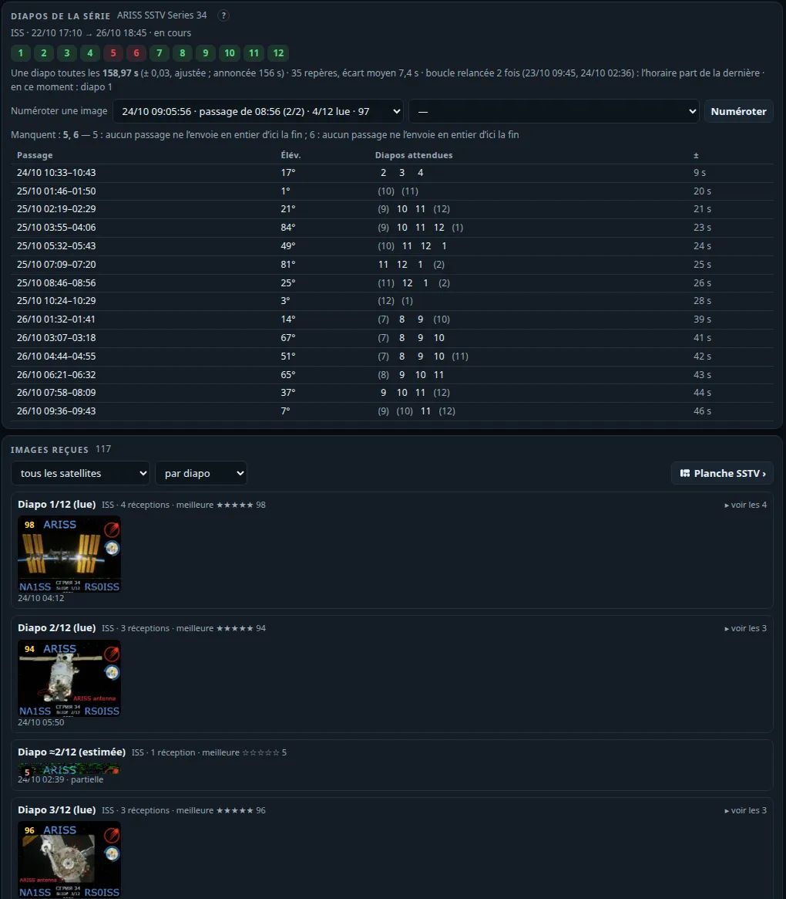</p>

### SSTV options

In **SSTV › Réglages › Options SSTV** (the phone: SSTV, *Direct* tab), all receive only.

- **« Diapo manquante attendue »**: from the series' timetable (above), before each pass that sends **whole** a slide still missing — or received only with a mark under a threshold (60 by default, 0 for missing ones only) —, one notice per pass, *N* minutes before the slide (15 by default): « Diapo 5 attendue à 04:32 UTC (≈ 06:32 heure locale), 49° — passage ISS (74° max) ». On SatMe-PC with the [activities' notices](#upcoming-activities-the-online-sources) (toast, « Dernières alertes », and aloud when the announcements speak), on the phone as a notification on the activities' channel. It follows « Activités à venir »'s switch; a pass whose estimate is looser than a third of a period, or already begun, is never announced.
- **Reception quality** while a picture comes in, under the live picture: the sound's level (RMS and peak, dBFS) with a warning when it clips or is too low; each line's sync (green clean, amber noisy, red lost) and the SNR measured inside the sync pulses (dB in 3 kHz, fitted on white noise from 40 to 10 dB: noise ≈ 350·10^(−SNR/20) Hz; below 10 dB the pulses drown); **the mark the picture heads for**: each line spoilt 0..1 (sync lost or noisier than 130 Hz: 1, else (noise − 10)/120), 100 − 110 × their share − the share missing. On the owner's 49 ISS pictures of series 33 and 34 it follows the gallery's mark within 4 points (RMS). Measured beside the decoder: the picture is the same with or without it (tested).
- **« Enregistrer le son de chaque passage SSTV »** (SatMe-PC, off by default): each pass of the series' satellite, while it is followed and SSTV decoded, recorded from AOS to 30 s after LOS. *Why ISS WAVs were already in `enregistrements/`*: each Agenda › SSTV campaign has its own « Enregistrer » box, ticked by default — the auto-pilot records every pass it takes (its history names the file). Each live picture's sidecar names its recording (`recording=`, now on the phone too: the recorder's MP3), so it can be decoded again; each picture also keeps its own sound.
- **Retention** of the SSTV recordings: *N* days and/or a size, **both 0 by default: nothing is ever deleted** until you set them. Only an SSTV pass's recording is a candidate (named by a picture, the auto-pilot's history, or recorded by the option); never one linked to a picture used in a sheet or marked **« à garder »** (viewer), never one the passage journal names (unless unticked), never one less than a day old. Applied hourly (PC) or with the activities' check (phone), or by hand after the list is shown; each deletion is written to `enregistrements/retention-sons.log` (phone: `recordings/retention-sons.log`).
- **QSL picture** (viewer: 🪪 QSL): the picture doubled, a banner below or laid over its foot — callsign · locator (the picture's own, else Réglages › Ma station), date and time UTC, satellite, frequency and mode (from the activity or campaign then), elevation at reception and the pass's peak, series and slide n/12, « reçu avec SatMe » if wanted; PNG or JPEG. A new file: the original is never touched (tested). PC: download; phone: share.
- **ARISS award pack** (viewer: 🏅 Pack ARISS, or *Pack ARISS de la série*: the best copy of each slide): a zip with `original/` (the pictures byte for byte), `qsl/`, `LISEZMOI.txt` (or `README.txt`) and `resume.html`: callsign, grid square and region, date and UTC time of each capture, satellite, frequency, mode, series, slide, the pass (AOS, LOS, elevations), the mark, the equipment of the « Montage » plan that receives (else the rig chosen), and the steps. **Nothing is sent.**

The ARISS SSTV award, as read on 24 October 2026 (check the current series' page, it changes): receive and decode **at least one picture** of the session, a partial one accepted if recognisable ([ARISS SSTV award, PZK](https://ariss.pzk.org.pl/sstv/)); upload it on the [ARISS SSTV gallery form](https://ariss-usa.org/ARISS_SSTV/submit.php) — name, callsign (SWL without), e-mail (the certificate is sent there), general location, grid square, campaign, date and UTC time of the capture; **« clean » pictures only, no added callsign, no composite** (so the original, not the QSL); png, jpg or gif, 800 kB and 800×800 at most; then, on the next page, sign up for the personalised certificate; requests accepted « typically 72 hours » after the event; the electronic diploma (PNG) comes by e-mail within three weeks ([ARISS SSTV events](https://www.ariss.org/upcoming-sstv-events.html)).

## FT8 / FT4

A tab made to see the band, not only to read it:

- **The slot's ring**: the 15 s as a circle, the countdown, cyan when the slot is even, orange when odd; beside it **the clock** read from the stations' DT.
- **A waterfall that speaks**: 46 s, the slots' edges and times. **Each callsign decoded is written with its flag, at its frequency, in its slot.** A **free spot** to send is found by itself (the quietest place between 500 and 2 500 Hz, away from the stations decoded; on QO-100, only in the digital segments).
- **The radar**: each station a dot at its bearing and distance from your QTH, fading with time, pulsing when just heard. Green for a CQ, ★ for a country new to your log, pink when it calls you.
- **Who to call now**: the stations of the last 5 minutes, ranked by what each would bring (new country, new square, distance, strength, CQ, rarity); a click prepares the contact in the log.
- **Marks** the same everywhere (list, messages, waterfall): calls me, watched, new country, new square, already worked. **Stations guettées**: the callsigns to watch for. One **banner** when the reception goes wrong (no sound, digital silence, nothing decoded for 40 slots).
- **💬 Messages**, as a messenger: the conversations between two stations (flags, the last message, ✓ when the QSO is closed), each one as bubbles, or everything as it comes. Each message says what it is: 📣 call, 📍 square, 📶 report, ✅ report received, 🤝 RR73 / 73.

**The decoder**, measured on a corpus of whole slots (weak stations down to −22 dB, overlaps, Doppler slopes, FT4): the satellite's known **Doppler drift removed** before decoding; each candidate read in its own narrow channel (start to 1/32 symbol, frequency to 1/16 tone); decoded signals **subtracted** and the rest searched again; residual drift searched, and that of a moving LNB (up to ±15 Hz/s, see [A drifting LNB](#a-drifting-lnb)); **hashed callsigns** resolved (`<CALL>` when known); during a QSO, **decoding by expectation** of the partner's possible answers (marked *ap*). SatMe-PC goes deep when the satellite is low or there is time left in the slot. FT8 listening (on or off) and the FT8 / FT4 mode are kept across restarts.

**PSK Reporter** (Réglages, off by default): the FT8 / FT4 stations heard sent every 5 minutes with their square, the frequency and the satellite — only when the frequency is sure (rig on CAT).

<p align="center">

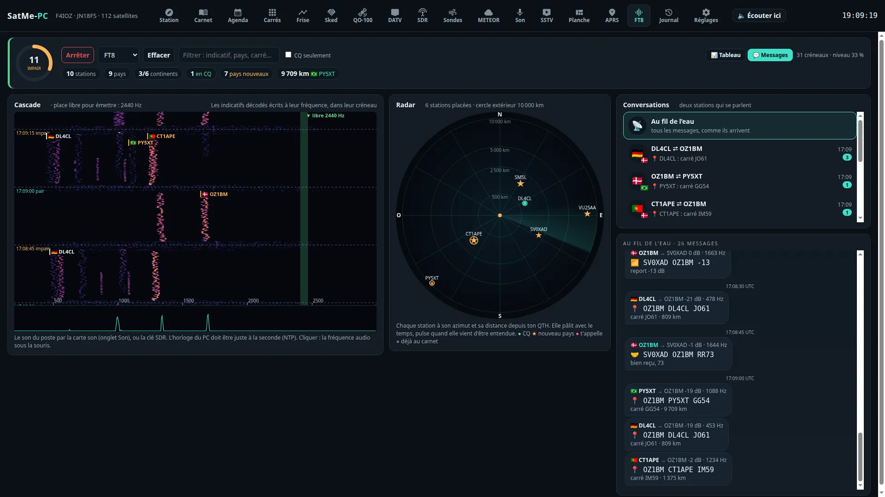
</p>

## Telemetry

The **Télémesure** tab (workspace *Modes*) decodes what satellites send about themselves: FSK / GMSK packets from 1200 to 9600 bit/s, SSDV pictures, BPSK telemetry in the FUNcube format. Three sub-tabs: **Paquets**, **Images SSDV**, **BPSK**. Everything is off by default; receive only. Frames are kept on the PC (`telemesure/`); nothing goes to the internet without the *Partager avec SatNOGS DB* box.

### FSK · GMSK packets

The **Paquets** sub-tab decodes cubesats in FSK or GMSK from 1200 to 9600 bit/s, including the « G3RUH » 9600 bit/s format (1 + x¹² + x¹⁷ scrambler, NRZI, HDLC frames with CRC-16, mostly AX.25).

- Ticked (off by default), it takes the main SDR receiver's **raw I/Q samples** off QO-100 (not the sound): FM discriminator, residual frequency correction up to ±12 kHz around the followed Doppler, clock recovery, then two readings of the bits (with and without the scrambler).
- The **rate** comes from the followed satellite's SatNOGS DB transmitter (FSK, GFSK, GMSK, MSK and its speed) or is chosen by hand. AX.100 « mode 5 » frames (ASM + Golay) and satellite-specific protocols are not read.
- Each frame: the time, the AX.25 header and its text (or the bytes), the received and transmitted frequency (Doppler removed), the correction applied. Kept per pass in `telemesure/paquets/` (one JSON line per frame, and a KISS file if ticked).
- **Essai**: a made-up burst (telemetry and SSDV packets) goes through a separate decoder. The SDR **test generator** also has a « Paquets 9600 » signal: telemetry bursts and an SSDV picture, end to end.
- **Partager avec SatNOGS DB** (off by default): each frame received from a followed satellite is sent with the public SiDS protocol, with the station's callsign, UTC time and the position rounded to 0.1° (≈ 10 km). Frames from the test, the generator and replayed recordings are never sent.

<p align="center"></p>

### SSDV pictures

The **Images SSDV** sub-tab rebuilds the SSDV pictures (JPEG in 256-byte packets, CRC-32 and Reed-Solomon) found in the decoded frames, packet by packet; the blocks of missing packets stay grey. Pictures are kept in `telemesure/ssdv/`.

### BPSK: FUNcube and the QO-100 beacon

The **BPSK** sub-tab decodes telemetry in the FUNcube format: AO-73 (FUNcube-1) and those reusing it, 1200 bit/s BPSK, the same coded frames as the QO-100 beacon (256 bytes every 5 s).

- Ticked (*Décoder la télémesure 1200 bit/s*, off by default), it listens to the **main SDR receiver** off QO-100: tune it in SSB (USB) to the telemetry downlink (AO-73: 145.935 MHz), Doppler followed by SatMe; the carrier is searched across the audio band then held by a Costas loop.
- Each frame: satellite and type (whole orbit, high resolution, message), the **real-time values** read from AMSAT-UK's published downlink document and its equations (panel and battery voltages and currents, temperatures, radio, PA, antennas, software state), the message if any, or the raw bytes.
- **Essai**: a made-up signal goes through the same decoder (marked *essai*). Uploading to the FUNcube data warehouse is not done.
- **QO-100 beacon**: the middle beacon at 400 bit/s is decoded in the QO-100 cockpit (*Balise* sub-tab); a link leads there.

<p align="center">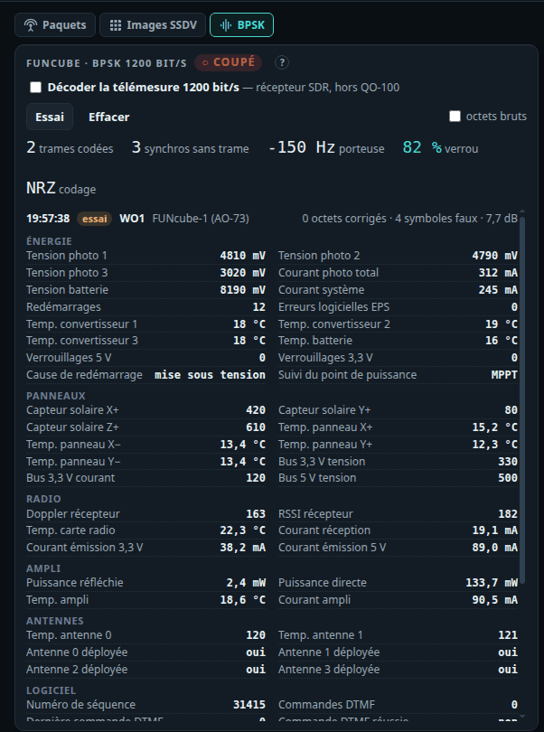</p>

## Voice to text (Phonie → texte)

What the station hears in SSB or FM — the sound card, the SDR's sound, or a DATV stream's sound — written out over by over: QO-100's SSB is the first use. A window **Phonie → texte** in the **SDR**, **QO-100** and **Carnet** tabs shows each over as a bubble: time, frequency (QO-100's downlink when on QO-100), language, text (paler when the engine is less sure), and its translation when asked. Callsigns (written or spelled: "Sierra Papa five Alfa Bravo Charlie", "Fox quatre Italie Oscar Zoulou", in English, French, German, Spanish, Italian, Polish), squares ("Juliett November one eight") and reports ("five nine", "cinq neuf") are lit; a callsign's chip prepares the contact in the log, with the square and report heard.

- **Off by default.** Nothing listens and nothing starts until the window's box is ticked.
- **The engine** is faster-whisper, in Python, as a separate process on this PC: during listening nothing leaves the PC. **Réglages › Phonie → texte › Installer le moteur** creates a Python environment in SatMe's folder (`stt/`), installs faster-whisper from PyPI (about 150 MB; with an NVIDIA card, about 1.3 GB more for cuBLAS and cuDNN) and downloads the model chosen (large-v3 3.1 GB, turbo 1.6 GB, medium 1.5 GB, small 0.5 GB). Nothing is downloaded without that button. It needs Python 3.9 or newer (Debian/Ubuntu: `python3-venv`; Windows: python.org, "Add python.exe to PATH"). Another interpreter with faster-whisper can be given instead.
- An NVIDIA card is used when it answers, else the processor (choose *small* or *medium* there). On an RTX 3060 with large-v3, 20 s of speech take about 1.3 s.
- **Translation, offline** (*Traduire en*, French by default): each over translated on the PC with open OPUS-MT language pairs (CC BY 4.0), through English when there is no direct pair. **Installer la traduction** fetches the languages ticked (Polish, German, English, Spanish, Italian, Dutch, Portuguese, Russian, Ukrainian, Czech…) into `stt/traduction`.
- The voice is cut between silences (1 to 25 s, the squelch respected); noise, carriers and the sentences an engine invents on noise ("Thank you for watching"…) are dropped. When the engine lags, the oldest over waiting goes, and the window says how late it is.
- Each day's transcript is kept in `phonie/YYYY-MM-DD.jsonl`; ⤓ downloads it as text.
- **🔊 Traduction parlée** (spoken translation; off by default, receive only: the voice is never transmitted): each over's translation said by a **synthetic voice**, on the PC's speaker (the received sound lowered meanwhile), in the browser, or both; ⚙ opens its settings (voice, intonation, output, volume, foreign languages only). Two overs wait at most, none older than 30 s. **Réglages › Phonie → texte › Installer la voix** adds Piper (piper-tts, about 35 MB) to the engine and one voice per language (about 63 MB each, `stt/voix`). Without Piper: eSpeak NG or speech-dispatcher, else the browser's voice. Intonation **proche**: on the over heard, the voice's pitch (100 times a second), its mean and spread, the speed (syllables a second) and each phrase's loudness; the synthetic voice takes about the same speed, its mean pitch is brought to the speaker's (8 semitones at most) and its phrase rises and falls are 70 % replaced by the ones heard (a degree-2 curve per phrase), by a pitch-synchronous pitch shift that keeps the length and the formants. **Voix clonée** (optional, about 1 GB: torch for the processor and the OpenVoice V2 tone colour converter, MIT licence): the speaker's timbre too, about 2 s of computing per 10 s over.

<p align="center">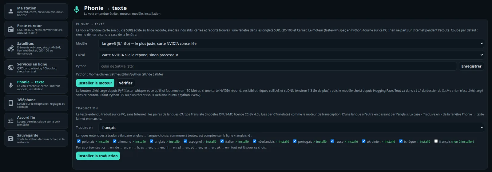</p>

## The SDR receiver

<p align="center"></p>

The **SDR** tab (workspace **Station**): listening (the followed satellite, Doppler corrected, or a frequency), demodulation (NFM, USB, LSB, AM; width, squelch, de-emphasis), the spectrum and waterfall, the vernier and magnifier. On the spectrum a click tunes, the wheel zooms, dragging moves the view within the 176 kHz the receiver sees, the passband's edges can be pulled; on the waterfall the wheel tunes; on the keyboard ← → one step, ↑ ↓ ten steps. **Reception only.**

- **CTCSS**: in NFM the sub-tone heard (the 50 tones from 67.0 to 254.1 Hz) is read under the voice in less than a second and shown beside the level (« CTCSS 67,0 Hz », its deviation on hover). **Sous-ton** (Démodulation card, *aucun* by default): the tone squelch — the sound (speaker, decoders, speech) passes only while that tone is heard. Receive only; the test generator can put one under its FM signal.

### Memories and band plan

**Mémoires** (and **＋** for the frequency listened to): named frequencies with their mode, width, CTCSS tone, a **tag** and a colour, kept in **folders** (one level of sub-folders).

- A click on a memory tunes the receiver there: within the view, by the offset; beyond it, the receiver goes there and stops following the satellite.
- Drag and drop between folders, rename, delete (memories move to the parent folder), sort, search, edit in the row; a memory can be **locked out of the scan**.
- On the spectrum, **small flags**: click to tune, right-click to edit. Filter by tag.
- Kept by SatMe-PC (`memoires-sdr.json`); **Exporter** / **Importer** as JSON, without doubles, from one PC to another.
- **Band plan**: a coloured strip at the top of the spectrum — IARU Region 1 for 2 m, 70 cm, 23 cm, 13 cm and 3 cm, and QO-100's. It can be replaced band by band with a `plan-bandes.json` file in SatMe-PC's folder (the default plan downloads from **Affichage** as a model).
- **Band stack**: the band buttons (2 m, 70 cm, 23 cm, 13 cm, 3 cm / QO-100) keep the last three frequencies, modes and widths that stayed more than 5 s; pressing the band again steps through them.

### Scanning (Balayage)

**Balayage** (SDR tab), receive only:

- **What is scanned**: a folder's memories, a range channel by channel (step and mode to choose), or a range judged span by span on the wide spectrum.
- **Stop** on a level above the noise or on the squelch opening; **resume** when the signal drops, after a time, or by hand; a **priority channel** checked every N seconds; locked-out channels skipped; signals found kept as memories.
- The scan's steps are never written to the settings; at the stop the frequency is kept once, or the one before given back (*revenir à la fréquence d'avant*, and always when nothing was found). Refused while DATV, ADS-B, QO-100, a sonde or METEOR holds the receiver; a hand tuning stops it.

<p align="center">
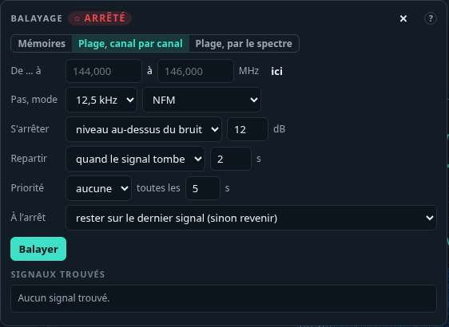
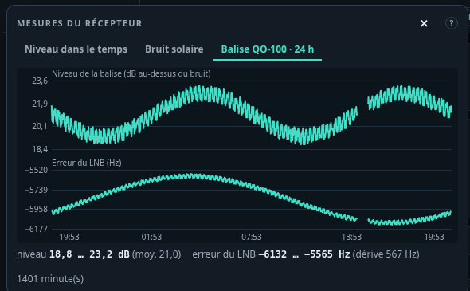
</p>

### Display (Affichage)

The **Affichage** button sets the spectrum and waterfall, kept in this browser (**défaut** goes back to the defaults):

- **Average** over 2 to 16 frames; **peak hold** (fixed or decaying 1, 3 or 10 dB/s) and **minimum hold**, cleared with ⟲;
- **Levels**: *auto* (the bottom on the noise, the top on the strongest signal), or a reference and a range (30 to 120 dB);
- **Waterfall**: seven palettes, contrast, brightness, black set on the noise, speed;
- **Tuning**: *inertia* wheel (a quick spin starts the tuning, which slows down), steps in SSB / CW (1 to 100 Hz) and FM / AM (100 Hz to 12.5 kHz);
- **Markers**: the band plan, the memory flags.

### Sound cleaning

Under the demodulation (SDR tab and QO-100 cockpit), set for each mode (USB, LSB, NFM, AM) and kept; **everything is off at first**.

- **NB** (noise blanker): very short clicks (switching supplies, the LNB supply) found on the raw I/Q samples and blanked before any filter; threshold and width in *Réglages fins du nettoyage*.
- **Notch auto**: up to three steady carriers whistling in the voice, notched out; in CW a note must hold 2 s before it is notched, so the keying gets through.
- **Notch**: a narrow notch at the audio frequency given; **Shift + click** on the spectrum or the magnifier puts it on a carrier.
- **Noise reduction** light, medium or strong: the hiss drops between words and under the voice (29 ms of delay, paused while the squelch is closed).
- Sound **AGC** in SSB and AM: slow, medium or fast.

### I/Q: back in time, recording, replay

The **I/Q** button keeps the receiver's raw samples (1.0584 MS/s: 127 MB a minute from an RTL dongle, 254 MB from the Pluto, the bladeRF or the generator), as **SigMF** (`.sigmf-data` and `.sigmf-meta`: frequency, date, satellite, mode).

- **Remonter le temps** (off by default): the last 1 to 10 minutes always kept in a fixed-size file on disk; **Garder les dernières minutes** turns them into a recording — a signal noticed too late is not lost.
- **● Enregistrer**: 1 to 60 minutes at most.
- **Replay**: the **Fichier I/Q** *Récepteur* takes the recording as the receiver; spectrum, demodulation and decoders (SSTV, CW, FT8, voice) work on it. Pause, position, speed ×1 / ×2 / ×4, loop, and *tranches FT8* (restart aligned on the 15 s slots). Raw files (`.cu8`, `.cs8`, `.cs16`, `.cf32`) dropped in the folder replay too.
- What is decoded from a recording is marked « relecture » (dated from the recording), never taken for a real reception: no journal, no sheet, no PSK Reporter, no SatNOGS, no « new picture »; APRS frames are counted, never kept, and no automatic pass recording starts.

### Test generator

The **Générateur d'essai** *Récepteur*: a fake receiver, with no antenna or hardware — noise (strong, medium, weak) and signals around the frequency listened to, each with its offset and SNR: carrier, keyed CW (text and speed to choose), SSB (synthetic voice), FM tone (with a CTCSS sub-tone if wanted), an FT8 call in the even slots, SSTV pictures in narrow FM, PSK31, RTTY, « Paquets 9600 » (telemetry and an SSDV picture). **Écouter** sets the mode and offset to hear it. Nothing is transmitted; SSTV pictures show without being kept, nothing goes to PSK Reporter.

### Measurements (Mesures)

The **Mesures** button (SDR and QO-100 tabs), reception only:

- **Level over time**: the channel listened to, a **marker** set a few kHz from the listening frequency (it follows the Doppler), the noise floor, or the QO-100 beacon over the noise; over 10 min, 1 h or 24 h, as **CSV** (mean, minimum, maximum, UTC).
- **Sun noise** (Y factor): aim at **cold sky**, *Mesurer*, then at the **Sun**, *Mesurer*; the Sun / cold sky ratio against the expected one, worked out from the dish's diameter and efficiency, T<sub>sys</sub> and the day's solar flux (SFU at 10.7 cm, typed by hand: nothing is fetched from the internet). **Balayer**: a grid around the Sun by the rotator (rotctld or simulated), after confirmation, within its end stops; « Arrêter » stops the rotator.
- **QO-100 beacon · 24 h**: one point a minute while the beacon is followed — its level over the noise and the LNB's error; the drift from night to day.

## SDR hardware

The **SDR** tab's *Récepteur* chooses the receiver; everything works the same with each: Doppler, QO-100 (behind the LNB, IF around 739 MHz, or behind a converter), the cockpit, waterfall and panorama, the signal classifier, the sound for the decoders (FT8, SSTV, APRS, voice, LEILA), METEOR, radiosondes. **Fine tuning** as on the phone: the vernier (N Hz per cm, with momentum), the magnifier around the listened frequency, voice netting in SSB (Réglages › Accord fin). SSB and AM use a hang AGC.

| Hardware | Link | Receives | Transmits |
|---|---|---|---|
| **RTL-SDR** dongle | rtl_tcp, on this PC (started for you) or on the network | about 24 MHz – 1.7 GHz | — |
| **ADALM-PLUTO** | network (USB cable: 192.168.2.1, port 30431; or Wi-Fi / Ethernet) | 70 MHz – 6 GHz | DATV, SSTV |
| **bladeRF 2.0** micro | USB 3, through bladeRF-cli (Linux) | 70 MHz – 6 GHz | DATV, SSTV |
| **HackRF One** | USB, through hackrf_transfer | — | DATV tests only (indoor, dummy load) |
| **MiniTiouner** | USB, through LongMynd (or a SatMe-Node) | DVB-S / S2 | — |
| **IC-9700 IF** | the rig's sound set to IF (network or USB sound card) | the 12 kHz IF, ±3.6 or ±7.5 kHz | — |

### ADALM-PLUTO

Nothing to install: SatMe talks to its IIO server directly. On its USB cable it answers at **192.168.2.1** (port 30431); on Wi-Fi or Ethernet give its address.

- **The receiver only receives.** It sets the RX oscillator, the sample rate, the analog bandwidth and the gain, and nothing else: it never opens the transmitter, never writes its settings, never touches its USB drive or its `config.txt`. Only the transmitter's code (DATV, SSTV) writes on the transmit side.
- It runs at 2.1168 MS/s, brought down to the dongle's 1.0584 MS/s; its 12 bits are kept to the demodulator. About 8.5 MB/s on the cable.
- **Gain**: *automatique* is the AD936x's slow AGC; otherwise 0 to 71 dB. The status line shows the board and its firmware. Pulled out, or silent for three seconds: the reception stops and says why.

### bladeRF 2.0 (USB)

A **Nuand bladeRF 2.0** (micro xA4…) on a **USB 3** port, driven through the **bladeRF-cli** tool in interactive mode, the samples (SC16 Q11) going through a named pipe.

- **Installing (Linux)**: `sudo apt install bladerf` (bladeRF-cli, libbladeRF and the udev rule). The **FPGA** loads by itself when the board opens, from `~/.config/Nuand/bladeRF/hostedxA4.rbf` (or `/usr/share/Nuand/bladeRF/`): put your model's `.rbf` file there. The package's udev rule gives access to the **plugdev** group: `sudo usermod -aG plugdev $USER`, log in again, unplug and plug back. Check with `bladeRF-cli -p`.
- **Détecter** (SDR tab or Émission card) runs `bladeRF-cli -e info -e version`: read-only, it shows the model, serial number, FPGA and firmware; that serial is then used to open the board. bladeRF-cli's folder is set in the SDR tab (empty: the PATH).
- **Receiving**: as the Pluto, 2.1168 MS/s brought down to 1.0584 MS/s, 12 bits kept; gain *automatique* (the AD9361's AGC) or 0 to 60 dB. Only RX1 commands; silent too long or unplugged, the reception stops and says why.
- **Transmitting**: the Pluto's rules (the same AD9361), QO-100 included. The gain is an attenuation (bladeRF-cli gets 66 + gain), **−50 dB by default**, never above the maximum in Réglages, **held at −40 dB** into a load and indoors. Each setting is checked in bladeRF-cli's answer before `tx start`; once the stream flows the gain is read back. Stop: `tx stop`, pipe closed, `quit`, then the tool ended. A bladeRF receiving does not transmit, and the other way round.
- **Windows**: bladeRF-cli.exe cannot write into a named pipe: the bladeRF works only under Linux for now; the page says so.

### HackRF One (test transmitter)

The DATV Émission card's *Émetteur* also offers a **HackRF One**, to test a receiver — **never to QO-100**: its converter takes 8-bit samples, its harmonics and spurious outputs need a filter, and QO-100 needs a power amplifier. The HackRF sends only in the **indoor test** and the **dummy load** test.

SatMe drives it through `hackrf_transfer`, the samples on its standard input as signed 8-bit I/Q, at the Pluto's sample rates, with the narrowest baseband filter that holds the signal:

`hackrf_transfer [-d SERIAL] -t - -f FREQ_HZ -s RATE -b FILTER_HZ -x VGA -a 0 -p 0`

- **Installation.** Linux: `sudo apt install hackrf` (it brings `hackrf_transfer`, `hackrf_info` and the udev rules: unplug and replug the HackRF afterwards). Windows: the HackRF tools for Windows (`hackrf_transfer.exe`, `hackrf_info.exe`) and the HackRF's WinUSB driver; give their folder in *Outils HackRF* if they are not in the PATH.
- **Detection, read-only.** *Détecter* runs `hackrf_info` only (it lists the boards, sends nothing). Nothing else runs until **ÉMETTRE** is confirmed.
- **Low power only.** The RF amplifier is **always off** (`-a 0` on every command line; a line without it, or with any other option, is refused by the code), the antenna port's supply off (`-p 0`), the TX VGA gain 0 to **20 dB** at most (the HackRF goes to 47).
- **Oscillateur décalé** (on by default): the LO is tuned beside the signal and the baseband shifted back digitally, so the LO leakage falls outside the occupied band; indoors the LO and the image stay in the same amateur band.
- **Stop**: the tool's input closed first, then terminated, then killed. It stops when the tool dies, says the HackRF is missing or busy, stops taking samples for 3 s, at the end of the time allowed, when the page is silent for 15 s, and when SatMe-PC closes.

## Aircraft (ADS-B) and the map

The **Avions** tab receives **ADS-B** on 1090 MHz (2 MS/s), off until **Recevoir** is clicked. Reception only.

- **Receiver**: the SDR tab's dongle (taken only on **Prendre la clé**, the SDR tab then no longer starts on it), a **second dongle** (its own rtl_tcp, `-d` index or serial, on its port), or the **ADALM-PLUTO** (never taken from DATV or transmission). Gain, *réparer 1 bit faux* (single-bit repair).
- **The aircraft list**: ICAO, callsign, altitude, speed, track, position, distance and azimuth, last seen, messages, RSSI.
- **SBS-1 output** (« MSG,… » text lines) on 127.0.0.1:30003, off by default, for other programs on this PC.
- **Aircraft scatter** (a forecast, nothing is transmitted): a partner by callsign or locator, a band (10 GHz, 13 cm, 23 cm, 2 m), a radius, a horizon in minutes, both stations' heights and a minimum altitude. Each aircraft is extended in a straight line: the **window** is the time it spends in the common volume both stations see (radio horizon, 4/3 earth), with its duration, altitude, elevations and Doppler. A message when a window opens.

<p align="center">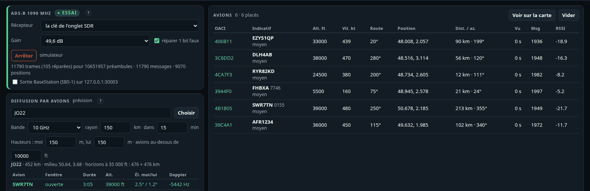</p>

The **Carte** tab: the shared map, **without internet** (SatMe's own coastlines). Layers: satellites (footprint, ground track), APRS, the followed sonde, aircraft, ships, DATV stations whose locator is known, worked squares, your station, day and night, the forecast aurora, aircraft scatter, range rings. *Fond OpenStreetMap* (unticked by default): tiles loaded by the browser, nothing goes through SatMe-PC.

<p align="center">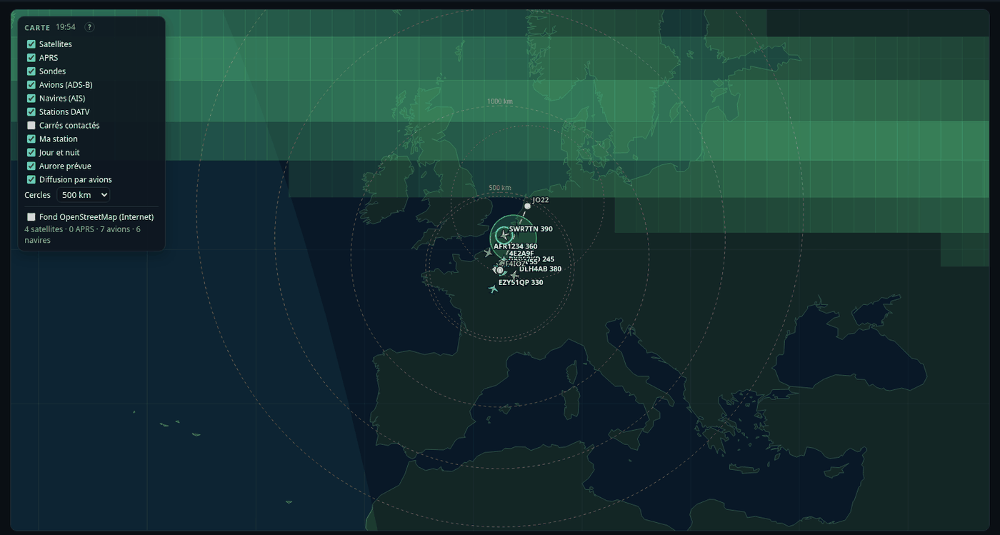</p>

## Ships (AIS)

The **Navires** tab receives **AIS** on 162 MHz, off until **Recevoir** is clicked. Reception only.

- Both channels (161.975 and 162.025 MHz) from one dongle at 288 kS/s: position, voyage, class A and B, beacon and aid-to-navigation messages (ITU-R M.1371).
- **Receiver**: the SDR tab's dongle (taken only on request) or a second dongle (its own rtl_tcp). AIS never takes the ADS-B's dongle, nor the other way round.
- **The list**: MMSI, name, destination, callsign, type and size, position, speed, course, distance and azimuth, last seen, channels; **Voir sur la carte**.
- **NMEA output** (`!AIVDM` lines over UDP to 127.0.0.1:10110), off by default, for a navigation program on this PC.
- **Essai**: simulated ships around the station.

<p align="center">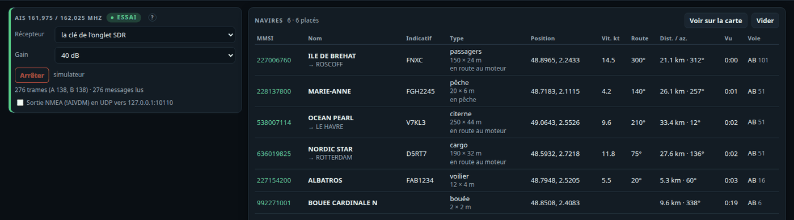</p>

## Space weather

The **Météo spatiale** tab (workspace *Ciel*): what is needed to judge propagation and aurora.

- **Nothing is downloaded** until *Récupérer la météo spatiale (Internet)* is ticked. Only then are NOAA's public products (services.swpc.noaa.gov, and that host only) fetched every 15 min (aurora every 30 min) and kept on disk; at start the kept copies are shown with their age.
- **Kp index** on a gauge, its bars over three days (observed and forecast), the 10.7 cm **solar flux** (offered to the Sun noise measurement), **X-rays** (GOES) over 6 h, the **solar wind** (speed, Bz, Bt), the forecast **aurora** (OVATION) here and within 1200 km, and its oval on the map.
- **Alerts**: geomagnetic storm (Kp ≥ 5) and solar flare (≥ M5), with what they change for operating; said aloud if ticked.

<p align="center"></p>

## Montage: the station chain

The **Montage** tab (workspace **Station**) draws the station: the antenna on the left, the computer on the right, reception on top, transmission below. It lights up with what SatMe does: **cyan** what receives, **red** what transmits, the flow animated along the cables, the frequencies on them (sky, IF, uplink). It is a drawing: nothing there starts a transmission, opens a port or touches the LNB supply.

<p align="center"></p>

- **Composing**: a ready-made *montage*, **Proposer d'après SatMe**, or **✎ Modifier**. A click on a device shows its ports, notes and photo. *Complet* or *Simplifié* (what receives or transmits now). Zoom (**+** **−** **0**, Ctrl + wheel), pan with the mouse, minimap; **Exporter** as SVG, PNG or a print view; a foldable legend of cables and states.
- **Several plans**: the **Plan** selector keeps several drawings of the same station (« SatMe-Node déporté », « IC-9700 satellites », « DATV par le node »…): **＋ Nouveau**, **Dupliquer** (photos included), **Renommer**, **Supprimer**; each has its own photos and undo / redo. The old montage becomes the first plan, nothing lost (`montage.json` keeps it at its top, an older SatMe-PC reads it as before).
- **Afficher le plan de ce qui tourne** (show the plan of what runs, on by default): the plan shown is the one that best draws what receives or transmits (DATV through the node → the node's plan; SSTV from the IC-9700's codec → a plan with the IC-9700). A better plan takes over only after about ten seconds, and the plan stays half a minute after the activity ends: no flip-flop. A plan chosen by hand stays until the activity ends or the box is ticked again. When no plan draws what runs, the **chaîne détectée** (detected chain) is shown (e.g. 70 cm Yagi → IC-9700 → USB (sound) → SatMe-PC → SSTV), with **Garder comme plan** (keep as a plan).
- **Decoders fed by the rig's sound**: SSTV, APRS, FT8, CW or phonie fed by the rig's sound card (the IC-9700's USB codec, or its network sound) light the rig, its antenna and the PC, even without CAT; the frequency is the CAT's, else the followed satellite's transmitter (ISS SSTV 437.550 MHz), and it picks the antenna of its band. Another sound card lights that card.
- **What is live**: CAT and rotator, the SDR and DATV receivers, the IC-9700 over the network (its LAN cable lit, the delay, a lost link), the USB knob, listeners, space weather, the QO-100 channels, recording and generator, ADS-B and AIS holding a dongle. Non-satellite functions unticked disappear from the drawing.
- **The IC-9700 over the network** in the function views: the rig's network sound is its own sound (no more advice to take the USB codec, offered only when another card runs); the rig → PC link drawn as it goes, dashed blue with its delay and « CAT + son »; with no LAN cable drawn, it is shown *détecté* (detected), lighter, with **Ajouter ce câble** (add this cable). « Aucune antenne » offers **Ajouter une antenne 2 m / 70 cm** (a dual-band Yagi on the rig's free ports); the band of the rig's frequency picks the antenna port, and a port already taken (70 cm to the QO-100 up-converter) is said. SatMe-PC stays in the simplified drawing, in its own place, never over a piece.
- **Ce qui manque** (what is missing): each function checked from antenna to screen; a **danger** is said loudly — for instance the LNB supply that would reach an SDR board through a splitter (a DC block is then proposed).

### Drawing and editing

**✎ Modifier** opens the catalogue's **palette**, by group: antennas (dishes, Yagis, X-quad, collinear, indoor antenna, GPS antenna), heads and converters (PLL LNB, Twin LNBs including the Octagon with an external 25 MHz reference, DX Patrol MK3 / MK4 up- and down-converters with their 10 MHz input), amplifiers (DX Patrol 2.4 GHz 20 / 15 W), filters, bias-T, DC + reference injector, DC block, splitter, references (DX Patrol 10 MHz GPSDO, Leo Bodnar programmable GPSDO), 13.8 V supply, sequencer, rigs, SDR boards, MiniTiouner, SatMe-Node, sound card, USB knob, rotator, PC, phone.

- **Drag** a piece onto the drawing; **draw a cable** from port to port (its type comes from the ports: coax, network, USB, Wi-Fi, audio, CAT, rotor, IQ, reference, power, GPS, internet); the cable's card (type, label, remove). Each piece has its options (IF output, reference, frequencies).
- Free placement or **Disposition auto** (several layouts tried, the one with fewest crossings kept); **Undo / Redo** (Ctrl+Z / Ctrl+Y), kept by SatMe-PC; everything also works from the keyboard.
- **Proposer d'après SatMe**: a chain drawn from SatMe's state (rig, rotator, SDR boards, DATV receiver and transmitter, converters, the QO-100 chain's oscillators) and the system's lists (USB, sound cards) read without opening anything; each piece *detected* or *assumed*, merged piece by piece.
- The services' **boxes**: Wavelog, QRZ.com, PSK Reporter, wide band chat, rigctld clients, satellite link, paired phone, SatMe-Node, « Écouter ici », with their state.
- **Photos**: a device's photo (8 MB at most) is **cut out** automatically (background removed, adjustable tolerance, the original kept beside); *Photo à la place du dessin* shows it in the diagram, the RX / TX glow following its shape.

<p align="center">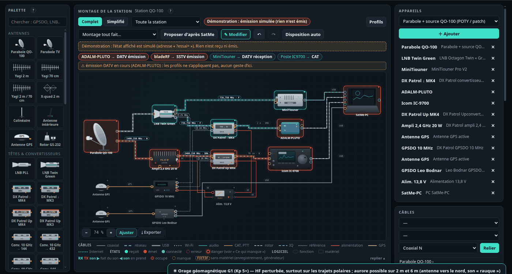</p>

### Functions and profiles

- **The functions** of SatMe (SDR receiver, DATV, SSTV, FT8, CW, APRS, voice to text, METEOR, sondes, transmissions) to the right of the computer, with the sound hardware: **who holds which device** (« ADALM-PLUTO → DATV réception »), who receives, who transmits, who makes or takes sound. A **conflict** (a function wanting a device or a sound input already taken) shows in red with its reason and the gesture that frees it.
- **Fonction**: one function's chain alone, from the antenna to its screen, each link running, ready, missing or busy, and what is missing. The buttons only do reception (start or stop a receiver, choose a sound source).
- **Profils**: the receive settings of the moment kept under a name (« SSTV par IC-9700 ») — SDR receiver (board, mode, frequency, tracking, sound), the decoders' sound input, SSTV, FT8 / FT4, CW, APRS, voice to text, DATV receiver; never anything of transmission nor the LNB supply. **Aperçu** lists what will change; **Appliquer** does it in a safe order (stops, settings, receivers, sound card, decoders). **Refused during a transmission.** DATV reception is not started from here: the step is recalled.
- **Schéma** (QO-100 cockpit and DATV, unticked by default): the simplified drawing over the tab.

## Réglages (settings)

By category, a list on the left: **Ma station** (callsign, square, minimum elevation, horizon, non-satellite functions), **Poste et rotor** (CAT over USB or the network, TH-D72, rotator, converters, Doppler log, ADALM-PLUTO), **Satellites** (orbital elements, AMSAT, QO-100 at start), **Interfaces** (satellite link, rigctld, USB knob), **Annonces** (spoken announcements), **Services en ligne** (QRZ.com, Wavelog / Cloudlog, hams.at skeds), **Phonie → texte**, **Téléphone**, **Accord fin**, **Émission** (IC-9700: network allowed, time-out, power cap, sound card; the transmitters' I/Q correction), **Démarrage** (network, port, data folder, updates, quick setup), **Accès à distance** (password, HTTPS, app, screen kept on), **Sauvegarde** (the whole station in one file, restored at the next start; deployment to another PC).

### The rig and the rotator

The rig's model (IC-9700, IC-9100, IC-910H, TS-2000, two rigs FT-817 / IC-705, TH-D72, or simulated), its port and speed, Connect / Disconnect; the rotator (GS-232 over serial, rotctld over the network, or simulated), Follow the satellite, Park, Stop, its end stops and parking. The Suivi tab keeps only their name and a green tick.

**The pass plan** (Réglages › Poste et rotor › Rotor): the **azimuth travel** (360°, or 450° / 540° with an overlap), **Monte à 180° ?** (only a rotator that goes to 180° can flip), the north or south end stop, the **wait before AOS**, and **hidden zones** (roof, tree, hill: `170-190<20 ; 300-330<10`, or drawn by dragging on the small sky) — the plan gives them almost no weight and puts its unwinds there. It keeps the most of the pass, weighed by elevation (a minute at 60° is worth far more than at 5°), then the shortest travel, then the fewest changes. The small sky shows the next pass's plan with the settings applied. The rotator's speed is measured while the mast runs far from its command.

**Calibrer le rotor…** (Réglages › Poste et rotor › Rotor): a step-by-step assistant, tracking stopped while it is open (given back as it was afterwards), the controller's raw `C2` reading and SatMe's side by side, a **STOP** always on screen, and nothing moved but on a click. Over GS-232 it sends the controller's own calibrations, as the K3NG firmware implements them: `O2` with the boom at a real 0° (inclinometer), `F2` at the real top — F2 makes the current position the firmware's *maximum* elevation (ELEVATION_MAXIMUM_DEGREES, 180), so if the real top is not 180° it says so and offers the alternatives (firmware setting, or SatMe's correction) — then `O` / `F` at the full CCW / CW azimuth stops, as set (north or south stop). Each waits for its keystroke and "Wrote to memory"; `?>` (another firmware, no pot sensor) and rotctld (no such command) are told, and only the software correction applies there. A **verification** sends test positions (el 45/90/135, az 90/180/270) on click; the inclinometer or compass reading entered, the table shows the error. **Software correction**, per axis, controller reading ↔ real angle (`read:real;…`, e.g. `0:0;180:160`; one point an offset, two a scale, more piecewise): built from the table or typed, applied both ways, the limits staying in real degrees and the controller never sent beyond its travel; empty by default, reset in one click. Power-cycle the controller afterwards and read again to check the EEPROM kept it. The page the phone serves has the same assistant; the phone's Rotor screen shows and edits the correction.

<p align="center">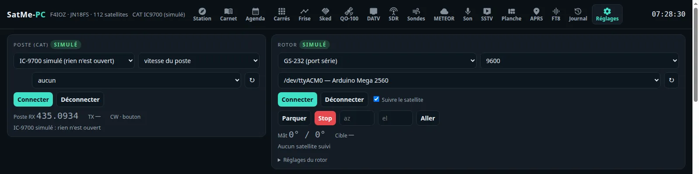</p>

### The IC-9700 over the network

**Réglages › Poste et rotor › Liaison: Réseau (LAN de l'IC-9700)**: SatMe-PC joins the IC-9700's built-in network server (three UDP ports: control 50001, CI-V 50002, audio 50003; one session at a time), with no USB cable. It takes the **CI-V** there (the same Doppler control as over USB) and the **received sound**, offered as the source « IC-9700 (réseau) » to the Son tab, SSTV, FT8, voice to text and « Écouter ici ».

- **On the rig**: *MENU › SET › Network*: DHCP (or a fixed address), **Network Control: ON**, *Network User1 ID* and its password, *Network Radio Name*, the ports (50001 by default). The rig's address shows in that same menu; type it into SatMe-PC with the ports.
- **Receive only** by default: no sound is sent, the transmit audio path is not requested, every CI-V transmit command (PTT `1C 00`, tuner `1C 01`, `17`, `28`, even behind the `29` prefix) is refused. One exception, ticked on this PC: *Émission par le réseau autorisée* lets PTT through (see [The IC-9700 transmitting](#the-ic-9700-transmitting)). On disconnecting the session is always handed back to the rig; a lost link is taken up again in the background.
- **Sound**: 16-bit PCM at 16 kHz by default, 8 kHz for a slow link; a 40 to 300 ms buffer puts packets back in order and asks again for missing ones. The samples' layout (byte order, signed or not) is recognised from the sound itself.
- **Credentials**: the rig expects a coded form of the user ID and password. The simplest: capture on your network the start of a connection that works (port 50001, a `.pcap` or `.pcapng` file), type the ID and password in clear, then *Identifiants codés › Apprendre le codage depuis une trace*: SatMe-PC reads the coded fields there, learns the coding and says whether the rig had accepted that login. The file is read in memory then forgotten; neither the coded bytes nor the clear text are shown or written to a log. The 16 coded bytes can also be pasted (hexadecimal).
- *Spectre du poste* (option): the scope the rig sends over CI-V, as a strip in the Suivi tab; set back OFF on the rig at disconnection. *Journal des paquets*: headers only, in `icom-reseau-trace.txt`.

**AF or IF sound.** The *Son* menu says what the rig sends on its sound output (USB or network):

- **AF** (the rig's factory setting): the rig demodulates, SatMe receives its sound. If the rig actually sends its IF, SatMe notices (energy high in the band, an IF folded to about 4 kHz) and says so: set the rig's output to AF.
- **IF**: the rig sends its last IF, centred on 12 kHz, about 15 kHz wide; SatMe demodulates it itself in the SDR tab, receiver **« IC-9700 FI »**: waterfall, USB, LSB, CW, FM, AM, cleaning, channels, recording and decoders. On the rig: **MENU › SET › Connectors › USB AF/IF Output › Output Select: IF** (AF to go back). Over the network the 16 kHz sound folds the IF: ±3.6 kHz usable around the dial; through the USB sound card (48 kHz): the whole IF, ±7.5 kHz. The centre is the rig's RX dial read by CAT; *Recentrer le poste* moves the rig's RX shift (receive only). *Sens inversé* if stations go up when the dial goes down.

<p align="center">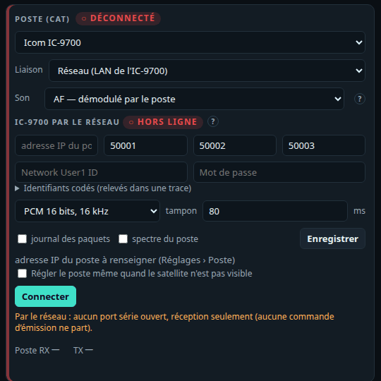</p>

**Doppler / CAT log** (off by default): during a followed pass with the rig connected, every 5 s the time, azimuth, elevation, range, the Doppler predicted on both legs, the frequency the loop wrote and the one it read back — one CSV per pass in `doppler/`, linked from the pass in the Journal. Only what the CAT loop already does is noted. *Journal détaillé* (off by default): the spectrum around the downlink kept during followed passes, for the [pass report](#pass-report).

### The IC-9700 transmitting

The **Émission IC-9700** panel (Suivi tab, and the QO-100 cockpit while it is shown) drives the transmission of the IC-9700 connected by CAT (USB, network or simulated), from this PC or from another machine (remote mode, same password).

- **PTT held**: the **PTT** button stays down while you talk (or the **space bar**, the panel focused). SatMe sends `1C 00 01`, then `1C 00 00` on release. **One client** holds the PTT, everyone sees who (red **TX** strip at the top of every page), and anyone may stop it (the strip, Escape). From another machine, one confirmation per session, as for DATV.
- **Released by itself**: **2 s** without news from the page holding it (tab hidden, window left, link lost, microphone closed), the **time-out** reached (Réglages › Émission, 3 min by default, 1 to 10), the rig no longer answering (its TX state read back twice a second), the rig disconnected (the unkey goes before the CAT closes), SatMe-PC closed. A refused unkey is sent again as soon as the rig answers. Nothing transmits at start nor after a reconnection. Keep the **rig's own time-out** (its menu) too: it is the last guard if the PC stops dead.
- **The browser's microphone**: 48 kHz mono, a light compressor, a level control, a meter, the browser's AGC as an option; 20 ms frames over a WebSocket of their own (`/api/poste/micro/ws`), sent only during the PTT, and dropped by SatMe-PC when that client does not hold the PTT. To the rig: its **USB sound card** ("CODEC", recognised or chosen in Réglages › Émission), or **over the network**. On the rig, the modulation source *DATA OFF MOD* must be **USB** (or **LAN** over the network), and **VOX off**. Browsers give the microphone only to a secure page: this PC (http://localhost), or **HTTPS** from another machine (see [Remote access](#remote-access)).
- **Power**: the rig's RF power (CI-V `14 0A`, 0 to 255) in % and in estimated watts for the band (100 W on 144 MHz, 75 W on 430 MHz, 10 W on 1200 MHz), a slider and presets (5, 10, 25, 50, 100 %), read and written on the band that transmits (SUB in satellite mode). **Puissance au plus** (Réglages › Émission): never exceeded; under that cap, the PTT waits for the rig to confirm a power below it.
- **Over the network**: **Émission par le réseau autorisée** (Réglages › Émission), off by default, can only be ticked on the station's PC (never from another machine nor through a phone backup). Ticked, only PTT passes the guard (`1C 00`): tuner, CW and voice memories stay refused; the TX audio stream is asked at login (reconnect the rig after ticking it). Cleared during a transmission: the PTT is released at once.
- **The network TX audio is not verified on a rig yet**: it follows the received sound's format and the public descriptions of the protocol (20 ms packets, 16-bit, at the receive rate). To verify it: capture with Wireshark Icom's own software transmitting a few seconds **into a dummy load**, then *Réglages › Émission › Vérifier sur une capture*: SatMe reads what that software asks at login and the shape of its packets, compares, and keeps the mark and size it found. Nothing of the capture is kept.
- **Tuning SSB while transmitting**: the USB knob, the mouse wheel and a drag (finger or mouse) on the Suivi tab's RX / TX frequencies tune as in reception, with the USB knob's step. On a linear satellite the position in the transponder moves, uplink and downlink locked, and the Doppler goes on. With no satellite driving the rig (terrestrial SSB, Doppler on hold, satellite below the horizon), the knob tunes the rig's dial directly, shown in place of the satellite's frequency.

### Non-satellite functions

**Réglages › Ma station**: the tabs not about satellites — **Avions**, **Navires**, **Sondes** — are shown only when ticked (off by default; at the first start, those the station already used stay). Unticked: the tab leaves the rail, the palette and the map's layers, its address shows a notice and its start routes are refused; unticked while receiving, it stops after confirmation and gives its dongle back.

### Orbital elements

As on the phone: the **SatMe GP server** first (`https://gp.f4ioz.fr` by default), or that server only, and the sources to choose — AMSAT's bulletin, CelesTrak's groups (through the server only: the PC never asks CelesTrak), SatNOGS DB, and **the picture satellites (SSTV, SSDV)**: LAPAN-A2, ASRTU-1, HADES-SA, Geoscan-2/4/5, 239Alferov, UmKA-1, UTMN2, SONATE-2… most of them missing from AMSAT's bulletin, asked one by one by their number.

<p align="center"></p>

### The satellite link (WebSocket)

For other programs on the PC (a logger, a dashboard, a script): **Réglages › Interfaces › Lien satellite**, off by default. Once on, `ws://localhost:8095/` (the port can be changed) pushes JSON text frames; on this PC only, unless SatMe-PC was started with `--reseau`. Nothing a client sends is acted upon (ping is answered, close echoed).

| `type` | When | Fields |
|---|---|---|
| `hello` | on connecting | `app`, `version`, `callsign`, `locator` |
| `satellite` | every second while a satellite is followed | `time`, `name`, `catnum`, `az`, `el`, `rangeKm`, `rangeRateKmS`, `transmitter`, `downlinkHz`, `uplinkHz` (with Doppler), `dopplerDownHz`, `dopplerUpHz` |
| `passAlert` | the followed satellite and the ★ favourites | `kind` (`aosSoon` 5 min before, with `inS`; `aos`; `los`), `name`, `catnum`, `aos`, `los` (ms UTC), `maxEl`, `aosAz`, `losAz` |
| `qsoLogged` | a contact goes into the log | `time`, `call`, `grid`, `satellite`, `catnum`, `mode`, `rstSent`, `rstRcvd`, `downlinkMHz`, `uplinkMHz`, `az`, `el`, `myGrid` |

```
{"type":"satellite","time":1792089000000,"name":"ISS","catnum":25544,"az":212.4,"el":31.7,"rangeKm":812.3,"rangeRateKmS":-4.512,"transmitter":"FM voice repeater (V/U)","downlinkHz":437806580,"uplinkHz":145987810,"dopplerDownHz":6580,"dopplerUpHz":-2190}
```

### The frequency for logging programs (rigctld)

**Réglages › Interfaces › Fréquence pour les carnets**, off by default: a server speaking the rigctld network protocol, port 4532 (it can be changed; not the rotor's), on this PC only unless « Réseau local » is ticked and SatMe-PC was started with `--reseau`. A logging or digital-modes program set to « rigctld » at 127.0.0.1:4532 reads:

- `f` the sky frequency of the receive path in use — the rig when connected by CAT, else the SDR receiver; on QO-100 the nominal downlink (10 489 750 000), or the uplink when « Noter la montée » is ticked;
- `m` the mode and passband, `v` VFOA, `s` / `i` split and the transmit frequency when one goes with it (QO-100's uplink, the rig's TX), `t` whether SatMe transmits now (DATV, SSTV, I/Q calibration);
- `\dump_state`, `\chk_vfo`, `\get_powerstat`, `\dump_caps`, the long forms, and the extended answers (`+`, `;`).

`T` (PTT) and every transmit setting are always refused (`RPRT -11`). `F` and `M` are refused too unless « Autoriser le changement de fréquence » is ticked, and then retune the SDR receiver only — never the rig, nor while QO-100 is on the rig.

### The USB volume knob (VFO)

**Réglages › Interfaces › Molette USB**, off by default, **Linux only**: the USB volume knob tunes, as on the phone. It is read from `/dev/input`; when it cannot be read, the card gives the udev rule (**plugdev** group) to copy into a terminal.

- **Turning**: one step (10 Hz, 100 Hz or 1 kHz). **Pressing**: change the step, next target, or offset to zero. Keys A, B, C of a small keypad choose the target (« Apprendre », then press the key).
- **Accorde**: *Auto* (the SDR tab tunes the SDR receiver, the QO-100 cockpit the narrow band; elsewhere the rig when linked by CAT, else the running SDR), or always the *Poste* (VFO, RX or TX offset), the *SDR*, *QO-100*.
- **Capturer** (option): SatMe alone reads the knob, the desktop volume no longer moves while SatMe-PC runs; never a full keyboard.
- **Reception only**: the knob never keys a transmitter and starts nothing.
- **The udev rule** (Linux), when the card says the knob cannot be read — in a terminal, then unplug and replug the knob (your account must be in the `plugdev` group):

  ```
  echo 'SUBSYSTEM=="input", ATTRS{idVendor}=="2341", ATTRS{idProduct}=="484d", MODE="0660", GROUP="plugdev"' | sudo tee /etc/udev/rules.d/70-satme-molette.rules && sudo udevadm control --reload && sudo udevadm trigger
  ```

  (the card gives the same line with the plugged knob's numbers). A chip in the header shows the target and the step, and changes them.

<p align="center">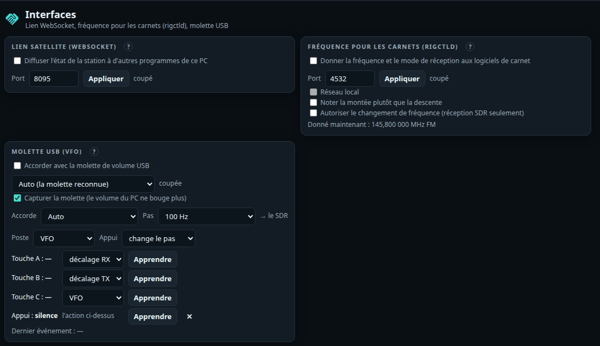</p>

### Spoken announcements

**Réglages › Annonces**, off by default: what the station does, said aloud in French.

- **What** (each announcement has its box): the followed satellite N minutes before AOS, its AOS and LOS (maximum elevation), a DATV / SSTV / I/Q transmission starting or stopping and « Émission en cours » every N minutes, LEILA on QO-100, a new SSTV picture, your own callsign decoded in FT8 / FT4 or CW, DATV locked or lost and the callsign read in its picture, an aircraft scatter window, the rotator at its limit or lost, the SDR receiver stopped by itself, the knob's step.
- **How**: numbers in words, callsigns spelled (Alfa, Bravo…), frequencies digit by digit; three levels of detail; the same sentence never twice in 30 s, three waiting at most.
- **Through**: the browser's voice (a local French voice), or a voice on the PC (speech-dispatcher, eSpeak NG, Piper), the SDR speaker lowered meanwhile. **Tester**; a speaker in the header mutes at once.

<p align="center">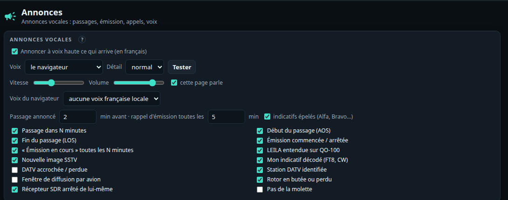</p>

### Transmitters' I/Q correction

**Réglages › Émission**: for each transmitting board (ADALM-PLUTO, bladeRF, HackRF, by serial number), the LO leakage, the image and the crystal error corrected just before the transmitter, for DATV as for SSTV. Neutral by default: samples and LO exactly as before. Sliders (applied live to a transmission on that board), a test tone and an **automatic closed-loop calibration**, indoors only (1245 MHz, −40 dB at most, the HackRF's VGA at 0): another SDR receiver of the station hears the tone, the leakage and the image, and SatMe looks for the bottom; the receiver lent by the SDR tab is given back as it was.

### Remote access

**Réglages › Accès à distance**: started with `--reseau`, SatMe-PC asks every other machine for a **password** (a login page); this PC itself gets in without one.

- **At the first start** with `--reseau`, a four-word password is drawn, written in SatMe-PC's log and shown here until replaced (8 characters at least). With no password, other machines get nothing.
- A session lasts **30 days** (a cookie). **Five wrong tries** from one address: a minute's wait, then twice as long after each series (an hour at most).
- The password is kept only **hashed** (PBKDF2) in `acces-distant.properties`, never in the backup; changing it closes the other sessions (**Fermer les autres sessions** too). A transmission started remotely asks the same confirmations as here.
- **Without HTTPS** the password and the page go in clear: a trusted network only (or an encrypted tunnel).
- **HTTPS** (*HTTPS* card, off by default, set on this PC only): the same page on a second port (8443 by default), with a certificate made by this PC on first use (EC P-256, about a year, made again by itself a month before the end, kept in `https/`) for its names and addresses. The browser warns once: compare the SHA-256 fingerprint it shows with the card's before accepting. The page becomes "secure": the **microphone** (IC-9700 transmitting), screen kept on and install then work from another machine. Open the port: `sudo ufw allow from 192.168.1.0/24 to any port 8443 proto tcp`. *Nouveau certificat* makes a new one (browsers will warn again). Plain http stays as before.
- **Firewall** (Linux, ufw): open the page's port to the home network only, once, in a terminal: `sudo ufw allow from 192.168.1.0/24 to any port 8090 proto tcp` (adapt the range). For pairing the phone by QR code, the next port: `sudo ufw allow from 192.168.1.0/24 to any port 8091 proto tcp`. **From outside**, go through a **VPN** into the home network (and allow the VPN's range the same way); never open the port to the internet.
- **Sur cet appareil**: *Garder l'écran allumé* and **Installer l'application** (a window of its own, an icon), for this browser; browsers allow them only on http://localhost or over HTTPS.

### Remote mode

For the page opened from afar (a VPN, another house): the **Distant** button at the top, or **Réglages › Accès à distance › Mode distant**, for this browser only (suggested when the page is opened from another machine). The **Mode distant** badge and its « ? » list what is lightened.

- **🔈 Écouter ici** takes the **low-latency** path: a WebSocket (`/api/son/ws`, behind the same session), 20 ms frames at 8, 12 or 16 kHz (low-passed then resampled), as 16-bit PCM or **µ-law** (half the bandwidth: 64 kbit/s at 8 kHz). The player keeps a 60–120 ms buffer set from the measured jitter (95th percentile + 20 ms), replaces a lost frame by the previous one faded, follows the sound card's drift (±0.5 %), and shows the estimated latency, the jitter, the round trip, the frames concealed. On this PC, about 0.11 s instead of 0.6 s with the HTTP stream, which stays as the fallback (*Voie*: auto, low latency, HTTP stream).
- Over http from another machine, browsers refuse the AudioWorklet: the same buffer then runs in a ScriptProcessor (about 20 ms more). No Opus (it would need a native encoder on the PC).
- **Lightened**: SDR spectrum and waterfall at 5 frames a second (256 points, levels in one byte), the magnifier, the QO-100 panorama, the DATV wide band and level meter less often, DATV video as a thumbnail every 2 s (**▶ Vidéo en direct** on the picture to ask for it), map, planes and ships every 5 to 10 s, the live stream reduced to the shown tab, animations off.
- **Receive only**: this path refuses any sound going up and any transmit command (the connection is closed). The IC-9700's microphone and PTT have their own path (*Émission IC-9700* panel, see [The IC-9700 transmitting](#the-ic-9700-transmitting)), over HTTPS from another machine.

### Start-up, updates and deployment

**Quick setup** (*Configuration rapide*): at the first start (no settings yet), a four-step window — callsign and name (written on SSTV sheets), the locator (checked: `JN18FS`) or latitude and longitude (the six-character square taken from them, the passes computed from the exact point), minimum elevation, local or UTC time, the language of PDF reports, messages and release notes, then access from the network and the port. The same settings as *Réglages › Ma station*; **Passer** closes it, nothing is blocked. Always there in **Réglages › Démarrage › Configuration rapide…**; rig and rotator stay in *Réglages › Poste et rotor*.

**What's new** (*Quoi de neuf*): at the first start of a new version, what changed since the last version started here (not on a new install). Later from the help (**?**), the palette (**Ctrl K**) and *Réglages › Démarrage*. The notes come from `pc/NOUVEAUTES.md`, bundled at build time.

**New version**: at start and then once a day, SatMe-PC asks GitHub's public API for the latest SatMe-PC release. Newer: a discreet **⬆ 2026.10.NN** badge at the top; a click shows its notes, the release page and the right file (`satme-pc-windows.msi` on Windows, `satme-pc.tar` on Linux). Nothing is downloaded or installed by itself; **Masquer** hides it for that version in this browser. A build by hand ("dev") asks nothing; an error or GitHub's rate limit passes quietly (asked again later), the answer kept in `mise-a-jour.json`. **Réglages › Démarrage › Mise à jour**: *Vérifier les mises à jour* (on by default), *Vérifier maintenant*.

**Startup options** (*Réglages › Démarrage*): **Accès depuis le réseau** (`--reseau`), **Port** (`--port`), **Dossier des données** (`--dossier`), each with its value now and where it comes from (*ligne de commande*, *fichier de démarrage*, *par défaut*).

- **The order**: the command line wins over the file, the file over the defaults. `--local` forces "this PC only" whatever the file says.
- **The file**: `~/.config/satme/satme-pc.properties` on Linux and macOS (`$XDG_CONFIG_HOME/satme/` when set), `%APPDATA%\SatMe\satme-pc.properties` on Windows — outside the data folder, which it names. Three lines, editable by hand while SatMe-PC is stopped: `port=8090`, `reseau=true`, `dossier=/path`.
- **Taken into account at the next start.** **Redémarrer SatMe-PC** is offered only where SatMe-PC can start itself again safely (started by the icon on Windows or by `lance-satme.sh` on Linux); under systemd: `systemctl --user restart satme-pc`; in a terminal: Ctrl+C and start again. Refused while transmitting.
- **From this PC only** (or a session opened with the remote access password); a request from another site is refused. Ticking *Accès depuis le réseau* reminds of the password and HTTPS (see [Remote access](#remote-access)).
- **Another data folder**: a full path SatMe-PC can write to, outside the current folder; *copy my data* (at the next start, into an empty or new folder) or *start with an empty folder*. The old folder is never deleted.

**Deployment** (*Déploiement*, in *Réglages › Sauvegarde*): the station's settings and the startup options in a small JSON file, to set up another PC the same way (log, journal and pictures stay in the full backup). **Without the secrets** by default (passwords, API keys, QRZ.com login, SatMe-Node codes); the *avec les secrets* box adds them. The remote access password and the HTTPS certificate are never in it. **Importer** first shows what would change (setting by setting, secrets masked); the startup options are written at once, the settings put in at the next start (those replaced kept in `avant-deploiement-…`).

**Starting SatMe-PC with the session**: *satme-pc.service* (a systemd `--user` unit for Linux, the commands to install it at its top) or *SatMe-PC-demarrage.cmd* (Windows, to put in the `shell:startup` folder); **Voir** shows them. SatMe-PC installs nothing itself; the startup file's options are read as usual.

## More of the PC

<p align="center">


</p>
<p align="center">


</p>

## Hardware safety

- **Nothing opens by itself.** A serial port opens only when it is chosen and "Connect" is clicked. No automatic search.
- **RTS and DTR low** by default. Icom CAT raises them (its USB bridges need it): **pick the right rig's port**. The TS-2000 keeps them low, and a port that echoes our own words (a RigExpert's PTT port) is closed at once.
- On Linux the system raises RTS/DTR for an instant on every port opening, before SatMe can lower them: one more reason to open only the port meant.
- **CAT transmits only through the IC-9700's held PTT** (*Émission IC-9700* panel: one client, 2 s guard, time-out, released on disconnect and on close); `TX`, `KY` refused by the TS-2000 driver. APRS through a KISS TNC transmits only when you send a message, your position or a status yourself.
- **The MiniTiouner's LNB supply is off** unless chosen.
- **The ADALM-PLUTO and the bladeRF 2.0 transmit only from the DATV and SSTV tabs**, on a confirmed click, within the rules above; their receivers never write the transmit side. DATV and SSTV never transmit at the same time.
- **The IC-9700 over the network only receives**, unless *Émission par le réseau autorisée* is ticked on this PC: then PTT alone passes and the TX audio path is requested; tuner, CW and voice memories stay refused before they reach the rig.
- **Nothing goes to the internet without a ticked box**: space weather, SatNOGS sharing, PSK Reporter, OpenStreetMap background, wide band chat, the online log upload — all off by default.
- **The interfaces never transmit**: rigctld refuses PTT, the USB knob tunes without ever transmitting, ADS-B, AIS, scanning, the measurements and the generator only receive, the Montage profiles are not applied during a transmission; the Sun scan moves the rotator only after confirmation.
- **The HackRF One transmits only from the DATV tab**, on a confirmed click, for the indoor test or into a load, its RF amplifier always off and its gain 20 dB at most; never to QO-100.

## Before the first try

- **Linux**: be in the `dialout` group (`sudo usermod -aG dialout $USER`, then log in again).
- **Windows**: install the adapter's driver (CP210x, FTDI, CH340); the rig shows as `COM3`, `COM4`…
- Start with the **simulated rig** and **simulated rotator**, then plug in the real hardware one piece at a time.
- To try **a second copy** of SatMe-PC beside the station (another port, another folder), start it with `SATME_SANS_SERIE=1` (or `-Dsatme.sansSerie=true`): it then opens no serial port at all, and cannot raise RTS/DTR on a rig or a board.
- With no hardware at all: the SDR receiver's **test generator**, and the **Essai** buttons of telemetry and ships.
