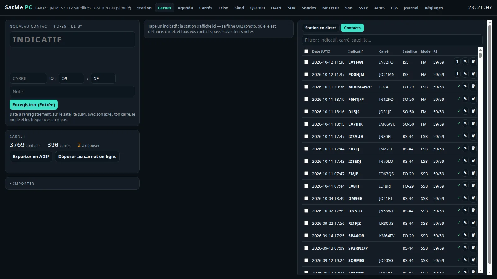
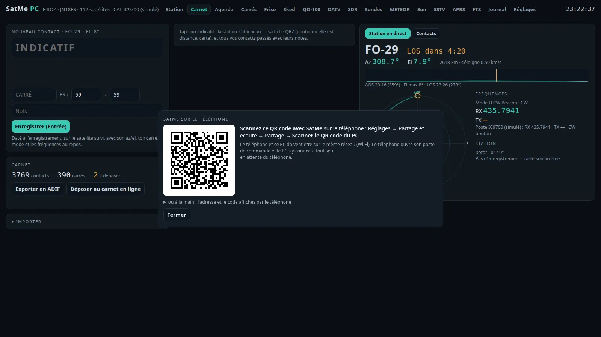
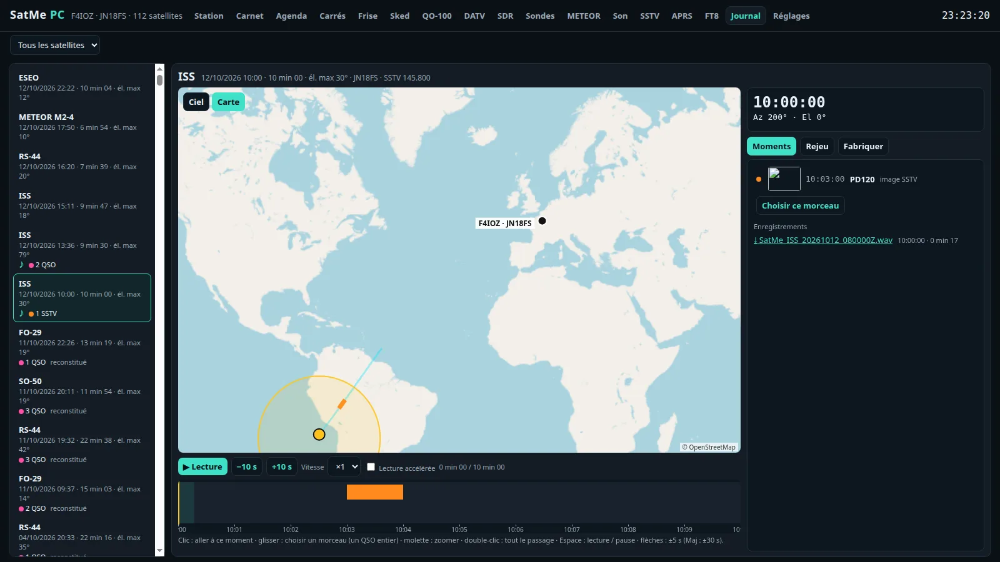
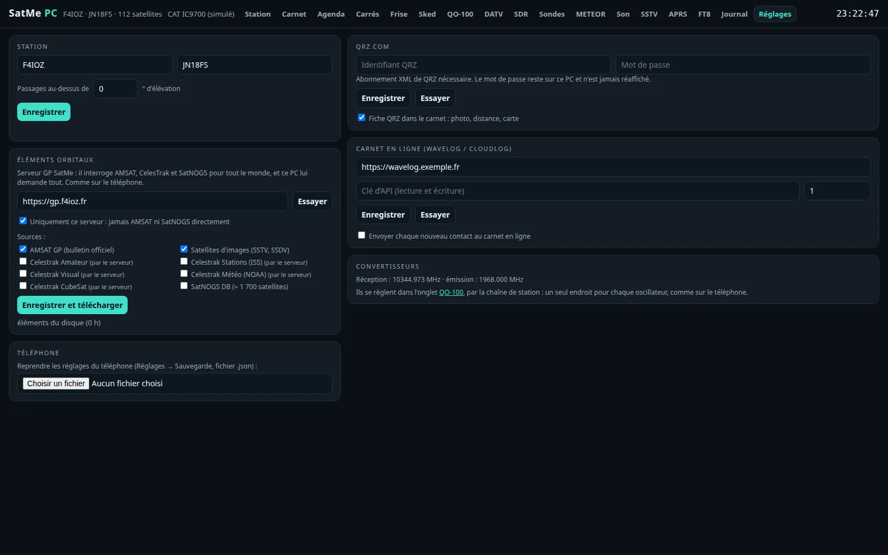
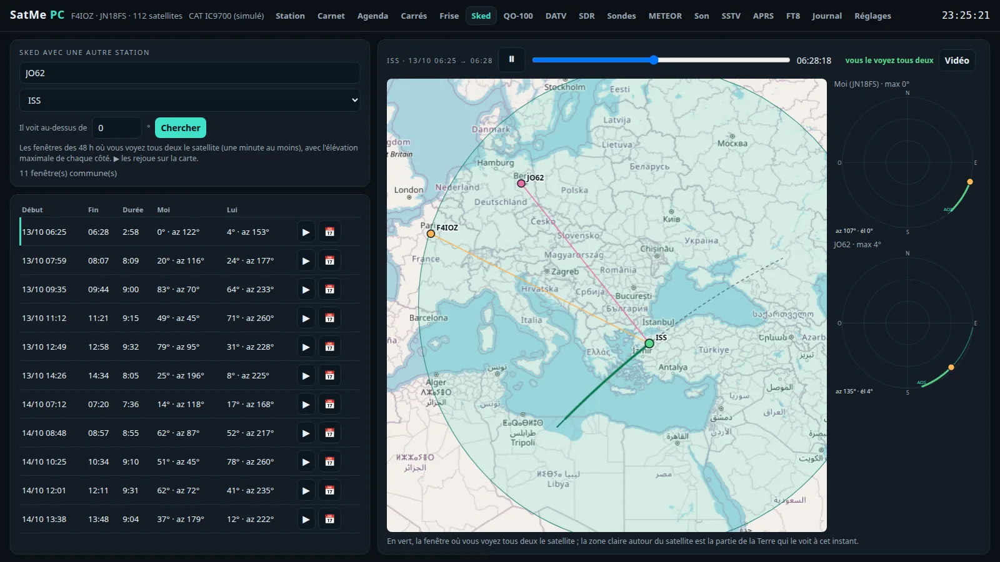
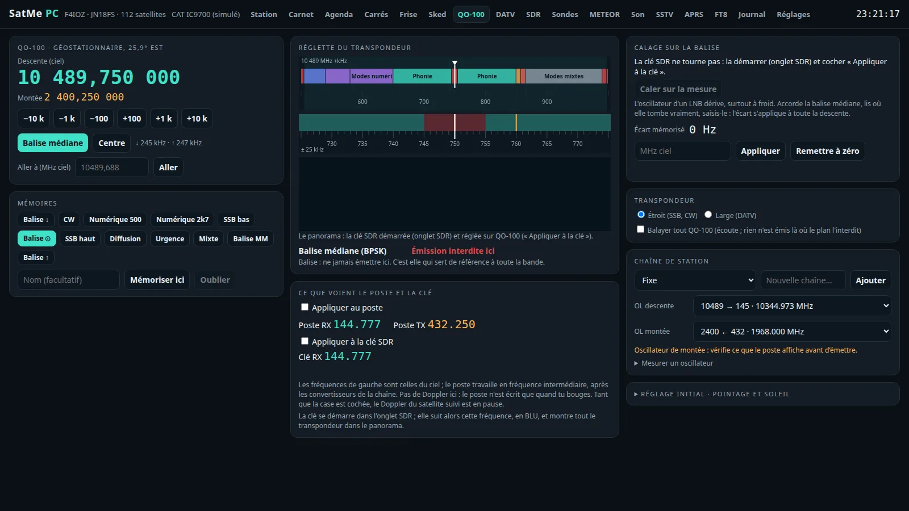
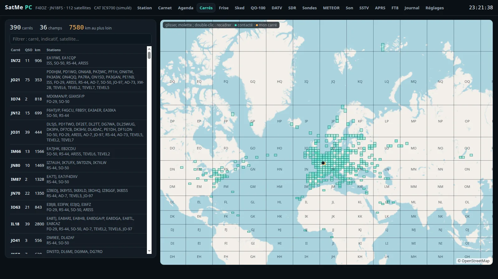
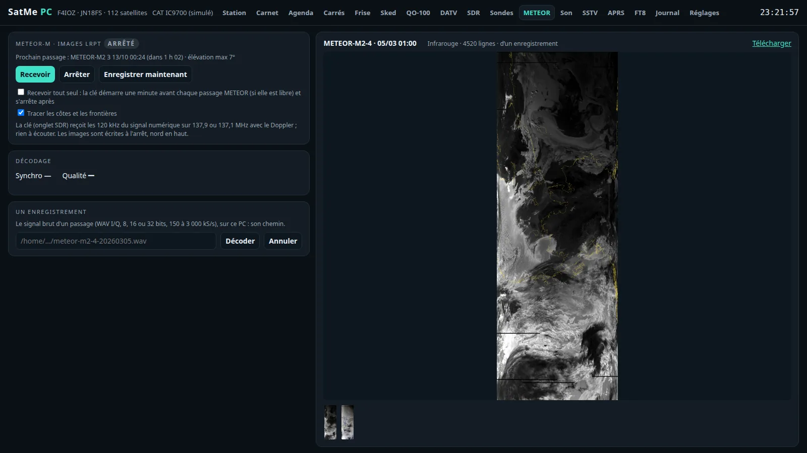
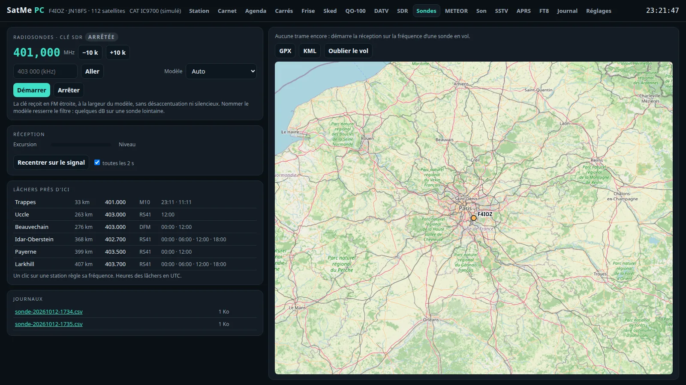
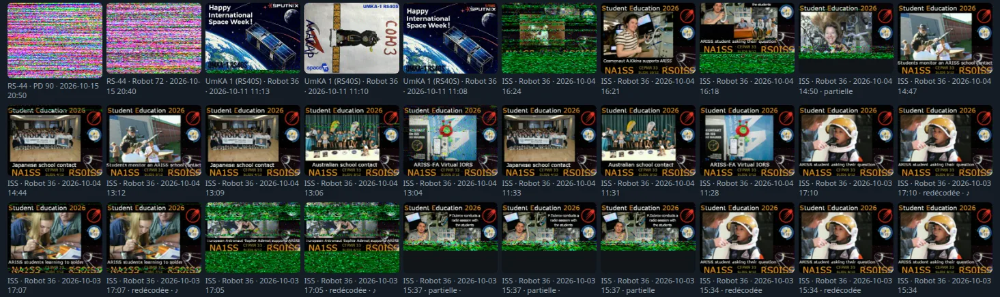

# SatMe-PC — the station in a browser

*October 2026. The Android app stays the reference; the PC does what it does, and what is made on the PC comes to the phone too. The PC pages are in French for now.*

SatMe runs on a PC (Linux, Windows, Raspberry Pi) and is driven from a browser. Its core is **the same code as on the phone**: Doppler loop, rotator tracking, pass journal, SSTV, METEOR, APRS, FT8 and the log all come from the shared `:moteur` module.

<p align="center"></p>

## Installing it

- **Linux**: [Installing SatMe-PC](installer-satme-pc.md) — download `satme-pc.tar`, unpack, start, then open **http://localhost:8090/**.
- **The MiniTiouner by the antenna**: [Installing SatMe-Node on a Raspberry Pi](installer-satme-node.md).

| Option | Effect |
|---|---|
| `--port 8090` | the page's port |
| `--reseau` | page open to the other machines of the network (a station at the foot of the mast, driven from the house); without it, this PC only |
| `--dossier DIR` | where settings, log, journal and recordings are kept (`~/.satme`, `%APPDATA%\SatMe` on Windows) |
| `--noeud` | SatMe-Node: the MiniTiouner only, driven over the network |

## The tabs

- **Station**: passes over the next 24 hours (favourites, heard on AMSAT these days, agenda), the satellite followed on the sky or the map, Doppler-corrected frequencies with the RX/TX offsets, the rig (CAT) and the rotator.
- **Carnet** (log): a contact is typed with the callsign predicted from your log and QRZ (Tab goes through the predictions, Enter confirms). Next to it, the station live: the satellite, its frequencies, the polar plot, the rotator, whether you are in the passband, the recording. The callsign's card: every past contact and its notes, the QRZ.com sheet (photo, distance, map) if you want it.
- **Agenda**, **Frise** (the passes laid on a timeline), **Carrés** (worked grid squares on a map).
- **Sked**: the windows where you and another station both see a satellite, replayed on the map with both skies, and made into a video.
- **QO-100**: the narrow band transponder's band plan, the beacon calibration, the station chain (converters), and the transponder seen by the SDR dongle.
- **DATV**: QO-100's wide band with a MiniTiouner, see below.
- **SDR**: an RTL-SDR dongle on this PC (rtl_tcp started for you) or on the network.
- **Sondes** (radiosondes) and **METEOR** (LRPT pictures) from the dongle.
- **Son** (sound card, recording), **SSTV** (live decoding, the pictures in a viewer), **APRS**, **FT8 / FT4**.
- **Journal**: the passes replayed with their sound, made into a picture, a video or a GIF.
- **Réglages** (settings): station, orbital elements, QRZ.com, the online log, converters.

<p align="center">


</p>

## The log and the online log

- **Delete** a contact from its row (🗑), or tick several and delete them at once.
- **Each new contact sent to Wavelog / Cloudlog by itself**, after a delay to choose (30 s to 30 min): the time to fix it or hold it back (⏸, countdown in the log). A contact the server refuses is held back with the reason. "Essayer" lists the station profiles the key gives. The phone has the same delay choice.
- **ADIF** export, and the deposit by hand (⬆) as before.

## SatMe on the phone

The log's **Import → SatMe sur le téléphone**:

- **By QR code**: the PC shows one; on the phone, *Settings → Share and listen → Share → Scan the PC's QR code*. The phone opens its control desk and the PC joins it by itself (same Wi-Fi). On Linux, the PC's firewall must let the page's port + 1 through (`8091` by default), for example `sudo ufw allow from 192.168.0.0/16 to any port 8091 proto tcp`.
- **Or by hand**, with the address and code the phone shows.
- The phone's passes are listed; those ticked come over with their **SSTV pictures**, their **recordings** (made WAV, the spoken header cut) and their **contacts** (added to the log unless already there).
- A **pass file (.zip)** made on the phone can also be dropped on the page.

<p align="center"></p>

## Pass journal

The phone's journal page, under the PC's tabs: passes listed (♪ when there is sound), replayed on the sky or the map with the S-meter, the frequency, the contacts and the pictures in their place. "Make": sound, picture, video, GIF or pass file. **The file's frame is drawn over the replay** (phone 3:4 or screen 16:9): what is inside the frame is what the file shows.

<p align="center">


</p>

## Orbital elements

As on the phone: the **SatMe GP server** first (`https://gp.f4ioz.fr` by default), or that server only, and the sources to choose — AMSAT's bulletin, CelesTrak's groups (through the server only: the PC never asks CelesTrak), SatNOGS DB, and **the picture satellites (SSTV, SSDV)**: LAPAN-A2, ASRTU-1, HADES-SA, Geoscan-2/4/5, 239Alferov, UmKA-1, UTMN2, SONATE-2… most of them missing from AMSAT's bulletin, asked one by one by their number.

<p align="center"></p>

## DATV — QO-100's wide band with a MiniTiouner

The **DATV** tab receives DVB-S/S2 with a **MiniTiouner** (tuner and demodulator on USB), driven by [LongMynd](https://github.com/BritishAmateurTelevisionClub/longmynd), BATC's free program. SatMe runs it apart, as it runs rtl_tcp: build it, then give its path on the page (or put it in the `PATH`).

- The beacon (10491.5 MHz, 1.5 MS/s), the narrow channels, 125 to 2000 kS/s; the LNB's oscillator (9750 MHz by default) and "Caler sur le signal" to correct it on the beacon.
- Lock (DVB-S / DVB-S2), MER, MODCOD, carrier and offset, service and provider, video and audio streams, the constellation live.
- The picture in the page, the sound on the PC, the same stream in **VLC**, and **recording** to a `.ts` file.
- The MiniTiouner's **LNB supply stays off** unless chosen (13 V or 18 V), with a warning.
- Linux: a udev rule lets LongMynd open the MiniTiouner. LongMynd's own file misses the Pro TS2 (its USB name is `MiniTiouner_Pro_TS2`); this one covers them all, then unplug and plug it in again:

  ```
  echo 'SUBSYSTEMS=="usb", ATTRS{idVendor}=="0403", ATTRS{idProduct}=="6010", ATTRS{product}=="MiniTiouner*", MODE:="0666"' | sudo tee /etc/udev/rules.d/60-satme-minitiouner.rules
  sudo udevadm control --reload-rules && sudo udevadm trigger
  ```
- Plugged in, the MiniTiouner also shows as two serial ports (`/dev/ttyUSB…`): never choose them as the rig's or the rotator's port.

<p align="center"></p>

### SatMe-Node: the MiniTiouner next to the antenna

The MiniTiouner works best close to the LNB. A **SatMe-Node** is SatMe on a small computer there — a Raspberry Pi (a **Pi 3 is enough**: the node only receives, it decodes nothing) — driven over the network by SatMe-PC and by the phone (**QO-100** screen → **DATV**: the same controls, the picture through the phone's own decoder). It runs LongMynd; its status and the transport stream (0.3 to 2 Mbit/s) come to the PC, which shows, plays and records them as if the MiniTiouner were plugged into it.

Installing it on the Pi: [Installing SatMe-Node on a Raspberry Pi](installer-satme-node.md) — three commands, about ten minutes on a Pi 3.

The script installs Java, builds LongMynd, lets it open the MiniTiouner (udev), and starts the **satme-noeud** service (`satme --noeud`, port 8090). At its first start the node draws a **six-digit code**, shown at the end of the installation (again: `journalctl -u satme-noeud | grep Code`). In SatMe-PC, DATV tab, MiniTiouner **Changer**: the node's address and its code, **Associer**. The PC keeps the key the node gave: either can restart. An empty address goes back to the MiniTiouner on the PC.

Without its key the node only says what it is; what changes it is a POST; its LNB supply stays off unless chosen.

*Above, a test signal. The MiniTiouner Pro TS2 itself is recognised and searches (tuner, demodulator, LNAs), on the PC and through a node; the first signal on the air is still to come.*

## More of the PC

<p align="center">


</p>
<p align="center">


</p>
<p align="center">


</p>

## Hardware safety

- **Nothing opens by itself.** A serial port opens only when it is chosen and "Connect" is clicked. No automatic search.
- **RTS and DTR low** by default. Icom CAT raises them (its USB bridges need it): **pick the right rig's port**. The TS-2000 keeps them low, and a port that echoes our own words (a RigExpert's PTT port) is closed at once.
- On Linux the system raises RTS/DTR for an instant on every port opening, before SatMe can lower them: one more reason to open only the port meant.
- **No transmit command** is ever sent (`TX`, `KY` refused by the TS-2000 driver).
- **The MiniTiouner's LNB supply is off** unless chosen.

## Before the first try

- **Linux**: be in the `dialout` group (`sudo usermod -aG dialout $USER`, then log in again).
- **Windows**: install the adapter's driver (CP210x, FTDI, CH340); the rig shows as `COM3`, `COM4`…
- Start with the **simulated rig** and **simulated rotator**, then plug in the real hardware one piece at a time.
